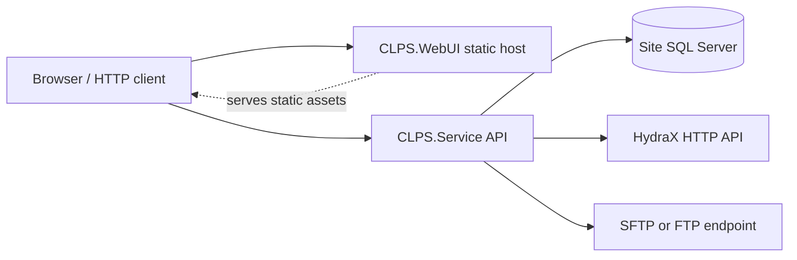
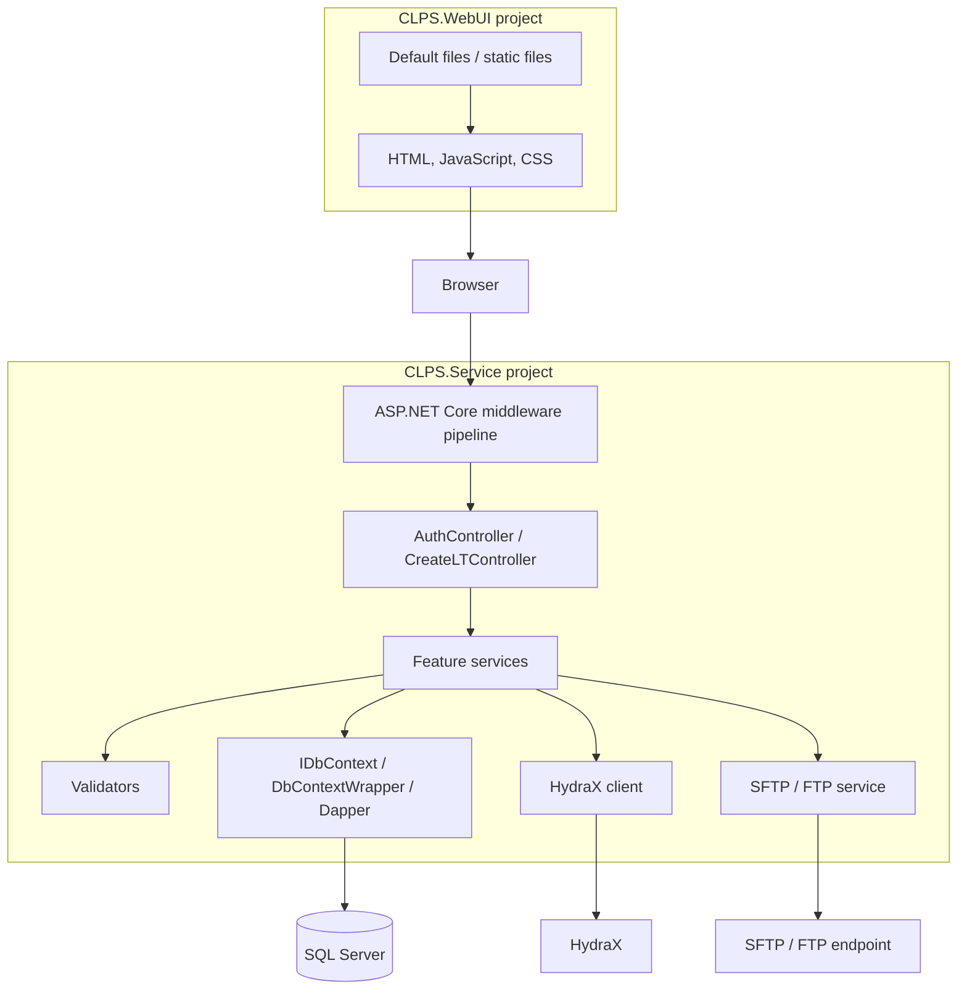
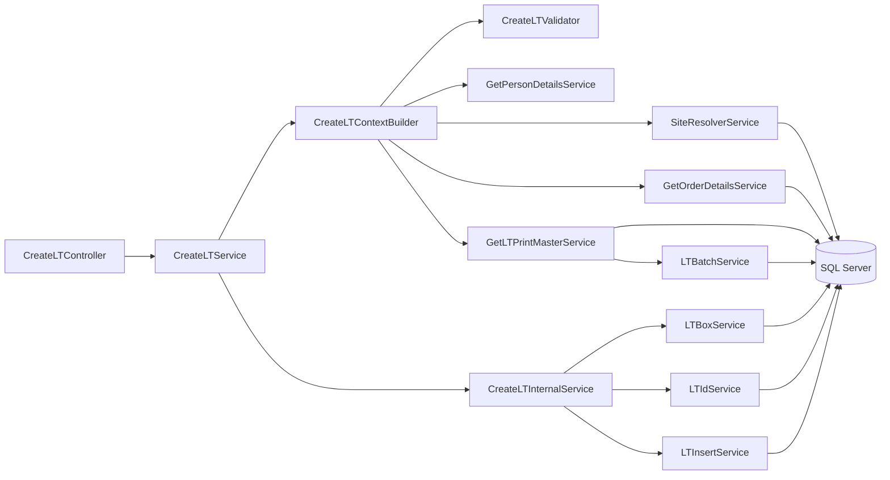
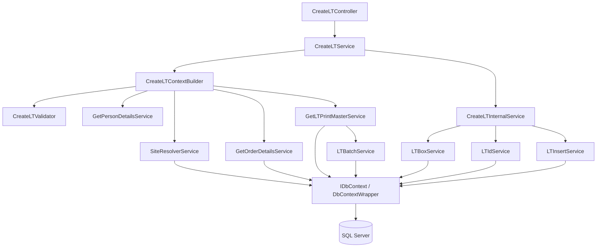
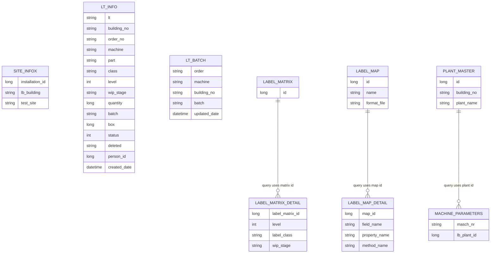
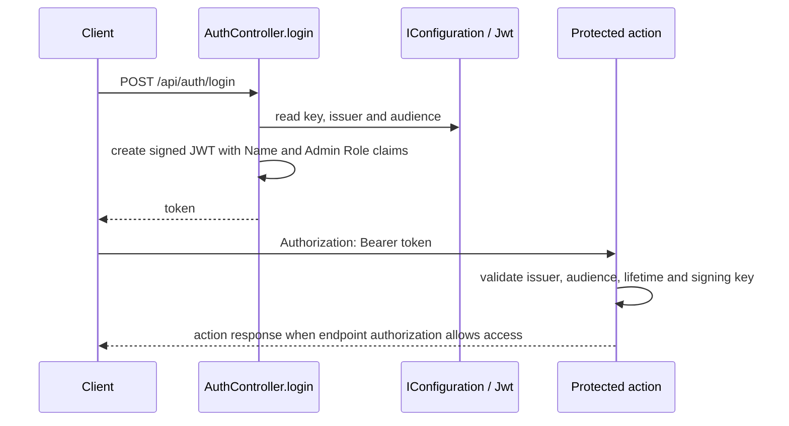
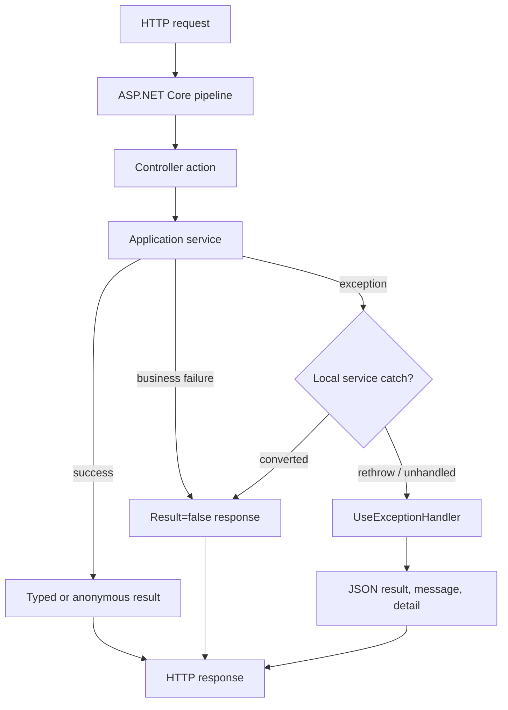

# CLPS .NET Web Service — Technical Design and Knowledge Transfer

**Analysis date:** 2026-10-16  
**Scope:** the three projects in `dotnet/CLPS/CLPS.Service/CLPS.Service.sln`: `CLPS.Service`, `CLPS.WebUI`, and `CLPS.Tests`. References in this document are relative to this file and point to implementation or project files in those projects.

## 1. Executive Summary

### Application purpose

The CLPS .NET solution implements manufacturing label-tracking workflows. Its API creates and retrieves LT records, resolves site/order/machine/label information, processes output batches, generates label data, and coordinates printing. A separate ASP.NET Core project serves the static web assets.

### Business capabilities and features

| Capability | Implemented behavior |
|---|---|
| Create a Label Tracking record | Validate request context and manufacturing data, resolve Print Master and batch data, generate LT identifier, determine a box number, insert the LT row. |
| Resolve site and machine plant | Select site database configuration by installation ID; read site metadata and optional machine plant information. |
| Validate order, machine, person and LT options | Check running order status, machine activation, person, LT class, level and WIP stage. |
| Manage batches | Accept a valid supplied batch or use SAP/AUTO batch resolution; AUTO mode stores order/machine/building mapping and uses a SQL sequence. |
| Log on, log off and associate output material | Run application workflows that call HydraX and perform database operations. |
| Generate and print labels | Resolve print eligibility, printer and BarTender endpoint; build label data; create and upload a `.dd` file; update LT print status. |
| Serve the web interface | Serve default and static web files from `CLPS.WebUI`. |

### Intended users

The API accepts HTTP client requests and the web project serves browser assets. The implementation defines operations for manufacturing data such as orders, machines, persons, batches and LTs; it does not declare named end-user personas in the analyzed classes.

### Core workflows

1. **LT creation:** HTTP request → site configuration → site and LT validation → order/person validation → Print Master and batch resolution → box and LT ID → SQL insert → response.
2. **Printing:** LT retrieval and eligibility → printer/BarTender resolution → label-data construction → DD file upload → status update.
3. **Create/replace print LT:** log off prior LT → attempt print → log on output batch, with retry handling in service code.
4. **Batch resolution:** validate supplied batch, or read SAP batch data / reuse or allocate AUTO batch mapping.

### High-level architecture summary

The solution is a .NET 8 solution containing an ASP.NET Core controller/service application, a static-file web host, and an xUnit test project. Business services, validation, database access and integration clients are organized as namespaces/folders within `CLPS.Service`. SQL Server access uses Dapper and `Microsoft.Data.SqlClient`; HydraX is called over HTTP; print files are transferred through the SFTP/FTP service.

### Evidence

| File | Class | Method | Evidence |
|------|-------|--------|----------|
| [CLPS.Service.sln](../CLPS.Service.sln) | Solution | — | Lists `CLPS.Service`, `CLPS.WebUI`, and `CLPS.Tests`. |
| [Controllers/CreateLTController.cs](../Controllers/CreateLTController.cs) | `CreateLTController` | API actions | Defines LT, batch, machine/order validation and print actions. |
| [Services/CreateLT/CreateLTService.cs](../Services/CreateLT/CreateLTService.cs) | `CreateLTService` | `CreateLTAsync` | Resolves site configuration/context and starts the LT creation flow. |
| [Services/LTInsert/LTInsertService.cs](../Services/LTInsert/LTInsertService.cs) | `LTInsertService` | `InsertLTAsync` | Inserts the LT record into `u_te_lb_lt_info`. |
| [Services/PrintOutputBatch/PrintOutputBatchService.cs](../Services/PrintOutputBatch/PrintOutputBatchService.cs) | `PrintOutputBatchService` | `ExecuteAsync` | Orchestrates LT validation, label generation, upload and status update. |
| [CLPS.WebUI/Program.cs](../../CLPS.WebUI/Program.cs) | Top-level application | — | Configures default and static file middleware. |

## 2. System Overview

### Functional overview and major modules

| Module | Responsibility | Main implementation areas |
|---|---|---|
| HTTP API | Route requests, bind DTOs, invoke services and shape HTTP responses. | `Controllers` |
| Authentication | Create JWT token and configure JWT bearer validation. | `AuthController`, service `Program.cs` |
| LT creation | Validate and assemble LT creation context, allocate identifier/box and insert LT row. | `Services/CreateLT`, `Services/LT`, `Services/Box`, `Services/LTInsert` |
| Order, person, machine and site | Read manufacturing/site data and validate request context. | `Services/Order`, `Services/Person`, `Services/Machine`, `Services/Site` |
| Print Master and batch | Select label configuration, determine package quantity and resolve batch. | `Services/LTPrintMaster`, `Services/Batch` |
| Output batch and HydraX | Run logon/logoff/association operations and external transaction requests. | `Services/LogonOutputBatch`, `Services/LogoffOutputBatch`, `Services/Associate`, `Infrastructure/HydraX` |
| Label and print | Resolve printer/server, generate label data and upload print file. | `Services/CreateLabelData`, `Services/PrintOutputBatch`, `Services/SftpService` |
| SQL access | Create site-specific SQL contexts and manage individual callback transactions. | `Infrastructure/Database` |
| Static web content | Serve UI files. | `CLPS.WebUI/wwwroot` |

### Layer responsibilities

- **Presentation:** `CreateLTController` and `AuthController` implement HTTP routes and response mapping.
- **Application/business services:** feature services coordinate validations, database queries and integration calls.
- **Validation:** `CreateLTValidator` normalizes and validates LT class, level and WIP stage.
- **Infrastructure:** database context/factories, HydraX client and SFTP/FTP upload adapter.
- **Data contracts:** request/response models and plain entity/context classes under `Models`.
- **Web UI:** `CLPS.WebUI` serves static files; the API request calls are implemented by browser JavaScript under `wwwroot`.

### Request lifecycle

The service `Program.cs` configures the web host, JWT bearer authentication, controllers, Serilog, CORS and localization. The middleware pipeline installs exception handling, static-file handling, HTTPS redirection, CORS, authentication and authorization, then maps controllers. A controller action calls an injected service; the service uses its dependencies to validate and process the request; the controller returns a typed or anonymous response.

### Data lifecycle

`SiteConfigurationService.GetSiteConfigAsync` maps an installation ID to a `SiteContext` from configuration. `DbContextFactory.Create` uses that context to create a database wrapper. Feature services issue SQL through Dapper or `SqlCommand`. LT creation inserts the LT row on the transaction connection passed to the insert service. Print and output-batch workflows also communicate with HydraX or a file-transfer endpoint.

### Evidence

| File | Class | Method | Evidence |
|------|-------|--------|----------|
| [Program.cs](../Program.cs) | Top-level application | — | Configures middleware, authentication, controllers, logging, DI and localization. |
| [Controllers/CreateLTController.cs](../Controllers/CreateLTController.cs) | `CreateLTController` | Actions | Calls injected application-service interfaces and maps service results to HTTP responses. |
| [Services/Configuration/SiteConfigurationService.cs](../Services/Configuration/SiteConfigurationService.cs) | `SiteConfigurationService` | `GetSiteConfigAsync` | Reads `Sites:{installationId}` configuration and constructs `SiteContext`. |
| [Infrastructure/Database/DbContextFactory.cs](../Infrastructure/Database/DbContextFactory.cs) | `DbContextFactory` | `Create` | Creates a database wrapper from site configuration. |
| [Infrastructure/Database/DbContextWrapper.cs](../Infrastructure/Database/DbContextWrapper.cs) | `DbContextWrapper` | `ExecuteAsync` | Opens SQL connection and transaction, invokes callback, commits or attempts rollback. |
| [Services/CreateLT/ContextBuilder/CreateLTContextBuilder.cs](../Services/CreateLT/ContextBuilder/CreateLTContextBuilder.cs) | `CreateLTContextBuilder` | `BuildContextAsync` | Coordinates site/LT validation, order/person validation and Print Master retrieval. |

## 3. High Level Design (HLD)

### Architecture pattern assessment

| Pattern | Assessment | Relevant projects and namespaces | Architectural justification |
|---|---|---|---|
| Layered architecture | Present as logical layers. | `CLPS.Service`; `CLPS.Service.Controllers`, `CLPS.Service.Services.*`, `CLPS.Service.Infrastructure.*`, `CLPS.Service.Models`. | Controllers call application services; services use validation and infrastructure dependencies. The layers are organized within the service project. |
| N-tier architecture | Logical UI, service/API and data/integration tiers are represented. | `CLPS.WebUI`, `CLPS.Service`; database and integration namespaces. | Static web host and API/service project are separate projects. SQL and external API/file transfer are accessed by the service. |
| Clean / Onion architecture | The code uses interfaces at service and infrastructure boundaries, with implementation folders in the service project. | `CLPS.Service.Services.*`, `CLPS.Service.Infrastructure.*`. | Application/service, model and infrastructure code are co-located in one project rather than a multi-project dependency-ring structure. |
| Hexagonal architecture | Port/adapter elements are present. | `IDbContext`, service interfaces, `IHydraXClient`, `ISftpService`. | Interfaces define selected boundaries and implementations adapt to SQL, HTTP and file transfer. |
| CQRS | No implementation identified in analyzed source code. | — | The controllers invoke service methods directly; no command/query bus is registered. |
| Event-driven architecture | No implementation identified in analyzed source code. | — | No message broker, event bus or event-handler registration appears in the service composition root. |

### System Context Diagram



### Application Architecture Diagram



### Component Diagram



### Evidence

| File | Class | Method | Evidence |
|------|-------|--------|----------|
| [CLPS.Service.sln](../CLPS.Service.sln) | Solution | — | Declares service, web UI and test projects. |
| [CLPS.Service.csproj](../CLPS.Service.csproj) | Project | — | Uses Web SDK and declares Dapper, SqlClient, JWT, Serilog and SSH packages. |
| [Program.cs](../Program.cs) | Top-level application | — | Registers controllers, scoped service interfaces and infrastructure implementations. |
| [Infrastructure/Database/IDbContext.cs](../Infrastructure/Database/IDbContext.cs) | `IDbContext` | `ExecuteAsync` | Defines a connection/transaction callback boundary. |
| [Infrastructure/HydraX/HydraXClient.cs](../Infrastructure/HydraX/HydraXClient.cs) | `IHydraXClient`, `HydraXClient` | `PostAsync`, `CommitTransactionAsync` | Defines and implements the HydraX HTTP adapter. |
| [Services/SftpService/SftpService.cs](../Services/SftpService/SftpService.cs) | `SftpService` | `UploadFileAsync` | Implements SFTP/FTP upload adapter. |

## 4. Solution Structure

### Project inventory

| Project | Project type | Responsibility | Referenced projects | External dependencies |
|---|---|---|---|---|
| `CLPS.Service` | `Microsoft.NET.Sdk.Web`, `net8.0` | ASP.NET Core API, workflows, validation, SQL and integration code. | No project reference declared in its project file. | Dapper, JWT bearer, SqlClient, configuration binder, Serilog, SSH.NET. |
| `CLPS.WebUI` | `Microsoft.NET.Sdk.Web`, `net8.0`; `win-x64` runtime identifier | Hosts static web assets. | No project reference declared in its project file. | No explicit package references. |
| `CLPS.Tests` | `Microsoft.NET.Sdk`, `net8.0`, test project | Unit tests and service test helpers. | References `CLPS.Service.csproj`. | coverlet, Microsoft.NET.Test.Sdk, Moq, xUnit. |

### Solution hierarchy

```text
dotnet/CLPS/
├── CLPS.Service/
│   ├── Controllers/
│   ├── Infrastructure/
│   │   ├── Database/
│   │   ├── HydraX/
│   │   └── Transactions/
│   ├── Models/
│   │   ├── Constants/
│   │   ├── Context/
│   │   ├── Entities/
│   │   ├── Internal/
│   │   ├── LabelMatrix/
│   │   ├── LabelMatrixDetail/
│   │   ├── Requests/
│   │   └── Responses/
│   ├── Services/
│   │   ├── Associate/  BTServer/  Batch/  Box/  ClassTabs/
│   │   ├── Configuration/  CreateLT/  CreateLabelData/  CreatePrintLT/
│   │   ├── LT/  LTData/  LTInsert/  LTPrintMaster/  LatestLT/
│   │   ├── LicenseTagStatus/  Localization/  LogoffOutputBatch/
│   │   ├── LogonOutputBatch/  Machine/  MaterialComment/  Order/
│   │   ├── PartClass/  Person/  PrintOutputBatch/  ProductMaster/
│   │   ├── Resources/  SftpService/  Site/  ZLabel4Service/
│   ├── Validators/
│   ├── Serialization/
│   ├── Resources/
│   ├── Properties/
│   ├── Program.cs
│   └── appsettings*.json
├── CLPS.WebUI/
│   ├── Program.cs
│   ├── wwwroot/
│   │   ├── clps/css/
│   │   ├── clps/js/
│   │   └── lib/
│   └── Properties/
└── CLPS.Tests/
    ├── CreateLTServiceTests.cs
    ├── CreateLTValidatorTests.cs
    ├── LTBoxServiceTests.cs
    ├── LTIdServiceTests.cs
    ├── LogonOutputBatchServiceTests.cs
    └── PrintOutputBatchServiceTests.cs
```

### Major folder roles

| Folder | Purpose and key classes | Architectural role |
|---|---|---|
| `Controllers` | `AuthController`, `CreateLTController` | HTTP presentation and response mapping. |
| `Services` | Feature interfaces and implementations such as `CreateLTService`, `LTBatchService`, `PrintOutputBatchService`. | Business orchestration and data/integration operations. |
| `Infrastructure/Database` | `IDbContext`, `DbContextWrapper`, factories and connection string builder. | ADO.NET/Dapper database adapter. |
| `Infrastructure/HydraX` | `IHydraXClient`, `HydraXClient`, configuration resolver. | HydraX HTTP adapter. |
| `Infrastructure/Transactions` | `TransactionContext` and commit/rollback action collections. | Transaction helper model. |
| `Models/Requests`, `Models/Responses` | API and service request/response types. | Data transfer contracts. |
| `Models/Entities`, `Models/Context` | `LTEntity`, `LTBatchRecord`, `CreateLTContext`, `SiteContext`. | Persistence-shaped and workflow-context data. |
| `Validators` | `CreateLTValidator`, `IValidator<T>`, `ValidationResult<T>`. | Request-domain validation. |
| `Serialization` | JSON serialization helper and `CLPSJsonContext`. | JSON serialization support. |
| `Resources` | Localized text JSON files. | Message/localization data. |
| `CLPS.WebUI/wwwroot` | HTML, JavaScript, CSS, and client libraries. | Static presentation assets. |
| `CLPS.Tests` | xUnit tests and test helpers. | Automated test code. |

### Test components

The test project references `CLPS.Service` and uses xUnit, Moq and the .NET test SDK. Three active `[Fact]` tests are present in `LTBoxServiceTests`: `IncrementBoxAsync_ShouldIncreaseValue`, `ShouldNotIncrement_WhenInsertFails`, and `Should_Not_Create_Duplicates`. The test source files for LT creation, LT validation, LT ID, LogonOutputBatch and PrintOutputBatch contain commented-out `[Fact]` declarations. No implementation identified in analyzed source code for integration-test fixtures or a separate integration-test project.

### Application entry points

`CLPS.Service` configures its host in top-level `Program.cs`. `CLPS.WebUI` also uses top-level `Program.cs`. No `Startup.cs` class is used by these projects. No implementation identified in analyzed source code for hosted/background services.

### Evidence

| File | Class | Method | Evidence |
|------|-------|--------|----------|
| [CLPS.Service.sln](../CLPS.Service.sln) | Solution | — | Lists all three projects and their relative paths. |
| [CLPS.Service.csproj](../CLPS.Service.csproj) | Project | — | Declares `net8.0`, Web SDK and service package references. |
| [CLPS.WebUI.csproj](../../CLPS.WebUI/CLPS.WebUI.csproj) | Project | — | Declares Web SDK, `net8.0` and `win-x64`. |
| [CLPS.Tests.csproj](../../CLPS.Tests/CLPS.Tests.csproj) | Project | — | Declares test packages and a project reference to the service. |
| [Program.cs](../Program.cs) | Top-level application | — | Registers implementation types against service interfaces. |
| [CLPS.WebUI/Program.cs](../../CLPS.WebUI/Program.cs) | Top-level application | — | Calls `UseDefaultFiles` and `UseStaticFiles`. |
| [CLPS.Tests/LTBoxServiceTests.cs](../../CLPS.Tests/LTBoxServiceTests.cs) | `LTBoxServiceTests` | Three active test methods | Verifies box cache increment, unchanged box on simulated failure, and uniqueness under parallel increments. |

## 5. Technology Stack

### Runtime and frameworks

| Concern | Implementation |
|---|---|
| .NET target | `net8.0` for all three projects. |
| ASP.NET Core | Web SDK projects target .NET 8; application code uses ASP.NET Core hosting, MVC controllers and middleware. |
| C# version | No explicit `LangVersion` is set in the project files; the compiler language version follows the SDK used to build. |
| Entity Framework Core | No implementation identified in analyzed source code. |
| Database access | Dapper plus ADO.NET `SqlConnection`, `SqlTransaction`, `SqlCommand`; provider is `Microsoft.Data.SqlClient`. |
| Authentication | `Microsoft.AspNetCore.Authentication.JwtBearer`; JWT creation uses `System.IdentityModel.Tokens.Jwt`. |
| Authorization | ASP.NET Core authorization attributes `[Authorize]` and `[AllowAnonymous]`. |
| Logging | Serilog with console and rolling-file sinks. |
| Validation | Custom `IValidator<T>` and `CreateLTValidator`; `[ApiController]` on `CreateLTController`. |
| API documentation | No implementation identified in analyzed source code. |
| Telemetry | No implementation identified in analyzed source code. |
| Caching | Static in-process `ConcurrentDictionary` caches in LT ID and box services. |
| HTTP/file integrations | `IHttpClientFactory`/`HttpClient`; SSH.NET packages and SFTP/FTP implementation. |

### Complete direct NuGet package inventory

| Package | Version | Project | Purpose |
|---|---:|---|---|
| Dapper | 2.1.72 | `CLPS.Service` | Micro-ORM mapping and SQL execution. |
| Microsoft.AspNetCore.Authentication.JwtBearer | 8.0.0 | `CLPS.Service` | JWT bearer authentication middleware. |
| Microsoft.Data.SqlClient | 7.0.1 | `CLPS.Service` | SQL Server ADO.NET provider. |
| Microsoft.Extensions.Configuration.Binder | 8.0.0 | `CLPS.Service` | Configuration binding support. |
| Renci.SshNet.Async | 1.4.0 | `CLPS.Service` | Asynchronous SSH.NET integration package. |
| Serilog | 4.3.1 | `CLPS.Service` | Structured logging API. |
| Serilog.AspNetCore | 8.0.0 | `CLPS.Service` | ASP.NET Core Serilog integration. |
| Serilog.Extensions.Logging | 10.0.0 | `CLPS.Service` | Microsoft logging abstraction integration. |
| Serilog.Sinks.Console | 6.1.1 | `CLPS.Service` | Console log output. |
| Serilog.Sinks.File | 7.0.0 | `CLPS.Service` | File log output. |
| SSH.NET | 2025.1.0 | `CLPS.Service` | SSH/SFTP implementation. |
| coverlet.collector | 6.0.0 | `CLPS.Tests` | Test coverage collection. |
| Microsoft.NET.Test.Sdk | 17.8.0 | `CLPS.Tests` | .NET test execution infrastructure. |
| Moq | 4.20.72 | `CLPS.Tests` | Mocking library. |
| xunit | 2.5.3 | `CLPS.Tests` | Unit test framework. |
| xunit.runner.visualstudio | 2.5.3 | `CLPS.Tests` | Visual Studio test adapter. |
| — | — | `CLPS.WebUI` | No direct `<PackageReference>` declared. |

### Evidence

| File | Class | Method | Evidence |
|------|-------|--------|----------|
| [CLPS.Service.csproj](../CLPS.Service.csproj) | Project | — | Target framework and service `<PackageReference>` entries. |
| [CLPS.Tests.csproj](../../CLPS.Tests/CLPS.Tests.csproj) | Project | — | Target framework and test `<PackageReference>` entries. |
| [CLPS.WebUI.csproj](../../CLPS.WebUI/CLPS.WebUI.csproj) | Project | — | Web SDK and target framework settings. |
| [Infrastructure/Database/DbContextWrapper.cs](../Infrastructure/Database/DbContextWrapper.cs) | `DbContextWrapper` | `ExecuteAsync` | Uses `SqlConnection` and `SqlTransaction`. |
| [Program.cs](../Program.cs) | Top-level application | — | Configures JWT authentication, Serilog and custom validator registration. |

## 6. Low Level Design (LLD)

### Controllers

#### `AuthController`

`AuthController` reads `IConfiguration`. Its `login()` action issues a JWT with fixed `Name` and `Role=Admin` claims, signed with the configured symmetric key and configured issuer/audience. The token expiry is one day after issuance.

#### `CreateLTController`

`CreateLTController` has `[ApiController]` and route prefix `api/clps`. Constructor-injected dependencies cover LT creation, order and Print Master retrieval, batch processing, LT data/list retrieval, label creation, printing, machine/order checks, logon/logoff, association, site/plant resolution, class tabs and INI configuration. Endpoint details are in §8.

### Services, interfaces and responsibilities

The interfaces and implementations below are registered in service `Program.cs` unless an entry denotes an internal implementation not exposed as an independent application service.

| Interface | Implementation | Public operation(s) | Responsibility |
|---|---|---|---|
| `ICreateLTService` | `CreateLTService` | `CreateLTAsync`, `CreateLTInternalAsync` | Resolve site context and coordinate LT creation. |
| `ICreateLTContextBuilder` | `CreateLTContextBuilder` | `BuildContextAsync` | Validate and resolve site, order, person, LT rules and Print Master into `CreateLTContext`. |
| `ICreateLTInternalService` | `CreateLTInternalService` | `CreateLTAsync` | Resolve box, generate LT, insert row, update process caches. |
| `IValidator<CreateLTValidationModel>` | `CreateLTValidator` | `ValidateAsync` | Normalize and validate LT class, level and WIP stage. |
| `ISiteConfigurationService` | `SiteConfigurationService` | `GetSiteConfigAsync` | Resolve per-installation database settings. |
| `ISiteResolverService` | `SiteResolverService` | `ResolveSiteAsync` | Resolve installation site metadata. |
| `IMipPlantResolverService` | `MipPlantResolverService` | `ResolveMipPlantAsync` | Resolve plant/building for a machine. |
| `IGetOrderDetailsService` | `GetOrderDetailsService` | `GetOrderDetailsAsync` | Retrieve and validate order/manufacturing details. |
| `IValidateRunningOrderService` | `ValidateRunningOrderService` | `ValidateRunningOrderAsync` | Return running-order data for a machine query. |
| `IGetPersonDetailsService` | `GetPersonDetailsService` | `ValidatePersonAsync`, person detail operation | Validate or retrieve person data. |
| `IMachineValidationService` | `MachineValidationService` | `ValidateMachineAsync` | Check machine labeling activation. |
| `IGetLTPrintMasterService` | `GetLTPrintMasterService` | `GetLTPrintMasterAsync` | Select label matrix/detail and resolve print-master data. |
| `ILTBatchService` | `LTBatchService` | `ResolveBatchAsync` | Validate or generate batch values. |
| `ILTBoxService` | `LTBoxService` | `GetLatestBoxAsync`, `IncrementBoxAsync`, cache operations | Resolve and advance process-local box values. |
| `ILTIdService` | `LTIdService` | `GenerateLTIDAsync`, `UpdateMemory` | Allocate LT identifiers and maintain last-LT cache. |
| `ILTInsertService` | `LTInsertService` | `InsertLTAsync` | Validate LT entity fields and insert LT row using supplied SQL transaction. |
| `IGetLTDataService` | `GetLTDataService` | `GetLTDataAsync` | Retrieve LT data. |
| `IGetLatestLTIdService` | `GetLatestLTIdService` | `GetLatestLTIdAsync` | Retrieve latest LT data by request. |
| `IGetLTListService` | `GetLTListService` | `GetLTListAsync` | Retrieve an LT list. |
| `ICreateLabelDataService` | `CreateLabelDataService` | `CreateLabelDataAsync` | Generate fields from label-map and master data. |
| `IPrintOutputBatchService` | `PrintOutputBatchService` | `ExecuteAsync` | Validate and print LT; update print status. |
| `IPrintFileService` | `PrintFileService` | `PrintFileAsync` | Generate DD content and upload it. |
| `IPrinterResolutionService` | `PrinterResolutionService` | `ResolvePrinterAsync` | Resolve printer configuration. |
| `ICreatePrintLTService` | `CreatePrintLTService` | `ExecuteAsync` | Coordinate logoff, print and logon, with configured retries. |
| `ILogonOutputBatchService` | `LogonOutputBatchService` | `ExecuteAsync` | Create LT/log on output material with HydraX operations. |
| `ILogoffOutputBatchService` | `LogoffOutputBatchService` | `ExecuteAsync` | Log off output material using LT and HydraX data. |
| `IAssociateService` | `AssociateService` | `ExecuteAsync` | Associate requested manufacturing/material records. |
| `IHydraXClient` | `HydraXClient` | `PostAsync`, `LogoutAsync`, `CommitTransactionAsync`, `CreateSessionClient` | Send HydraX HTTP requests and transaction calls. |
| `IConnectionFactory` | `ConnectionFactory` | `BuildConnectionString` | Build SQL Server connection string from site context. |
| `IDbContextFactory` | `DbContextFactory` | `Create`, `CreateMaster` | Create database wrappers. |
| `IDbContext` | `DbContextWrapper` | `Table`, `ExecuteAsync` | Provide SQL connection/transaction callback execution. |
| `ISftpService` | `SftpService` | `UploadFileAsync` | Upload a file using SFTP or FTP. |
| `ITranslationService` | `TranslationService` | `Get` | Resolve localized text. |

Other registered feature services include BT server, class tabs, INI/Hydra configuration, LT status, material comment, part-class, product master and ZLabel4 services. Their interfaces and implementations are in matching `Services/<Feature>` folders and are wired in [Program.cs](../Program.cs).

### Database access components

The service uses `IDbContext` rather than a repository class. `DbContextWrapper.ExecuteAsync` supplies a `SqlConnection` and `SqlTransaction` to a callback. Feature services contain Dapper queries or direct `SqlCommand` statements. `LTInsertService.InsertLTAsync` takes an existing connection and transaction and executes the parameterized LT insert against them.

### Repositories

No implementation identified in analyzed source code for a repository layer. Feature services execute their database operations through `IDbContext`, Dapper or `SqlCommand`; examples include `LTInsertService`, `LTBatchService`, `GetOrderDetailsService` and `SiteResolverService`.

### Middleware processing sequence

The `Program.cs` service pipeline is configured in this order:

1. `UseExceptionHandler`
2. `UseStaticFiles`
3. `UseHttpsRedirection`
4. `UseCors("AllowAll")`
5. `UseAuthentication`
6. `UseAuthorization`
7. `MapControllers`
8. `UseRequestLocalization`
9. `Run`

The exception handler writes JSON containing `result`, exception `message`, and exception `detail` with stack trace when an exception is present.

No implementation identified in analyzed source code for a custom middleware class. The configured middleware is composed directly in the service `Program.cs`.

### Validator details

| Validator | Associated model | Rule | Error source |
|---|---|---|---|
| `CreateLTValidator.ValidateAsync` | `CreateLTValidationModel` | Blank class defaults to `3SI`; accepted values: `3SI`, `3S`, `4S`; values normalized uppercase. | `TranslationKeys.lkPleaseProvideProperLTClass`. |
| `CreateLTValidator.ValidateAsync` | `CreateLTValidationModel` | Blank level defaults to `1`; accepted range 1–3; `3SI` level cannot exceed 1. | Translation keys for level range/class-level combination. |
| `CreateLTValidator.ValidateAsync` | `CreateLTValidationModel` | Blank WIP stage defaults to `FG`; only `FG` accepted. | `TranslationKeys.lkPleaseProvideProperWipStage`. |
| `CreateLTContextBuilder.BuildContextAsync` | `CreateLTRequest` and dependencies | Requires request, installation ID (unless supplied site context), order (unless supplied order), resolved site, valid LT result and normalized level. | Translation service keys from `TranslationKeys`. |
| `LTInsertService.ValidateEntity` | `LTEntity` | Requires entity, positive box, nonblank order, class and LT. | Translation service keys from `TranslationKeys`. |

### Dependency mapping



### LT Creation End-to-End Workflow Analysis

The implementation follows `CreateLTController.CreateLT` → `CreateLTService.CreateLTAsync` → `CreateLTContextBuilder.BuildContextAsync` → `CreateLTInternalService.CreateLTAsync`.

```mermaid
sequenceDiagram
  participant Client
  participant Controller as CreateLTController
  participant Service as CreateLTService
  participant Builder as CreateLTContextBuilder
  participant Site as SiteResolverService
  participant Validator as CreateLTValidator
  participant Order as GetOrderDetailsService
  participant Person as GetPersonDetailsService
  participant Master as GetLTPrintMasterService
  participant Batch as LTBatchService
  participant Internal as CreateLTInternalService
  participant Box as LTBoxService
  participant Id as LTIdService
  participant Insert as LTInsertService
  participant SQL as SQL Server

  Client->>Controller: POST /api/clps/CreateLT
  Controller->>Service: CreateLTAsync(request)
  Service->>Service: validate request and InstallationID
  Service->>SQL: resolve site config / create DB context
  Service->>Builder: BuildContextAsync(request, context)
  par Site and LT input validation
    Builder->>Site: ResolveSiteAsync(installationID, context)
    Site->>SQL: query u_site_infox
    Builder->>Validator: ValidateAsync(class, level, WIP)
  end
  Builder->>Builder: require resolved site, valid rules and level
  par Order and person checks
    Builder->>Order: GetOrderDetailsAsync(order, machine, context)
    Order->>SQL: read order status, machine, part, plant
    Builder->>Person: ValidatePersonAsync(personId, context)
  end
  Builder->>Master: GetLTPrintMasterAsync(order, machine, part, class, level, WIP)
  Master->>SQL: read matrix, detail, plant and part
  Master->>Batch: ResolveBatchAsync
  Batch->>SQL: read SAP / AUTO mapping / sequence as configured
  Master-->>Builder: Print Master, batch and label quantity
  Builder-->>Service: CreateLTContext
  Service->>Internal: CreateLTAsync(request, context)
  Internal->>Box: GetLatestBoxAsync(order, class, context)
  Internal->>SQL: begin callback transaction
  Internal->>Id: GenerateLTIDAsync(connection, tx, prefix, building, !IsTestSite)
  Id->>SQL: read latest LT and allocate sequence
  Internal->>Insert: InsertLTAsync(entity, same connection, tx)
  Insert->>SQL: INSERT u_te_lb_lt_info
  Internal->>Box: IncrementBoxAsync
  Internal->>Id: UpdateMemory(building, LT)
  Internal->>SQL: commit callback transaction
  Internal-->>Service: CreateLTInternalResult
  Service-->>Controller: CreateLTResponse
  Controller-->>Client: HTTP 200 response
```

#### Workflow behavior by stage

1. **HTTP boundary:** `CreateLTController.CreateLT` rejects a null body with HTTP 400. It calls `CreateLTAsync` and returns HTTP 200 for a service response, including a response with `Result=false`. The action has `[AllowAnonymous]`.
2. **Site/context setup:** `CreateLTService.CreateLTAsync` rejects null request, missing `InstallationID`, or unknown site configuration with failure responses. It creates a site-specific `IDbContext` and invokes `CreateLTInternalAsync`.
3. **Context preconditions:** `CreateLTContextBuilder.ValidateRequest` requires an order and installation unless corresponding dependency context was supplied.
4. **Parallel validations:** `BuildContextAsync` executes site resolution and LT rule validation concurrently. It then executes order details and person validation concurrently.
5. **Order checks:** `GetOrderDetailsService` checks running indicators (`prod_kenn` and `a_status` equal `L`), supplied-machine match and nonempty plant ID.
6. **Print Master:** the builder passes order, resolved machine, installation ID, part, LT class, level and WIP stage. Print Master selects the top-scoring label matrix and rejects equal top scores, resolves detail/plant/part data and determines label quantity.
7. **Batch:** Print Master calls batch resolution with an empty input batch. Batch mode reads SAP data or reuses/creates an AUTO mapping. In `GetLTPrintMasterAsync`, a failed batch result is represented as `"0"` while result construction continues. `CreateLTRequest.Batch` is not copied into the Print Master request.
8. **Quantity:** `ResolveQuantity` prefers positive request quantity, then positive Print Master label quantity. If neither is positive, the builder proceeds with a null quantity and the internal service uses `GetValueOrDefault()` (zero).
9. **Box and ID:** internal service gets the latest box, derives prefix (`3S` and `3SI` map to `3S`), and calls the ID service with `!ctx.IsTestSite` as `isProduction`. `LTIdService` uses the flag to select production or test marker and uses a SQL Server sequence for the numeric segment.
10. **Insert and transaction:** `CreateLTInternalService.GenerateAndInsertLTAsync` calls `IDbContext.ExecuteAsync`; ID generation and `LTInsertService.InsertLTAsync` use its supplied SQL connection and transaction. `LTInsertService` validates required values and performs a parameterized `INSERT INTO u_te_lb_lt_info`. `DbContextWrapper` commits after the callback completes or attempts rollback and rethrows on exception.
11. **Cache changes and completion:** `LTBoxService.IncrementBoxAsync` and `LTIdService.UpdateMemory` change process-local caches before the outer callback commits. The internal service releases its static semaphore in `finally`. Precondition failures are result objects; generation/insert/transaction exceptions propagate to the global exception handler.

### Evidence

| File | Class | Method | Evidence |
|------|-------|--------|----------|
| [Controllers/CreateLTController.cs](../Controllers/CreateLTController.cs) | `CreateLTController` | `CreateLT` | Route `POST api/clps/CreateLT`, null guard, service call, HTTP result and `[AllowAnonymous]`. |
| [Services/CreateLT/CreateLTService.cs](../Services/CreateLT/CreateLTService.cs) | `CreateLTService` | `CreateLTAsync`, `CreateLTInternalAsync` | Site config, DB context, context builder and internal service invocation. |
| [Services/CreateLT/ContextBuilder/CreateLTContextBuilder.cs](../Services/CreateLT/ContextBuilder/CreateLTContextBuilder.cs) | `CreateLTContextBuilder` | `BuildContextAsync`, `ResolveQuantity`, `ValidateRequest` | Parallel validation, order/person checks, Print Master request construction and quantity selection. |
| [Validators/CreateLTValidator.cs](../Validators/CreateLTValidator.cs) | `CreateLTValidator` | `ValidateAsync` | LT class, level and WIP normalization and validation. |
| [Services/LTPrintMaster/GetLTPrintMasterService.cs](../Services/LTPrintMaster/GetLTPrintMasterService.cs) | `GetLTPrintMasterService` | `GetLTPrintMasterAsync`, `GetLTPrintMasterInternalAsync` | Label-matrix/detail lookup, quantity rules and batch resolution. |
| [Services/CreateLT/Internal/CreateLTInternalService.cs](../Services/CreateLT/Internal/CreateLTInternalService.cs) | `CreateLTInternalService` | `CreateLTAsync`, `GenerateAndInsertLTAsync`, `GetPrefix` | Semaphore, box selection, ID generation, insert call, cache updates. |
| [Services/LT/LTIdService.cs](../Services/LT/LTIdService.cs) | `LTIdService` | `GenerateLTIDAsync` | ID format, sequence selection and test/production marker branch. |
| [Services/LTInsert/LTInsertService.cs](../Services/LTInsert/LTInsertService.cs) | `LTInsertService` | `InsertLTAsync`, `ValidateEntity` | Parameterized insert using caller connection/transaction and entity guards. |
| [Infrastructure/Database/DbContextWrapper.cs](../Infrastructure/Database/DbContextWrapper.cs) | `DbContextWrapper` | `ExecuteAsync` | Transaction creation, commit and rollback flow. |

## 7. Database Design

### Database access components

`IDbContext` is a custom abstraction over SQL connection/transaction callbacks. `DbContextWrapper` uses `Microsoft.Data.SqlClient`, creates `SqlConnection`, starts `SqlTransaction`, runs the callback and commits on success. Services use Dapper or `SqlCommand` for SQL operations. Database connectivity is created by `ConnectionFactory` and `DbContextFactory`.

### Query-backed tables and data objects

The following tables are referenced by SQL statements in feature services. Their use here describes application queries and writes.

| Entity / table | Key | Relationships | Configuration |
|---|---|---|---|
| `u_te_lb_lt_info` / `LTEntity` | Not identified in analyzed source code. | Query fields include order, machine, part, class, batch, box, person and label-map data. Physical FK relationships: Not identified in analyzed source code. | `LTInsertService` issues parameterized insert; LT/box/status services query or update it. |
| `u_te_lb_batch` / `LTBatchRecord` | Not identified in analyzed source code. | Query matches order, machine and building. Physical FK relationships: Not identified in analyzed source code. | `LTBatchService` reads and inserts AUTO mappings. |
| `u_te_lb_label_matrix` / `LabelMatrix` | Not identified in analyzed source code. | Label-matrix detail is queried by matrix ID. Physical constraints: Not identified in analyzed source code. | SQL is supplied by `LabelMatrix.getLabelMatrixSQL()`. |
| Label-matrix detail / `LabelMatrixDetail` | Not identified in analyzed source code. | Filtered by matrix ID, level, class and WIP stage. Physical constraints: Not identified in analyzed source code. | SQL is supplied by `LabelMatrixDetail.getLabelMatrixDetailSQL()`. |
| `u_te_lb_label_map` / `LabelMapDb` | Not identified in analyzed source code. | `u_te_lb_label_map_detail` query joins using map ID. Physical constraints: Not identified in analyzed source code. | Read by `CreateLabelDataService`. |
| `u_te_lb_label_map_detail` / `LabelMapDetailDb` | Not identified in analyzed source code. | Query joins parent map ID. Physical constraints: Not identified in analyzed source code. | Supplies label field/property/method definitions. |
| `u_te_lb_part_master` | Not identified in analyzed source code. | Used with part-number lookup and ZZAPQ quantity lookup. Physical constraints: Not identified in analyzed source code. | Read by Print Master service. |
| `u_te_lb_part_zzapq_qty` | Not identified in analyzed source code. | Query filters by plant, part-master ID and package type. Physical constraints: Not identified in analyzed source code. | Supplies configured standard package quantity. |
| `u_te_lb_plant_master` | Not identified in analyzed source code. | Joined from machine parameters using plant ID. Physical constraints: Not identified in analyzed source code. | Supplies plant/building/country metadata. |
| `u_te_maschinen_parameters` | Not identified in analyzed source code. | Machine number maps to plant and is used for labeling-activation checks. Physical constraints: Not identified in analyzed source code. | Used by plant and machine validation services. |
| `u_site_infox` | Not identified in analyzed source code. | Filtered by installation ID. Physical constraints: Not identified in analyzed source code. | Supplies site alias, building, application server and test-site flag. |
| `auftrags_bestand`, `auftrag_status`, `maschinen`, `res_bestand` | Not identified in analyzed source code. | Queries join order status/order data and machine/resource data. Physical constraints: Not identified in analyzed source code. | Existing manufacturing data queried by order and Print Master services. |
| Generated SQL Server sequences | Sequence names use building identifiers. | Used for LT ID and AUTO batch sequence allocation. | Created/read through `sys.sequences` and `NEXT VALUE FOR` SQL. |

### Entity relationship diagram

The diagram represents query relationships present in source SQL. It is not an EF entity model.



### EF Core, entity configurations and migrations

No implementation identified in analyzed source code for EF Core `DbContext`, `DbSet`, Fluent API entity configuration, or EF migrations. SQL operations are implemented in feature services through `IDbContext`, Dapper and `SqlCommand`. Table constraints and indexes are represented here only when code declares them in a SQL statement.

No implementation identified in analyzed source code for standalone SQL script files or database migration classes. Sequence creation SQL is embedded in LT ID and batch services.

### Evidence

| File | Class | Method | Evidence |
|------|-------|--------|----------|
| [Infrastructure/Database/IDbContext.cs](../Infrastructure/Database/IDbContext.cs) | `IDbContext` | `ExecuteAsync` | Contract passes SqlClient connection/transaction to an operation. |
| [Infrastructure/Database/DbContextWrapper.cs](../Infrastructure/Database/DbContextWrapper.cs) | `DbContextWrapper` | `ExecuteAsync` | Creates and commits/rolls back SQL transactions. |
| [Infrastructure/Database/ConnectionFactory.cs](../Infrastructure/Database/ConnectionFactory.cs) | `ConnectionFactory` | `BuildConnectionString` | Creates `SqlConnectionStringBuilder` from `SiteContext`. |
| [Models/Entities/LTEntity.cs](../Models/Entities/LTEntity.cs) | `LTEntity` | — | Declares fields passed to the LT insert. |
| [Services/LTInsert/LTInsertService.cs](../Services/LTInsert/LTInsertService.cs) | `LTInsertService` | `InsertLTAsync` | Executes `INSERT INTO u_te_lb_lt_info` with Dapper parameters. |
| [Services/Batch/LTBatchService.cs](../Services/Batch/LTBatchService.cs) | `LTBatchService` | `GenerateLTBatch` | Uses `u_te_lb_batch` and generated SQL sequence operations. |
| [Services/Site/SiteResolverService.cs](../Services/Site/SiteResolverService.cs) | `SiteResolverService` | `ResolveSiteAsync` | Queries `u_site_infox` by installation ID. |

## 8. API Specification

### API reference

The route prefix for `CreateLTController` is `/api/clps`. The route prefix for `AuthController` is `/api/[controller]`, which resolves to `/api/auth`.

| Endpoint | Method | Controller | Service | Authentication |
|---|---|---|---|---|
| `/api/auth/login` | POST | `AuthController.login` | Inline token generation | No `[Authorize]` attribute. |
| `/api/clps/CreateLT` | POST | `CreateLTController.CreateLT` | `ICreateLTService.CreateLTAsync` | `[AllowAnonymous]`. |
| `/api/clps/SiteInfo` | GET | `CreateLTController.GetSiteInfo` | `ISiteResolverService`; optional `IMipPlantResolverService` | `[AllowAnonymous]`. |
| `/api/clps/LogonOutputBatch` | POST | `CreateLTController.LogonOutputBatch` | `ILogonOutputBatchService.ExecuteAsync` | `[AllowAnonymous]`. |
| `/api/clps/OrderDetails` | GET | `CreateLTController.GetOrderDetails` | `IGetOrderDetailsService.GetOrderDetailsAsync` | `[AllowAnonymous]`. |
| `/api/clps/LTPrintMaster` | POST | `CreateLTController.GetLTPrintMaster` | `IGetLTPrintMasterService.GetLTPrintMasterAsync` | `[AllowAnonymous]`. |
| `/api/clps/LTData` | GET | `CreateLTController.GetLTData` | `IGetLTDataService.GetLTDataAsync` | `[AllowAnonymous]`. |
| `/api/clps/LogoffOutputBatch` | POST | `CreateLTController.LogoffOutputBatch` | `ILogoffOutputBatchService.ExecuteAsync` | `[AllowAnonymous]`. |
| `/api/clps/GetLatestLTID` | POST | `CreateLTController.GetLatestLTId` | `IGetLatestLTIdService.GetLatestLTIdAsync` | `[AllowAnonymous]`. |
| `/api/clps/GetLTList` | POST | `CreateLTController.GetLTList` | `IGetLTListService.GetLTListAsync` | `[AllowAnonymous]`. |
| `/api/clps/batch` | GET | `CreateLTController.GetBatch` | `ILTBatchService.ResolveBatchAsync` | No attribute. |
| `/api/clps/CreateLabelData` | POST | `CreateLTController.CreateLabelData` | `ICreateLabelDataService.CreateLabelDataAsync` | `[AllowAnonymous]`. |
| `/api/clps/Associate` | POST | `CreateLTController.Associate` | `IAssociateService.ExecuteAsync` | `[Authorize]`. |
| `/api/clps/PrintOutputBatch` | POST | `CreateLTController.PrintOutputBatch` | `IPrintOutputBatchService.ExecuteAsync` | `[AllowAnonymous]`. |
| `/api/clps/CreatePrintLT` | POST | `CreateLTController.CreatePrintLT` | `ICreatePrintLTService.ExecuteAsync` | `[AllowAnonymous]`. |
| `/api/clps/ValidateMachine` | GET | `CreateLTController.ValidateMachine` | `IMachineValidationService.ValidateMachineAsync` | `[AllowAnonymous]`. |
| `/api/clps/ValidateRunningOrder` | GET | `CreateLTController.ValidateRunningOrder` | `IValidateRunningOrderService.ValidateRunningOrderAsync` | `[AllowAnonymous]`. |
| `/api/clps/GetClassTabs` | GET | `CreateLTController.GetClassTabs` | `IGetClassTabsService.GetClassTabsAsync` | No attribute. |
| `/api/clps/GetUIConfig` | GET | `CreateLTController.GetUIConfig` | `IIniConfigurationService.GetValueAsync` | No attribute. |
| `/api/clps/culture` | GET | `CreateLTController.Culture` | Framework culture properties | No attribute. |
| `/api/clps/public` | GET | `CreateLTController.GetPublic` | Reads `welcome.html` | `[AllowAnonymous]`. |

### Endpoint contracts and HTTP behavior

| Endpoint | Request | Response | Validation and HTTP status behavior |
|---|---|---|---|
| `POST /api/auth/login` | No request DTO. | `{ token }`. | Throws if configured JWT key is missing; otherwise returns HTTP 200. |
| `POST /api/clps/CreateLT` | `CreateLTRequest` body. | `CreateLTResponse`. | Null body → 400; service result returned with HTTP 200 whether `Result` is true or false. |
| `GET /api/clps/SiteInfo` | Query: `installationId`, optional `machine`. | Anonymous site/MIP response. | ID <= 0 → 400; unresolved site → 404; otherwise 200. |
| `POST /api/clps/LogonOutputBatch` | `LogonOutputBatchRequest` body. | `LogonOutputBatchResponse`. | Null body or failed result → 400; otherwise 200. |
| `GET /api/clps/OrderDetails` | Query: `orderOperation`, optional `machine`. | `GetOrderDetailsResult`. | Failed service result → 400; otherwise 200. |
| `POST /api/clps/LTPrintMaster` | `GetLTPrintMasterRequest` body. | `GetLTPrintMasterResult`. | Failed service result → 400; otherwise 200. |
| `GET /api/clps/LTData` | Query: `lt`, `installationId`. | `GetLTDataResponse`. | Failed service result → 400; otherwise 200. |
| `POST /api/clps/LogoffOutputBatch` | Query: `lt`, `qty`, `installationId`. | `LogoffOutputBatchResponse`. | Failed service result → 400; otherwise 200. |
| `POST /api/clps/GetLatestLTID` | `GetLatestLTIdRequest`. | Latest-LT response. | Failed service result → 400; otherwise 200. |
| `POST /api/clps/GetLTList` | `GetLTListRequest` body. | `GetLTListResult`. | Failed service result → 400; otherwise 200. |
| `GET /api/clps/batch` | Query: `order`, `machine`, `buildingNo`, `batchMethod`, optional `inputBatch`, `installationId`. | Anonymous subset containing result/order/machine/batch/message. | Returns 200 wrapper; batch service communicates failure through `Result`. |
| `POST /api/clps/CreateLabelData` | `CreateLabelDataRequest` body. | `CreateLabelDataResult`. | Null body or failed result → 400; otherwise 200. |
| `POST /api/clps/Associate` | `AssociateRequest`. | `AssociateResponse`. | Authorization required; failed result → 400; otherwise 200. |
| `POST /api/clps/PrintOutputBatch` | `PrintOutputBatchRequest` body. | `PrintOutputBatchResponse`. | Failed result → 400; otherwise 200. |
| `POST /api/clps/CreatePrintLT` | `CreatePrintLTRequest` body. | `CreatePrintLTResponse`. | Null body or failed result → 400; otherwise 200. |
| `GET /api/clps/ValidateMachine` | Query: `machine`, `installationId`. | `MachineValidationResponse`. | Failed result → 400; otherwise 200. |
| `GET /api/clps/ValidateRunningOrder` | Query: `machine`, `installationId`. | `RunningOrderValidationResponse`. | Failed result → 400; otherwise 200. |
| `GET /api/clps/GetClassTabs` | Query: `machine`, optional `installationID`. | `GetClassTabsResult`. | Blank machine or failed result → 400; otherwise 200. |
| `GET /api/clps/GetUIConfig` | Query: `installationId`. | Refresh-value object. | Missing/invalid setting or caught exception returns HTTP 200 with `result=false` and default value 30. |
| `GET /api/clps/culture` | No DTO. | Current culture and UI culture. | HTTP 200. |
| `GET /api/clps/public` | No DTO. | HTML content. | Missing welcome file → 404; otherwise 200. |

The service exception handler processes unhandled exceptions as described in §11. Service methods also return result DTOs; controller actions decide whether those results map to HTTP 400 or HTTP 200.

### Evidence

| File | Class | Method | Evidence |
|------|-------|--------|----------|
| [Controllers/CreateLTController.cs](../Controllers/CreateLTController.cs) | `CreateLTController` | All actions | Declares `api/clps` prefix, routes, body/query parameters, services and HTTP result mapping. |
| [Controllers/AuthController.cs](../Controllers/AuthController.cs) | `AuthController` | `login` | Declares `api/auth/login` and token response. |
| [Models/Requests](../Models/Requests) | Request DTO classes | — | Defines API/service request models such as `CreateLTRequest` and `PrintOutputBatchRequest`. |
| [Models/Responses](../Models/Responses) | Response DTO classes | — | Defines operation response contracts. |
| [Program.cs](../Program.cs) | Top-level application | — | Registers MVC, JWT bearer authentication, authorization middleware and controller mapping. |

## 9. Business Logic Analysis

### Explicit business rules

| File | Class | Method | Description | Code evidence |
|---|---|---|---|---|
| [Validators/CreateLTValidator.cs](../Validators/CreateLTValidator.cs) | `CreateLTValidator` | `ValidateAsync` | Default and accepted LT classes are `3SI`, `3S`, `4S`; class is uppercased. | Constants, normalization and accepted-value conditions. |
| [Validators/CreateLTValidator.cs](../Validators/CreateLTValidator.cs) | `CreateLTValidator` | `ValidateAsync` | Level defaults to 1, accepts 1–3, and `3SI` is restricted to level 1. | `DefaultLevel`, min/max constants and branch checks. |
| [Validators/CreateLTValidator.cs](../Validators/CreateLTValidator.cs) | `CreateLTValidator` | `ValidateAsync` | WIP stage defaults to `FG`; only `FG` is accepted. | `WipStageFG` and normalized stage comparison. |
| [Services/Order/GetOrderDetailsService.cs](../Services/Order/GetOrderDetailsService.cs) | `GetOrderDetailsService` | `GetOrderDetailsAsync`, `IsRunningOrder` | Order must have production and status indicators `L`; supplied machine must match; plant must be present. | SQL projection and helper conditions. |
| [Services/Machine/MachineValidationService.cs](../Services/Machine/MachineValidationService.cs) | `MachineValidationService` | `ValidateMachineAsync` | Machine labeling activation requires non-null `lb_operating_mode`. | Count query predicate. |
| [Services/Batch/LTBatchService.cs](../Services/Batch/LTBatchService.cs) | `LTBatchService` | `ResolveBatchAsync` | Supplied batch is `"0"` or 1–10 alphanumeric characters. | Regex `^[a-zA-Z0-9]{1,10}$`. |
| [Services/Batch/LTBatchService.cs](../Services/Batch/LTBatchService.cs) | `LTBatchService` | `GenerateLTBatch` | AUTO mode reuses a matching mapping, otherwise allocates a building-specific sequence and inserts a mapping. | Existing mapping query, sequence and insert statements. |
| [Services/LTPrintMaster/GetLTPrintMasterService.cs](../Services/LTPrintMaster/GetLTPrintMasterService.cs) | `GetLTPrintMasterService` | `GetLTPrintMasterInternalAsync` | The highest-scoring label matrix is selected; equal top scores are rejected. | `Max(MatchScore)` and `bestMatches.Count > 1` check. |
| [Services/LTInsert/LTInsertService.cs](../Services/LTInsert/LTInsertService.cs) | `LTInsertService` | `ValidateEntity` | Insert requires a positive box and nonblank order, class and LT. | Entity validation guards. |
| [Services/PrintOutputBatch/PrintOutputBatchService.cs](../Services/PrintOutputBatch/PrintOutputBatchService.cs) | `PrintOutputBatchService` | `ValidateLt` | Deleted LT is ineligible; non-reprint accepts Created or PrintError status. | Deleted flag and status checks. |
| [Services/PrintOutputBatch/PrintOutputBatchService.cs](../Services/PrintOutputBatch/PrintOutputBatchService.cs) | `PrintOutputBatchService` | `ExecuteAsync` | Print workflow updates status; material-comment failure is logged without changing print result. | Status update and comment-result branches. |

### Technical processing rules

| File | Class | Method | Processing rule |
|---|---|---|---|
| [Services/CreateLT/ContextBuilder/CreateLTContextBuilder.cs](../Services/CreateLT/ContextBuilder/CreateLTContextBuilder.cs) | `CreateLTContextBuilder` | `ResolveQuantity` | Positive request quantity takes priority; otherwise positive Print Master quantity is used. If neither exists, the creation context uses zero. |
| [Services/CreateLT/Internal/CreateLTInternalService.cs](../Services/CreateLT/Internal/CreateLTInternalService.cs) | `CreateLTInternalService` | `GetPrefix` | `3S` and `3SI` map to prefix `3S`; other classes throw `ArgumentException`. |
| [Services/CreateLT/Internal/CreateLTInternalService.cs](../Services/CreateLT/Internal/CreateLTInternalService.cs) | `CreateLTInternalService` | `GenerateAndInsertLTAsync` | Passes `!ctx.IsTestSite` as `isProduction` to LT ID generation. |
| [Services/LT/LTIdService.cs](../Services/LT/LTIdService.cs) | `LTIdService` | `GenerateLTIDAsync` | Normalizes building to uppercase alphanumeric; creates identifier from prefix, alpha marker, building, environment marker and seven-digit sequence. |
| [Services/LTPrintMaster/GetLTPrintMasterService.cs](../Services/LTPrintMaster/GetLTPrintMasterService.cs) | `GetLTPrintMasterService` | `GetLTPrintMasterInternalAsync` | Calls batch resolution with empty input batch; a failed batch result assigns `"0"` to the batch field. |
| [Services/Order/ValidateRunningOrderService.cs](../Services/Order/ValidateRunningOrderService.cs) | `ValidateRunningOrderService` | `ValidateRunningOrderAsync` | Query filters by machine and running indicators and includes a fixed order-number predicate. |
| [Services/CreateLT/Internal/CreateLTInternalService.cs](../Services/CreateLT/Internal/CreateLTInternalService.cs) | `CreateLTInternalService` | `CreateLTAsync` | Uses a static `SemaphoreSlim` to serialize LT creation in the current process. |
| [Services/Box/LTBoxService.cs](../Services/Box/LTBoxService.cs) | `LTBoxService` | `GetLatestBoxAsync`, `IncrementBoxAsync` | Keeps process-local box values in a `ConcurrentDictionary` keyed by order and LT class. |
| [Services/LT/LTIdService.cs](../Services/LT/LTIdService.cs) | `LTIdService` | `GenerateLTIDAsync`, `UpdateMemory` | Keeps last LT values in a process-local `ConcurrentDictionary` keyed by prefix and normalized building. |

### Processing workflows

**Print:** `PrintOutputBatchService.ExecuteAsync` reads LT data, validates status/deleted eligibility, resolves printer, loads BT server and label data concurrently, uploads print file, updates status to PrintSuccess, and reports material comment. Mid-flow failures call a helper that attempts PrintError status update.

**Create/replace print LT:** `CreatePrintLTService.ExecuteAsync` calls logoff, printing and logon in that order. `ExecuteWithRetryAsync` obtains retry count from INI configuration and retries selected operations.

**Batch:** `LTBatchService.ResolveBatchAsync` accepts validated input batch or calls `GenerateLTBatch` for selected SAP/AUTO logic. AUTO mode looks up an existing order/machine/building mapping, allocates a sequence if required, and inserts the new mapping.

### Evidence

| File | Class | Method | Evidence |
|------|-------|--------|----------|
| [Validators/CreateLTValidator.cs](../Validators/CreateLTValidator.cs) | `CreateLTValidator` | `ValidateAsync` | Implements LT class, level and WIP rules and normalization. |
| [Services/Order/GetOrderDetailsService.cs](../Services/Order/GetOrderDetailsService.cs) | `GetOrderDetailsService` | `GetOrderDetailsAsync`, `IsRunningOrder` | Checks order running-state indicators and machine/plant conditions. |
| [Services/Batch/LTBatchService.cs](../Services/Batch/LTBatchService.cs) | `LTBatchService` | `ResolveBatchAsync`, `GenerateLTBatch` | Implements input batch validation and SAP/AUTO selection. |
| [Services/LTPrintMaster/GetLTPrintMasterService.cs](../Services/LTPrintMaster/GetLTPrintMasterService.cs) | `GetLTPrintMasterService` | `GetLTPrintMasterInternalAsync` | Scores matrix matches and processes detail, part, plant and quantity data. |
| [Services/PrintOutputBatch/PrintOutputBatchService.cs](../Services/PrintOutputBatch/PrintOutputBatchService.cs) | `PrintOutputBatchService` | `ExecuteAsync`, `ValidateLt`, `FailWithStatusAsync` | Implements print eligibility, output sequence and status handling. |
| [Services/CreatePrintLT/CreatePrintLTService.cs](../Services/CreatePrintLT/CreatePrintLTService.cs) | `CreatePrintLTService` | `ExecuteAsync`, `ExecuteWithRetryAsync` | Implements logoff/print/logon and retry sequence. |

## 10. Authentication and Authorization Analysis

### JWT authentication flow

`Program.cs` reads `Jwt:Key`, `Jwt:Issuer`, and `Jwt:Audience`. Startup throws if the key is empty. JWT bearer validation enables issuer, audience, lifetime and signing-key checks. `AuthController.login` creates a token with Name and Admin Role claims and a one-day expiry.



### Authorization flow and endpoint protection matrix

| Endpoint | Authentication | Authorization | Evidence |
|---|---|---|---|
| `/api/auth/login` | No `[Authorize]` attribute. | No action-specific authorization attribute. | `AuthController.login`. |
| `/api/clps/CreateLT` | `[AllowAnonymous]`. | Explicitly allows anonymous access. | `CreateLTController.CreateLT`. |
| `/api/clps/SiteInfo` | `[AllowAnonymous]`. | Explicitly allows anonymous access. | `CreateLTController.GetSiteInfo`. |
| `/api/clps/LogonOutputBatch` | `[AllowAnonymous]`. | Explicitly allows anonymous access. | `CreateLTController.LogonOutputBatch`. |
| `/api/clps/OrderDetails` | `[AllowAnonymous]`. | Explicitly allows anonymous access. | `CreateLTController.GetOrderDetails`. |
| `/api/clps/LTPrintMaster` | `[AllowAnonymous]`. | Explicitly allows anonymous access. | `CreateLTController.GetLTPrintMaster`. |
| `/api/clps/LTData` | `[AllowAnonymous]`. | Explicitly allows anonymous access. | `CreateLTController.GetLTData`. |
| `/api/clps/LogoffOutputBatch` | `[AllowAnonymous]`. | Explicitly allows anonymous access. | `CreateLTController.LogoffOutputBatch`. |
| `/api/clps/GetLatestLTID` | `[AllowAnonymous]`. | Explicitly allows anonymous access. | `CreateLTController.GetLatestLTId`. |
| `/api/clps/GetLTList` | `[AllowAnonymous]`. | Explicitly allows anonymous access. | `CreateLTController.GetLTList`. |
| `/api/clps/batch` | No action attribute. | No action-specific authorization attribute. | `CreateLTController.GetBatch`. |
| `/api/clps/CreateLabelData` | `[AllowAnonymous]`. | Explicitly allows anonymous access. | `CreateLTController.CreateLabelData`. |
| `/api/clps/Associate` | JWT bearer middleware applies. | `[Authorize]`. | `CreateLTController.Associate`. |
| `/api/clps/PrintOutputBatch` | `[AllowAnonymous]`. | Explicitly allows anonymous access. | `CreateLTController.PrintOutputBatch`. |
| `/api/clps/CreatePrintLT` | `[AllowAnonymous]`. | Explicitly allows anonymous access. | `CreateLTController.CreatePrintLT`. |
| `/api/clps/ValidateMachine` | `[AllowAnonymous]`. | Explicitly allows anonymous access. | `CreateLTController.ValidateMachine`. |
| `/api/clps/ValidateRunningOrder` | `[AllowAnonymous]`. | Explicitly allows anonymous access. | `CreateLTController.ValidateRunningOrder`. |
| `/api/clps/GetClassTabs`, `GetUIConfig`, `culture` | No action attribute. | No action-specific authorization attribute. | Corresponding `CreateLTController` actions. |
| `/api/clps/public` | `[AllowAnonymous]`. | Explicitly allows anonymous access. | `CreateLTController.GetPublic`. |

### Authentication framework inventory

JWT bearer authentication and ASP.NET Core authorization attributes are implemented. No implementation identified in analyzed source code for Azure AD/Microsoft Entra authentication, ASP.NET Identity, policy registration, role-policy configuration or claims-policy configuration. `AuthController` issues a fixed Name/Admin identity rather than validating credentials in its action.

### Evidence

| File | Class | Method | Evidence |
|------|-------|--------|----------|
| [Program.cs](../Program.cs) | Top-level application | — | Configures JWT bearer validation parameters and authentication/authorization middleware. |
| [Controllers/AuthController.cs](../Controllers/AuthController.cs) | `AuthController` | `login` | Creates Name and Admin Role claims and issues a signed JWT. |
| [Controllers/CreateLTController.cs](../Controllers/CreateLTController.cs) | `CreateLTController` | Actions | Declares endpoint `[AllowAnonymous]` and `[Authorize]` attributes. |

## 11. Error Handling and Logging Analysis

### Exception and error processing

- The global exception handler is configured inline in `Program.cs` through `UseExceptionHandler`. Its JSON body has `result=false`, `message`, and `detail` from exception information.
- `DbContextWrapper.ExecuteAsync` catches callback failures, attempts `RollbackAsync`, catches rollback exceptions, and rethrows the original failure.
- Service methods use typed result objects with `Result` and `Message`, and some log then rethrow exceptions.
- Controller actions map failed service results to HTTP 400 for many endpoints. `CreateLT` returns the result with HTTP 200, and `GetUIConfig` returns a 30-second default in an HTTP 200 response when configuration reading fails.
- `CreatePrintLTService` and selected HydraX/printing services implement local retry behavior.

### Logging configuration

| Property | Implementation |
|---|---|
| Framework | Serilog |
| Minimum level | Debug |
| Overrides | Microsoft and System set to Information |
| Providers | Console and daily rolling file |
| File path template | `logs/app-.log` with daily rolling interval |
| Structured logs | Services use message-template properties for order, LT, machine and installation values. |
| Direct console output | `DbContextWrapper` writes database connection success to `Console.WriteLine`. |

### Processing diagram



### Evidence

| File | Class | Method | Evidence |
|------|-------|--------|----------|
| [Program.cs](../Program.cs) | Top-level application | — | Configures Serilog console/file sinks and global exception handler response. |
| [Infrastructure/Database/DbContextWrapper.cs](../Infrastructure/Database/DbContextWrapper.cs) | `DbContextWrapper` | `ExecuteAsync` | Commits successful callbacks; attempts rollback and rethrows on exceptions. |
| [Services/CreateLT/CreateLTService.cs](../Services/CreateLT/CreateLTService.cs) | `CreateLTService` | `CreateLTAsync` | Returns typed failure response for request/site validation errors. |
| [Services/PrintOutputBatch/PrintOutputBatchService.cs](../Services/PrintOutputBatch/PrintOutputBatchService.cs) | `PrintOutputBatchService` | `ExecuteAsync`, `FailWithStatusAsync` | Logs print exceptions and attempts PrintError status update. |
| [Services/CreatePrintLT/CreatePrintLTService.cs](../Services/CreatePrintLT/CreatePrintLTService.cs) | `CreatePrintLTService` | `ExecuteWithRetryAsync` | Executes retry loop for selected operations. |

## 12. Deployment Guide

### Hosting configuration

Both `CLPS.Service` and `CLPS.WebUI` use the ASP.NET Core Web SDK and target `net8.0`. The service creates a `WebApplication`, enables static files and HTTPS redirection, and maps controllers. The WebUI creates a `WebApplication`, enables default files and static files, then runs.

**Deployment implementation not found in repository.**

### Environment and application settings

- `CLPS.Service/appsettings.json` contains logging settings, JWT settings, allowed hosts and site configuration under `Sites`.
- `CLPS.Service/appsettings.Development.json` contains logging settings.
- `CLPS.WebUI/appsettings.json` contains logging and allowed-host settings; `CLPS.WebUI/appsettings.Development.json` contains logging settings.
- `SiteConfigurationService.GetSiteConfigAsync` reads `Sites:{installationId}` from `IConfiguration`.
- `Program.cs` reads JWT key, issuer and audience from the `Jwt` configuration section.
- Publish profile files are present in each project's `Properties/PublishProfiles` folder.

### Runtime configuration

| Area | Repository-defined behavior |
|---|---|
| Framework target | `net8.0` in Service, WebUI and Tests project files. |
| HTTP pipeline | Service configures HTTPS redirection, static files, CORS, JWT authentication/authorization and controllers. |
| WebUI pipeline | Default files and static files. |
| Kestrel endpoints | Not identified in analyzed source code. |
| IIS hosting | Not identified in analyzed source code. |
| Container/orchestrator configuration | Not identified in analyzed source code. |
| Environment-specific appsettings | Development appsettings are present for service and WebUI. |

### Evidence

| File | Class | Method | Evidence |
|------|-------|--------|----------|
| [CLPS.Service.csproj](../CLPS.Service.csproj) | Project | — | Declares Web SDK, target `net8.0` and publish-related properties. |
| [CLPS.WebUI.csproj](../../CLPS.WebUI/CLPS.WebUI.csproj) | Project | — | Declares Web SDK, target `net8.0`, runtime identifier and hosting-related build properties. |
| [Program.cs](../Program.cs) | Top-level application | — | Builds service pipeline and maps controllers. |
| [CLPS.WebUI/Program.cs](../../CLPS.WebUI/Program.cs) | Top-level application | — | Configures default/static files and runs host. |
| [appsettings.json](../appsettings.json) | Configuration | — | Defines logging, JWT, allowed hosts and `Sites` sections. |
| [appsettings.Development.json](../appsettings.Development.json) | Configuration | — | Defines development logging settings. |
| [Services/Configuration/SiteConfigurationService.cs](../Services/Configuration/SiteConfigurationService.cs) | `SiteConfigurationService` | `GetSiteConfigAsync` | Reads per-installation settings from configuration. |
