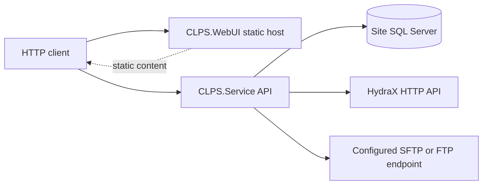
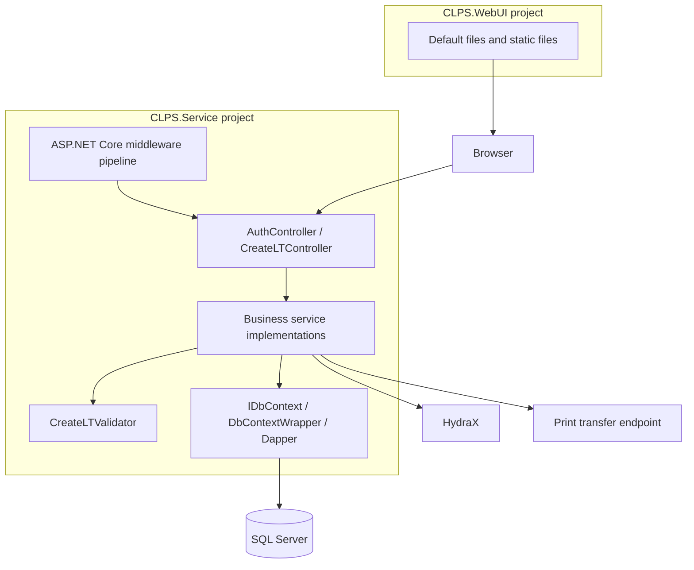
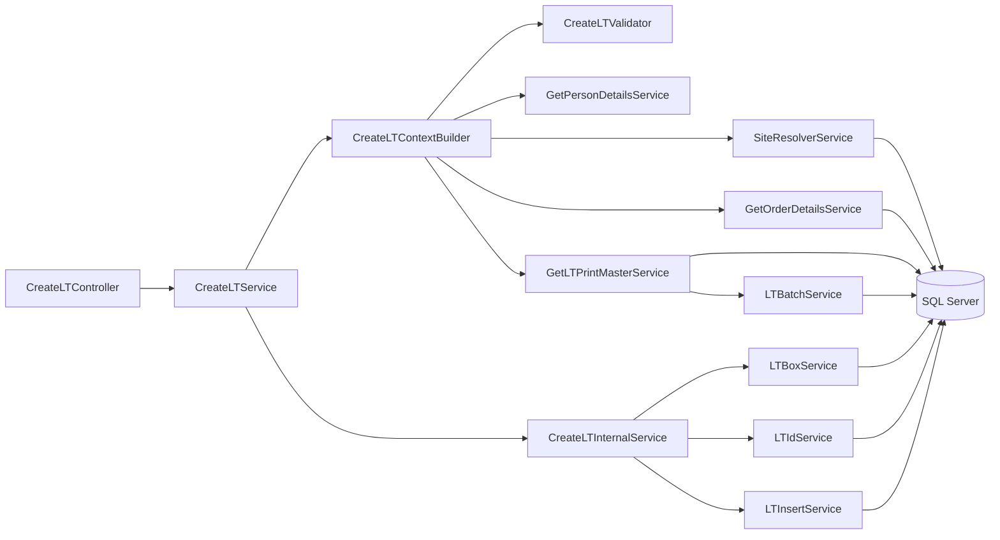
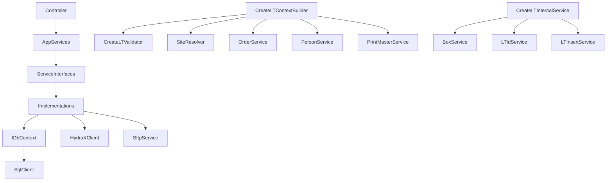
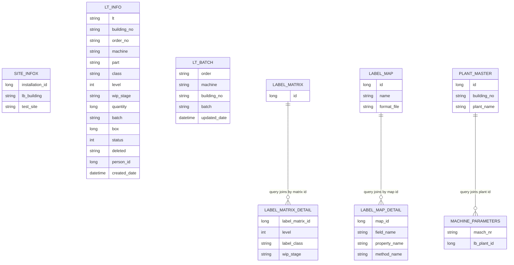

# CLPS .NET Web Service — Architecture and Technical Documentation

**Evidence snapshot:** 2026-10-16  
**Scope:** the three projects in `dotnet/CLPS/CLPS.Service/CLPS.Service.sln`: `CLPS.Service`, `CLPS.WebUI`, and `CLPS.Tests`. This document analyzes their .NET source, project manifests, configuration, and checked-in tests only. It does not analyze other repository product trees.

## Evidence conventions

- **Confirmed findings** are statements directly supported by source, project files, configuration, or tests. Each finding cites a file and, where useful, the class/method or exact code behavior.
- **Unknown information** is not inferable from the checked-in .NET solution. No conclusions are drawn about deployed systems or external database schema.
- **Assumptions avoided** are explicitly listed in §12.
- Code references are relative to this document. The project files and source are authoritative; a table/query in application code does not prove the physical database constraint or schema.

### Confirmed Findings

The solution contains the three projects documented in §4; the service targets .NET 8, uses ASP.NET Core MVC, Dapper and SqlClient; its HTTP, database, validation, authentication and integration components are described below from their implementations.

### Unknown Information

The source does not establish the deployed database schema, infrastructure topology, identity provider or actual production authorization boundary, deployment platform, external-system behavior, operational service-level objectives, or disaster recovery configuration.

### Assumptions Avoided

No deployment vendor, physical schema constraint, API consumer identity, business approval, or external-system behavior is inferred where not implemented or configured in the .NET solution.

## 1. Executive Summary

### Application purpose

The .NET solution implements CLPS manufacturing label-tracking functionality. The service API creates LT records and identifiers, resolves order/machine/site/label configuration, manages batches, supports output-batch logon/logoff and association operations, generates label data, and coordinates printing.

**Evidence:** `CreateLTController` exposes LT, batch, validation and printing actions in [Controllers/CreateLTController.cs](../Controllers/CreateLTController.cs); LT record insertion is performed by `LTInsertService.InsertLTAsync` in [Services/LTInsert/LTInsertService.cs](../Services/LTInsert/LTInsertService.cs); label output is coordinated by `PrintOutputBatchService.ExecuteAsync` in [Services/PrintOutputBatch/PrintOutputBatchService.cs](../Services/PrintOutputBatch/PrintOutputBatchService.cs).

### Business capabilities and features verified from code

| Capability | Verified implementation |
|---|---|
| Create label-tracking records | `CreateLTService.CreateLTAsync` and `CreateLTInternalService.CreateLTAsync` validate the request, assemble manufacturing/print context, generate an LT ID, and insert an LT row. |
| Resolve site and plant information | `SiteResolverService.ResolveSiteAsync` queries `u_site_infox`; `MipPlantResolverService.ResolveMipPlantAsync` maps a machine to plant data. |
| Validate order, machine, LT class/level/WIP, and person | `GetOrderDetailsService.GetOrderDetailsAsync`, `MachineValidationService.ValidateMachineAsync`, `CreateLTValidator.ValidateAsync`, and `GetPersonDetailsService.ValidatePersonAsync`. |
| Resolve print master and batch | `GetLTPrintMasterService.GetLTPrintMasterAsync` selects label-matrix settings and calls `LTBatchService.ResolveBatchAsync`. |
| List and retrieve LTs | `GetLTListService.GetLTListAsync`, `GetLatestLTIdService.GetLatestLTIdAsync`, and `GetLTDataService.GetLTDataAsync`. |
| Log on/off output batches and associate materials | `LogonOutputBatchService.ExecuteAsync`, `LogoffOutputBatchService.ExecuteAsync`, and `AssociateService.ExecuteAsync`; these invoke HydraX workflows. |
| Generate and print labels | `CreateLabelDataService.CreateLabelDataAsync`, `PrintFileService.PrintFileAsync`, and `PrintOutputBatchService.ExecuteAsync`. |
| Serve a web UI | `CLPS.WebUI` serves static files using `UseDefaultFiles` and `UseStaticFiles` in [CLPS.WebUI/Program.cs](../../CLPS.WebUI/Program.cs). |

The source supports clients operating these workflows; it does not define a verified end-user persona, organizational role model, or formal business objective beyond the operations implemented above.

### Core workflows

1. **Create LT:** HTTP request → installation/site DB configuration → site/LT/order/person validation → print-master and batch resolution → box and LT ID allocation → LT row insert → response.
2. **Print LT:** LT lookup/status eligibility → printer and BarTender-server resolution → label data construction → DD file upload → LT status update.
3. **Create/replace print LT:** log off old LT → attempt printing → log on a new output batch; retry behavior is configurable in service logic.
4. **Batch processing:** use supplied batch if valid, otherwise select SAP or AUTO behavior and return a batch result.

The detailed Create LT call chain and transaction behavior are in §6.

### High-level architecture summary

The solution is a single .NET 8 solution with one ASP.NET Core API/service project, one static-file web-host project, and one test project. Business services and infrastructure are in the same service project. SQL Server access uses Dapper and `Microsoft.Data.SqlClient`; no Entity Framework Core implementation is present. HydraX HTTP and SFTP/FTP file transfer are integration clients within the service.

## 2. System Overview

### Functional overview and major modules

| Module | Responsibility | Evidence |
|---|---|---|
| HTTP API | Maps `/api/clps` operations to service interfaces; maps selected service failures to HTTP 400. | `CreateLTController`, route attributes and action methods in [Controllers/CreateLTController.cs](../Controllers/CreateLTController.cs). |
| Authentication endpoint | Creates a signed JWT using configured key/issuer/audience. | `AuthController.login` in [Controllers/AuthController.cs](../Controllers/AuthController.cs). |
| LT creation | Checks request/site, builds creation context and performs ID/box/insert work. | `CreateLTService`, `CreateLTContextBuilder`, `CreateLTInternalService`. |
| Manufacturing validation and resolution | Checks order running state, machine activation, person validity, site and plant. | `Services/Order`, `Services/Machine`, `Services/Person`, `Services/Site`. |
| Batch, box and ID allocation | Resolves SAP/AUTO batch, reads/advances box state, generates LT identifiers. | `LTBatchService`, `LTBoxService`, `LTIdService`. |
| Label/print workflow | Resolves print master and printer, composes label fields and uploads a DD file. | `Services/LTPrintMaster`, `Services/CreateLabelData`, `Services/PrintOutputBatch`. |
| HydraX integration | Sends material/logon/logoff requests and transaction commits. | `Infrastructure/HydraX/HydraXClient.cs`; `Services/LogonOutputBatch`, `Services/LogoffOutputBatch`, `Services/Associate`. |
| Database access | Creates site-specific SQL contexts and provides connection/transaction callbacks. | `Infrastructure/Database/DbContextFactory.cs`, `DbContextWrapper.cs`, `IDbContext.cs`. |
| Configuration/localization | Reads `Sites` configuration, INI/HydraX settings and translation resources. | `Services/Configuration`, `Services/Localization`, `Resources`. |
| Static web host | Serves static web assets; it has no MVC controller or server-side API proxy in its `Program.cs`. | [CLPS.WebUI/Program.cs](../../CLPS.WebUI/Program.cs). |

### Layer responsibilities

```text
HTTP clients
  └─ CLPS.Service.Controllers
       └─ Services/* (business operations and orchestration)
            ├─ Validators/*
            ├─ Infrastructure/Database (IDbContext, SqlConnection, Dapper)
            └─ Infrastructure/HydraX + SftpService (external integrations)
                 └─ SQL Server / HydraX / print-file endpoint

CLPS.WebUI is a separate static-file host; CLPS.Tests references CLPS.Service.
```

The layers are folders/namespaces inside `CLPS.Service`, not separate class-library projects. Project references are shown in §4.

### Request lifecycle

For API requests, `Program.cs` configures controllers, JWT bearer authentication, Serilog, CORS, an exception handler, HTTPS redirection, static files, localization, and controller mapping. `CreateLTController` binds route/query/body inputs and calls injected service interfaces. Services resolve site-specific configuration and invoke database or integration operations. Controllers return `Ok`, `BadRequest`, or selected `NotFound` results.

**Evidence:** application setup in [Program.cs](../Program.cs), controller mapping `app.MapControllers()`, and action methods in [CreateLTController.cs](../Controllers/CreateLTController.cs).

### Data lifecycle

- Site selection uses an installation ID to read `Sites:{installationId}` configuration (`SiteConfigurationService.GetSiteConfigAsync`), then `DbContextFactory.Create` creates the database wrapper.
- Manufacturing/label master data is read through Dapper/direct SQL.
- LT and batch operations write SQL rows and/or consume SQL sequences.
- Printing composes label data and a local `.dd` file, uploads it, and changes LT status.
- Output-batch operations also perform external HydraX operations; those are not part of the SQL transaction.

**Evidence:** [SiteConfigurationService.cs](../Services/Configuration/SiteConfigurationService.cs), [DbContextFactory.cs](../Infrastructure/Database/DbContextFactory.cs), [DbContextWrapper.cs](../Infrastructure/Database/DbContextWrapper.cs), [LTInsertService.cs](../Services/LTInsert/LTInsertService.cs), and [PrintFileService.cs](../Services/PrintOutputBatch/PrintFileService.cs).

## 3. High Level Design (HLD)

### Architecture pattern assessment

| Pattern | Finding | Evidence, project and namespaces |
|---|---|---|
| Layered architecture | **Present as logical layers.** Controllers call services; services depend on interfaces and infrastructure. Layers are not separate projects. | `CLPS.Service`; `CLPS.Service.Controllers`, `CLPS.Service.Services.*`, `CLPS.Service.Infrastructure.*`; [Program.cs](../Program.cs) DI registrations. |
| N-tier | **Logical tiers are present:** static web host, API/service process, data and external systems. Physical deployment separation is not established. | `CLPS.WebUI` project and `CLPS.Service` project; [CLPS.WebUI/Program.cs](../../CLPS.WebUI/Program.cs), [Program.cs](../Program.cs). |
| Clean / Onion architecture | **Not established as a strict architecture.** Models, application services, controllers and infrastructure reside in the same `CLPS.Service` project; no distinct domain/application/infrastructure project dependency graph exists. | [CLPS.Service.csproj](../CLPS.Service.csproj); folders `Models`, `Services`, `Infrastructure`, `Controllers`. |
| Hexagonal architecture | **Some ports/adapters characteristics, not a complete hexagonal structure.** Service interfaces and `IDbContext` abstract selected dependencies, but adapters and application/domain code share the same project. | `ICreateLTService`, `IDbContext`, `IHydraXClient`; [Infrastructure/Database/IDbContext.cs](../Infrastructure/Database/IDbContext.cs). |
| CQRS | **Not evidenced.** No command/query bus or separate command/query model is present; controllers call services directly. | `CreateLTController` and service registrations in [Program.cs](../Program.cs). |
| Event-driven | **Not evidenced.** The inspected service invokes SQL and HTTP integrations synchronously within request workflows; no message broker or event handler registration is found. | [Program.cs](../Program.cs), [HydraXClient.cs](../Infrastructure/HydraX/HydraXClient.cs). |

### System Context Diagram



The diagram shows the dependencies implemented in code; the source does not establish that the UI and API are deployed together or on one origin. Evidence: [CLPS.WebUI/Program.cs](../../CLPS.WebUI/Program.cs), [ConnectionFactory.cs](../Infrastructure/Database/ConnectionFactory.cs), [HydraXClient.cs](../Infrastructure/HydraX/HydraXClient.cs), [SftpService.cs](../Services/SftpService/SftpService.cs).

### Application Architecture Diagram



### Component Diagram



## 4. Solution Structure

### Solution and project inventory

The solution file includes exactly three projects.

| Project | Project type / target | Responsibility | Project references | Direct external package dependencies |
|---|---|---|---|---|
| `CLPS.Service` | `Microsoft.NET.Sdk.Web`; `net8.0` | ASP.NET Core API, manufacturing workflows, database and integration code. | None declared. | Dapper, JWT bearer, SqlClient, configuration binder, Serilog, SSH.NET packages. |
| `CLPS.WebUI` | `Microsoft.NET.Sdk.Web`; `net8.0`; declares `win-x64` runtime identifier. | Static-file web host. | None declared. | No explicit `<PackageReference>`. |
| `CLPS.Tests` | `Microsoft.NET.Sdk`; `net8.0`; test project. | Unit tests referencing service code. | `CLPS.Service.csproj`. | coverlet, Microsoft.NET.Test.Sdk, Moq, xUnit. |

**Evidence:** [CLPS.Service.sln](../CLPS.Service.sln), [CLPS.Service.csproj](../CLPS.Service.csproj), [CLPS.WebUI.csproj](../../CLPS.WebUI/CLPS.WebUI.csproj), [CLPS.Tests.csproj](../../CLPS.Tests/CLPS.Tests.csproj).

### Solution hierarchy

```text
dotnet/CLPS/
├── CLPS.Service/
│   ├── Controllers/                  AuthController, CreateLTController
│   ├── Infrastructure/
│   │   ├── Database/                 ConnectionFactory, DbContextFactory,
│   │   │                             DbContextWrapper, IDbContext contracts
│   │   ├── HydraX/                   HydraXClient and site config resolver
│   │   └── Transactions/             TransactionContext helper
│   ├── Models/
│   │   ├── Constants/                LT status constants
│   │   ├── Context/                  SiteContext, CreateLTContext
│   │   ├── Entities/                 LTEntity and persistence DTOs
│   │   ├── Internal/                 internal creation results
│   │   ├── LabelMatrix*/             matrix query/result models
│   │   ├── Requests/                 API/service input DTOs
│   │   └── Responses/                API/service response DTOs
│   ├── Services/                     Feature services and interfaces
│   │   ├── Associate, Batch, Box, ClassTabs, Configuration
│   │   ├── CreateLT/{ContextBuilder,Internal}, CreateLabelData, CreatePrintLT
│   │   ├── LT, LTData, LTInsert, LTPrintMaster, LatestLT, LicenseTagStatus
│   │   ├── Localization, LogoffOutputBatch, LogonOutputBatch, Machine, Order
│   │   ├── MaterialComment, PartClass, Person, PrintOutputBatch
│   │   ├── ProductMaster, Resources, SftpService, Site, ZLabel4, BTServer
│   ├── Validators/                    CreateLTValidator and validator contracts
│   ├── Serialization/                 JSON context and helpers
│   ├── Resources/                     localized text JSON resources
│   ├── Properties/                    resource metadata and publish profiles
│   ├── appsettings*.json              service configuration
│   └── docs/                           architecture documents
├── CLPS.WebUI/
│   ├── Program.cs                     static-file host
│   ├── wwwroot/                       static assets
│   └── Properties/                    publish profiles
└── CLPS.Tests/
    ├── *Tests.cs                      unit-test source
    └── Client.cs, TestableLTIdService.cs
```

### Major folders and architectural roles

| Folder | Purpose / key classes | Architectural role |
|---|---|---|
| `Controllers` | `AuthController`, `CreateLTController` | HTTP entry points and status mapping. |
| `Services` | Feature service implementations and interfaces, including create, query, batch, print, site and HydraX workflows. | Application/business orchestration. |
| `Infrastructure/Database` | `IDbContext`, `DbContextWrapper`, factories and connection construction. | SQL Server adapter. |
| `Infrastructure/HydraX` | HTTP client, DTO/config resolver. | External integration adapter. |
| `Infrastructure/Transactions` | `TransactionContext` stores commit/rollback `Action`s. | Helper abstraction; no use in the LT creation path is shown. |
| `Models` | Request/response DTOs, contexts and entity-like data classes. | Data contracts; not EF-mapped entities. |
| `Validators` | `CreateLTValidator`, `IValidator<T>`, validation result. | Application input rules. |
| `Serialization` | System.Text.Json source-generation context and helpers. | JSON serialization support. |
| `Resources` | Translation JSON. | Localization data. |
| `CLPS.WebUI/wwwroot` | Static web resources. | Static content, not a server-side business layer. |
| `CLPS.Tests` | xUnit test source and helpers. | Automated test project. |

### Repository/repository-pattern and EF Core inventory

- **Repository classes/folder:** no class named or folder organized as a repository was found in the CLPS service project. Services execute Dapper or `SqlCommand` queries via `IDbContext`.
- **EF Core:** no EF Core package, `DbContext` subclass, `DbSet`, Fluent API configuration, or EF migration was found.
- **Startup:** no `Startup.cs` is present; service configuration is in top-level [Program.cs](../Program.cs).
- **SQL scripts/migrations:** the .NET solution scan found no checked-in `.sql` scripts or migration files. SQL statements are embedded in service source.

## 5. Technology Stack

### Platform and framework versions

| Concern | Confirmed finding | Evidence |
|---|---|---|
| .NET target | `net8.0` in Service, WebUI and Tests. | Three `.csproj` files linked above. |
| ASP.NET Core | Service and WebUI use `Microsoft.NET.Sdk.Web`; target framework is .NET 8. | [CLPS.Service.csproj](../CLPS.Service.csproj), [CLPS.WebUI.csproj](../../CLPS.WebUI/CLPS.WebUI.csproj). |
| C# language version | No explicit `LangVersion` is set. The project targets `net8.0`; exact compiler version depends on the SDK used. | `.csproj` property groups. |
| Entity Framework Core | Not present in package references or source patterns. | Service `.csproj`; scan of service source for DbContext/EF declarations. |
| Database provider | SQL Server using `Microsoft.Data.SqlClient`; Dapper for query mapping/execution. | [CLPS.Service.csproj](../CLPS.Service.csproj), [DbContextWrapper.cs](../Infrastructure/Database/DbContextWrapper.cs). |
| Authentication | JWT bearer middleware via `Microsoft.AspNetCore.Authentication.JwtBearer`; token creation via `System.IdentityModel.Tokens.Jwt`. | [Program.cs](../Program.cs), [AuthController.cs](../Controllers/AuthController.cs). |
| Authorization | ASP.NET Core authorization attributes (`[Authorize]`, `[AllowAnonymous]`); no policy registration or fallback policy found. | [CreateLTController.cs](../Controllers/CreateLTController.cs), [Program.cs](../Program.cs). |
| Logging | Serilog with console and daily rolling file sinks. | [Program.cs](../Program.cs). |
| Validation | Custom `IValidator<T>` / `CreateLTValidator`; ASP.NET Core `[ApiController]` binding behavior. No FluentValidation package found. | [Validators](../Validators), [CreateLTController.cs](../Controllers/CreateLTController.cs). |
| API documentation | No Swagger/OpenAPI registration or package reference found. | Service `Program.cs` and project package references. |
| Caching | Static `ConcurrentDictionary` caches in LT ID and box services; not a distributed cache registration. | [LTIdService.cs](../Services/LT/LTIdService.cs), [LTBoxService.cs](../Services/Box/LTBoxService.cs). |
| HTTP/file integration | `IHttpClientFactory`/`HttpClient`; SSH.NET packages and an SFTP service that also permits FTP. | [HydraXClient.cs](../Infrastructure/HydraX/HydraXClient.cs), [SftpService.cs](../Services/SftpService/SftpService.cs). |

### Complete direct NuGet package inventory from project files

| Project | Package | Version |
|---|---|---:|
| `CLPS.Service` | Dapper | 2.1.72 |
| `CLPS.Service` | Microsoft.AspNetCore.Authentication.JwtBearer | 8.0.0 |
| `CLPS.Service` | Microsoft.Data.SqlClient | 7.0.1 |
| `CLPS.Service` | Microsoft.Extensions.Configuration.Binder | 8.0.0 |
| `CLPS.Service` | Renci.SshNet.Async | 1.4.0 |
| `CLPS.Service` | Serilog | 4.3.1 |
| `CLPS.Service` | Serilog.AspNetCore | 8.0.0 |
| `CLPS.Service` | Serilog.Extensions.Logging | 10.0.0 |
| `CLPS.Service` | Serilog.Sinks.Console | 6.1.1 |
| `CLPS.Service` | Serilog.Sinks.File | 7.0.0 |
| `CLPS.Service` | SSH.NET | 2025.1.0 |
| `CLPS.Tests` | coverlet.collector | 6.0.0 |
| `CLPS.Tests` | Microsoft.NET.Test.Sdk | 17.8.0 |
| `CLPS.Tests` | Moq | 4.20.72 |
| `CLPS.Tests` | xunit | 2.5.3 |
| `CLPS.Tests` | xunit.runner.visualstudio | 2.5.3 |
| `CLPS.WebUI` | No direct package references | — |

The service/test projects also contain explicit assembly `<Reference>` entries under local `dll` folders. These are not `<PackageReference>` entries and are therefore not included in the direct NuGet table. The lock files record resolved transitive packages.

## 6. Low Level Design (LLD)

### Controllers

#### `AuthController`

| Class / method | Responsibility and dependencies | Evidence |
|---|---|---|
| `AuthController` | Reads `IConfiguration` in constructor. | [Controllers/AuthController.cs](../Controllers/AuthController.cs). |
| `login()` | `POST /api/auth/login`; creates a JWT containing fixed Name and Admin Role claims; signs using configured symmetric key. It accepts no credential DTO or user-validation service. | `AuthController.login` in [Controllers/AuthController.cs](../Controllers/AuthController.cs). |

#### `CreateLTController`

`CreateLTController` is marked `[ApiController]` and `[Route("api/clps")]`. Constructor injection includes create-LT, order, print-master, latest-LT, batch, label-data, print, LT-data, machine, running-order, logon/logoff, association, list, site, class-tab, INI, hosting environment, and MIP plant services. It has a large multi-feature controller boundary; action-to-service mapping is in §8.

**Evidence:** class and constructor in [Controllers/CreateLTController.cs](../Controllers/CreateLTController.cs).

### Service/interface inventory

The service project uses interface/implementation pairs for the following business and integration components. The method name shown is the primary public operation visible from the service contract/source.

| Service area | Interface → implementation | Primary operation(s) | Responsibility |
|---|---|---|---|
| LT creation | `ICreateLTService` → `CreateLTService`; `ICreateLTContextBuilder` → `CreateLTContextBuilder`; `ICreateLTInternalService` → `CreateLTInternalService` | `CreateLTAsync`, `BuildContextAsync` | Validate, resolve context and create LT. |
| Batch/box/ID | `ILTBatchService` → `LTBatchService`; `ILTBoxService` → `LTBoxService`; `ILTIdService` → `LTIdService` | `ResolveBatchAsync`, `GetLatestBoxAsync`, `IncrementBoxAsync`, `GenerateLTIDAsync` | Batch, box and LT identifier allocation. |
| LT insertion/data | `ILTInsertService` → `LTInsertService`; `IGetLTDataService` → `GetLTDataService`; `IGetLatestLTIdService` → `GetLatestLTIdService`; `IGetLTListService` → `GetLTListService` | `InsertLTAsync`, `GetLTDataAsync`, `GetLatestLTIdAsync`, `GetLTListAsync` | Persist or retrieve LT records. |
| Print master | `IGetLTPrintMasterService` → `GetLTPrintMasterService` | `GetLTPrintMasterAsync` | Select label matrix/detail, plant/part data and batch. |
| Label generation | `ICreateLabelDataService` → `CreateLabelDataService` | `CreateLabelDataAsync` | Resolve label-map fields and build print payload. |
| Print orchestration | `IPrintOutputBatchService` → `PrintOutputBatchService`; `IPrintFileService` → `PrintFileService`; `IPrinterResolutionService` → `PrinterResolutionService` | `ExecuteAsync`, `PrintFileAsync`, `ResolvePrinterAsync` | Validate, generate, transfer and update print status. |
| Print lifecycle | `ICreatePrintLTService` → `CreatePrintLTService` | `ExecuteAsync` | Logoff/print/logon sequence with retries. |
| Output batch | `ILogonOutputBatchService` → `LogonOutputBatchService`; `ILogoffOutputBatchService` → `LogoffOutputBatchService` | `ExecuteAsync` | HydraX-backed output material operations. |
| Material association | `IAssociateService` → `AssociateService` | `ExecuteAsync` | Associate material/LT data, including SQL/HydraX operations. |
| Order/person/machine | `IGetOrderDetailsService` → `GetOrderDetailsService`; `IValidateRunningOrderService` → `ValidateRunningOrderService`; `IGetPersonDetailsService` → `GetPersonDetailsService`; `IMachineValidationService` → `MachineValidationService` | `GetOrderDetailsAsync`, `ValidateRunningOrderAsync`, `ValidatePersonAsync`, `ValidateMachineAsync` | Validate order, person and machine state. |
| Site/plant | `ISiteResolverService` → `SiteResolverService`; `IMipPlantResolverService` → `MipPlantResolverService` | `ResolveSiteAsync`, `ResolveMipPlantAsync` | Resolve installation/site and machine plant. |
| HydraX | `IHydraXClient` → `HydraXClient`; `IHydraXConfigResolver` → `HydraXConfigResolver` | `PostAsync`, `CommitTransactionAsync`, `LogoutAsync`, `Resolve` | Resolve per-installation endpoint and call HydraX. |
| SQL context | `IDbContextFactory` → `DbContextFactory`; `IConnectionFactory` → `ConnectionFactory`; `IDbContext` → `DbContextWrapper` | `Create`, `BuildConnectionString`, `ExecuteAsync` | Create site-specific SqlClient access and transaction callbacks. |
| Configuration/localization | `ISiteConfigurationService` → `SiteConfigurationService`; `IIniConfigurationService` → `IniConfigurationService`; `IHydraConfigurationService` → `HydraConfigurationService`; `ITranslationService` → `TranslationService` | `GetSiteConfigAsync`, `GetValueAsync`, configuration methods, `Get` | Site/INI/Hydra settings and translated messages. |
| Other domain lookups | BT server, class tabs, product master, part class, ZLabel4, material comment, status, SFTP | Methods declared by their interfaces in `Services/*` | Supporting lookup, label-content, print status and transfer operations. |

**Evidence:** interface and implementation files under [Services](../Services); registration map in [Program.cs](../Program.cs). Service names and primary operations describe signatures; exact query and branch behavior is in each implementation.

### Database access/repository responsibilities

There is no repository abstraction. `DbContextWrapper.ExecuteAsync` opens a `SqlConnection`, starts a `SqlTransaction`, executes a callback and commits; on exceptions it attempts rollback and rethrows. Dapper queries are embedded in feature services, including `LTInsertService`, `LTBatchService`, `SiteResolverService`, `GetOrderDetailsService`, and `GetLTPrintMasterService`.

**Evidence:** [DbContextWrapper.cs](../Infrastructure/Database/DbContextWrapper.cs), [IDbContext.cs](../Infrastructure/Database/IDbContext.cs), and linked services.

### Middleware and dependency injection

`Program.cs` registers JWT bearer validation, MVC controllers with a combined JSON type resolver, Serilog, `IHttpClientFactory`, scoped service interfaces, localization and CORS. The pipeline installs exception handling, static files, HTTPS redirection, CORS, authentication, authorization, controller mapping and request localization.

The global exception handler writes a JSON object containing `result`, exception `message`, and exception `detail`/stack trace when available. No custom middleware class or `Startup.cs` is present.

**Evidence:** [Program.cs](../Program.cs), particularly `AddAuthentication`, `AddControllers`, `AddScoped`, `UseExceptionHandler`, and the middleware pipeline.

### Validator rules

`CreateLTValidator.ValidateAsync`:

- Defaults blank LT class to `3SI`, uppercases and accepts only `3SI`, `3S`, `4S`.
- Defaults missing level to `1`, accepts levels 1–3, disallows level >1 for `3SI`.
- Defaults blank WIP stage to `FG`; only `FG` is accepted.
- Mutates the validation model to its normalized values on success.

`CreateLTContextBuilder.BuildContextAsync` additionally requires a resolved site, valid validator result and a non-null normalized level. It checks the order and person responses before loading Print Master.

**Evidence:** `CreateLTValidator.ValidateAsync` in [Validators/CreateLTValidator.cs](../Validators/CreateLTValidator.cs); `BuildContextAsync` in [Services/CreateLT/ContextBuilder/CreateLTContextBuilder.cs](../Services/CreateLT/ContextBuilder/CreateLTContextBuilder.cs).

### LT Creation End-to-End Workflow Analysis

#### Call chain

```mermaid
sequenceDiagram
  participant Client
  participant C as CreateLTController
  participant S as CreateLTService
  participant B as CreateLTContextBuilder
  participant V as CreateLTValidator
  participant Site as SiteResolverService
  participant O as GetOrderDetailsService
  participant Person as GetPersonDetailsService
  participant PM as GetLTPrintMasterService
  participant Batch as LTBatchService
  participant I as CreateLTInternalService
  participant DB as DbContextWrapper / SQL Server
  participant Box as LTBoxService
  participant Id as LTIdService
  participant Insert as LTInsertService

  Client->>C: POST /api/clps/CreateLT
  C->>S: CreateLTAsync(request)
  S->>S: require request + InstallationID
  S->>DB: resolve Sites config and construct context
  S->>B: BuildContextAsync(request, context)
  par Site and LT input validation
    B->>Site: ResolveSiteAsync(installationId, context)
    Site->>DB: query u_site_infox
    B->>V: ValidateAsync(class, level, WIP)
  end
  B->>B: require site and normalized Level
  par Order and person validation
    B->>O: GetOrderDetailsAsync(order, machine, context)
    O->>DB: query order status, machine, part, plant
    B->>Person: ValidatePersonAsync(personId, context)
  end
  B->>PM: GetLTPrintMasterAsync(order, machine, part, class, level, WIP)
  PM->>DB: label matrix/detail, plant and part lookups
  PM->>Batch: ResolveBatchAsync
  Batch->>DB: SAP lookup or AUTO sequence/mapping
  PM-->>B: print master, batch, label quantity
  B-->>S: CreateLTContext
  S->>I: CreateLTAsync(request, context)
  I->>Box: GetLatestBoxAsync(order, class, context)
  I->>DB: ExecuteAsync starts transaction
  I->>Id: GenerateLTIDAsync(connection, transaction, prefix, building, !IsTestSite)
  Id->>DB: sequence lookup/allocation and last LT lookup
  I->>Insert: InsertLTAsync(entity, same connection, transaction)
  Insert->>DB: parameterized INSERT u_te_lb_lt_info
  I->>Box: IncrementBoxAsync (process memory)
  I->>Id: UpdateMemory(building, LT)
  I->>DB: commit transaction
  I-->>S: success response
  S-->>C: CreateLTResponse
  C-->>Client: HTTP 200 + result
```

#### Stage behavior and evidence

| Stage | Implementation and behavior | Evidence |
|---|---|---|
| HTTP action | `CreateLTController.CreateLT` rejects a null body with 400, calls `ICreateLTService.CreateLTAsync`, then returns `Ok(result)` even when `result.Result` is false. The action is `[AllowAnonymous]`. | [Controllers/CreateLTController.cs](../Controllers/CreateLTController.cs), `CreateLT`. |
| Site configuration | `CreateLTService.CreateLTAsync` requires a non-null request and `InstallationID`, loads site config, returns a failure DTO if missing, and creates `IDbContext`. | [Services/CreateLT/CreateLTService.cs](../Services/CreateLT/CreateLTService.cs), `CreateLTAsync`. |
| Context preconditions | `CreateLTContextBuilder.ValidateRequest` requires installation and order unless prepopulated dependencies are injected. | [Services/CreateLT/ContextBuilder/CreateLTContextBuilder.cs](../Services/CreateLT/ContextBuilder/CreateLTContextBuilder.cs), `ValidateRequest`. |
| Site and LT validation | Site resolution and LT validator run in parallel. Null site, invalid LT validation or missing normalized level fails context creation. | `BuildContextAsync` in the linked context-builder file; `CreateLTValidator.ValidateAsync` in [Validators/CreateLTValidator.cs](../Validators/CreateLTValidator.cs). |
| Order/person | Order and person checks run in parallel. Order service requires running status (`prod_kenn == "L"` and `a_status == "L"`), checks supplied machine against the order's machine, and requires PlantId. A failed order or person response stops the workflow. | `BuildContextAsync`; `GetOrderDetailsAsync` in [Services/Order/GetOrderDetailsService.cs](../Services/Order/GetOrderDetailsService.cs); `ValidatePersonAsync` in [Services/Person/GetPersonDetailsService.cs](../Services/Person/GetPersonDetailsService.cs). |
| Print Master | Builder supplies order, resolved machine, installation, part, normalized class, level and WIP. Service selects best-scored label matrix, rejects a tied top score, obtains detail, plant and part data, then resolves quantity and batch. | `BuildContextAsync`; `GetLTPrintMasterAsync` in [Services/LTPrintMaster/GetLTPrintMasterService.cs](../Services/LTPrintMaster/GetLTPrintMasterService.cs). |
| Batch behavior | Print Master invokes batch resolution with an empty supplied batch. Batch service may read SAP value or create/find AUTO batch mapping. A failed batch resolution is converted by Print Master to `"0"` while its successful result can continue. The `CreateLTRequest.Batch` value is not passed in this builder call. | `GetLTPrintMasterAsync`; `ResolveBatchAsync` in [Services/Batch/LTBatchService.cs](../Services/Batch/LTBatchService.cs); request DTO in [Models/Requests/CreateLTRequest.cs](../Models/Requests/CreateLTRequest.cs). |
| Quantity behavior | Positive request quantity wins; else a positive Print Master label quantity is used; else null resolves to zero in the builder/internal service. The intended failure is commented out. | `ResolveQuantity` and `BuildContextAsync` in [CreateLTContextBuilder.cs](../Services/CreateLT/ContextBuilder/CreateLTContextBuilder.cs); `GetValueOrDefault` in internal service. |
| Box selection | Internal service gets the latest box for order/class; `LTBoxService` reads a process cache first, otherwise queries latest LT box and caches `lastBox + 1`. | `CreateLTInternalService.CreateLTAsync`; `GetLatestBoxAsync` in [Services/Box/LTBoxService.cs](../Services/Box/LTBoxService.cs). |
| LT ID | Prefix maps `3S` and `3SI` to `3S`; other classes throw. `CreateLTValidator` permits `4S`, so that accepted value currently fails at prefix creation. ID generation receives `!ctx.IsTestSite` as `isProduction`; this correctly maps `IsTestSite == true` to production false and vice versa. | `GetPrefix` and `GenerateAndInsertLTAsync` in [Services/CreateLT/Internal/CreateLTInternalService.cs](../Services/CreateLT/Internal/CreateLTInternalService.cs); `GenerateLTIDAsync` in [Services/LT/LTIdService.cs](../Services/LT/LTIdService.cs); validator file linked above. |
| Transaction / insert | Internal service begins `DbContext.ExecuteAsync`; supplies its SQL connection and transaction to `LTInsertService.InsertLTAsync`, which executes the parameterized insert on those same objects. LT ID sequence work and row insert therefore share the wrapper's transaction. | [Services/CreateLT/Internal/CreateLTInternalService.cs](../Services/CreateLT/Internal/CreateLTInternalService.cs), `GenerateAndInsertLTAsync`; [Services/LTInsert/ILTInsertService.cs](../Services/LTInsert/ILTInsertService.cs); [Services/LTInsert/LTInsertService.cs](../Services/LTInsert/LTInsertService.cs); [Infrastructure/Database/DbContextWrapper.cs](../Infrastructure/Database/DbContextWrapper.cs). |
| In-memory updates | Box cache increments and LT ID cache is updated before `ExecuteAsync` returns/commits. These operations are not enlisted in SQL transaction and have no rollback callback in this path. | `IncrementBoxAsync` in [Services/Box/LTBoxService.cs](../Services/Box/LTBoxService.cs); `UpdateMemory` in [Services/LT/LTIdService.cs](../Services/LT/LTIdService.cs). |
| Failure handling | Failed preconditions return failure results. LT ID failure is converted to an exception by the internal service; insert/transaction errors propagate. The internal semaphore is released in `finally`; global exception handler serializes exception information. | [Services/CreateLT/CreateLTService.cs](../Services/CreateLT/CreateLTService.cs), [Services/CreateLT/Internal/CreateLTInternalService.cs](../Services/CreateLT/Internal/CreateLTInternalService.cs), [Program.cs](../Program.cs). |

#### Transaction boundary summary

| Operation | Boundary | Atomic with LT row? |
|---|---|---|
| Site/order/person/Print Master reads | Individual `IDbContext.ExecuteAsync` calls; separate connection/transaction invocations. | No; these are preflight reads. |
| ID allocation and LT row insert | One `DbContextWrapper.ExecuteAsync` transaction; `LTInsertService` uses the caller's connection and transaction. | **Yes, within the SQL transaction callback** for operations participating in that callback. |
| SQL Server sequence allocation | `NEXT VALUE FOR` in LT ID generation. | SQL Server sequence values are not rolled back with transaction rollback; gaps remain possible. |
| Box/LT process cache changes | Static in-memory dictionaries; updates occur before outer transaction commit. | No; cache can be ahead after transaction failure and is per process. |
| HydraX work in related output-batch flows | Separate HTTP request/transaction. | No SQL/HydraX distributed transaction is shown. |

### Dependency mapping



Dependency registrations are in [Program.cs](../Program.cs); the controller/service contracts and constructors are in their linked source files.

## 7. Database Design

### Data access implementation

- `IDbContext` defines the callback API accepting `SqlConnection` and `SqlTransaction`.
- `DbContextWrapper` creates a SQL connection, opens it, begins a transaction, executes the callback, commits on success, and attempts rollback before rethrow on callback failure.
- `DbContextFactory` creates a wrapper from `SiteContext`; `ConnectionFactory` builds a SQL Server connection string.
- Queries are embedded in services and use Dapper or `SqlCommand`; entity/model classes are plain C# types.

**Evidence:** [IDbContext.cs](../Infrastructure/Database/IDbContext.cs), [DbContextWrapper.cs](../Infrastructure/Database/DbContextWrapper.cs), [DbContextFactory.cs](../Infrastructure/Database/DbContextFactory.cs), [ConnectionFactory.cs](../Infrastructure/Database/ConnectionFactory.cs).

### Tables and query-derived logical relationships

The names below are table/object names used by application SQL. The source does not contain authoritative DDL.

| Name in SQL | Usage proven by service code | Evidence |
|---|---|---|
| `u_te_lb_lt_info` | LT row insert; latest LT/box lookup; LT status/data retrieval. | [LTInsertService.cs](../Services/LTInsert/LTInsertService.cs), [LTIdService.cs](../Services/LT/LTIdService.cs), [LTBoxService.cs](../Services/Box/LTBoxService.cs), [LTStatusService.cs](../Services/LicenseTagStatus/LTStatusService%20.cs). |
| `u_te_lb_batch` | AUTO batch mapping lookup/insert by order, machine and building. | [LTBatchService.cs](../Services/Batch/LTBatchService.cs). |
| `u_te_lb_label_matrix` / matrix detail | Label matrix matching and LT class/level/WIP print settings. | [Models/LabelMatrix/LabelMatrix.cs](../Models/LabelMatrix/LabelMatrix.cs), [Models/LabelMatrixDetail/LabelMatrixDetail.cs](../Models/LabelMatrixDetail/LabelMatrixDetail.cs), [GetLTPrintMasterService.cs](../Services/LTPrintMaster/GetLTPrintMasterService.cs). |
| `u_te_lb_label_map`, `u_te_lb_label_map_detail` | Label file format and field/property/method definitions. | [CreateLabelDataService.cs](../Services/CreateLabelData/CreateLabelDataService.cs). |
| `u_te_lb_part_master`, `u_te_lb_part_zzapq_qty` | Label package quantities, part revision and other part metadata. | [GetLTPrintMasterService.cs](../Services/LTPrintMaster/GetLTPrintMasterService.cs). |
| `u_te_lb_plant_master`, `u_te_maschinen_parameters` | Machine-to-plant data and plant/building configuration. | [GetLTPrintMasterService.cs](../Services/LTPrintMaster/GetLTPrintMasterService.cs), [MipPlantResolverService.cs](../Services/Site/MipPlantResolverService.cs). |
| `u_site_infox` | Installation/site alias, building, application server and test-site data. | [SiteResolverService.cs](../Services/Site/SiteResolverService.cs). |
| `auftrags_bestand`, `auftrag_status`, `maschinen`, `res_bestand` | Order status, machine, part/tool and machine group/category lookups. | [GetOrderDetailsService.cs](../Services/Order/GetOrderDetailsService.cs), [GetLTPrintMasterService.cs](../Services/LTPrintMaster/GetLTPrintMasterService.cs), [ValidateRunningOrderService.cs](../Services/Order/ValidateRunningOrderService.cs). |
| SQL Server sequences | LT ID and AUTO batch number allocation; sequence identifiers are generated by building. | [LTIdService.cs](../Services/LT/LTIdService.cs), [LTBatchService.cs](../Services/Batch/LTBatchService.cs). |

### Entity and logical ER diagram

`LTEntity` is the insert DTO used by `LTInsertService`. It contains BuildingNo, Order, Machine, Part, Level, WipStage, Class, LT, Quantity, Box, Batch, Status, LabelMap, PrinterId, Deleted, PersonId and CreatedDate.



This is a logical diagram of fields and joins found in SQL only. It is **not** proof of physical PK/FK relationships. `LT_INFO`/`LT_BATCH` are application aliases for tables, not physical names.

### Keys, constraints, indexes, migrations

| Requested database property | Finding |
|---|---|
| DbContext | No EF `DbContext`; a custom `IDbContext` wraps SqlClient transactions. |
| Fluent API | None found. |
| Migrations | None found in the .NET solution. |
| SQL scripts | None found in the .NET solution; queries/sequence DDL are embedded in service source. |
| Primary/foreign keys | **Unknown.** Entity DTOs and query joins do not establish database constraints. |
| Unique constraints/indexes/check constraints | **Unknown.** No deployed schema or DDL was found. |
| Transaction isolation | **Unknown.** `DbContextWrapper` calls `BeginTransaction()` without an explicit isolation level. |
| Sequence behavior | Code creates and consumes SQL Server sequences; sequence values can be consumed even if the surrounding transaction later rolls back. |

## 8. API Specification

### API conventions

- Controller prefix: `api/clps`; authentication prefix: `api/auth`.
- `CreateLTController` is `[ApiController]`; `AuthController` uses explicit route attributes.
- Many actions map `Result == false` to HTTP 400; `CreateLT` returns HTTP 200 for service-level failures.
- No OpenAPI/Swagger registration was found.
- Unless explicitly protected, endpoints are not automatically authenticated by a fallback policy in the inspected `Program.cs`.

### Endpoint reference

| Endpoint | Controller/action | Service invoked | Request DTO / inputs | Response DTO / shape | Validation and error behavior | Authentication / authorization |
|---|---|---|---|---|---|---|
| `POST /api/auth/login` | `AuthController.login` | Inline token construction | No credentials DTO | `{ token }` | Missing JWT key throws; fixed claims used. | No `[Authorize]`; anonymous by default. |
| `POST /api/clps/CreateLT` | `CreateLTController.CreateLT` | `ICreateLTService.CreateLTAsync` | `CreateLTRequest` | `CreateLTResponse` | Null body → 400; service `Result=false` still returns 200. | `[AllowAnonymous]`. |
| `GET /api/clps/SiteInfo` | `GetSiteInfo` | `ISiteResolverService.ResolveSiteAsync`; optionally `IMipPlantResolverService.ResolveMipPlantAsync` | `installationId`, optional `machine` | Anonymous site/MIP object | ID <= 0 → 400; missing site → 404. | `[AllowAnonymous]`. |
| `POST /api/clps/LogonOutputBatch` | `LogonOutputBatch` | `ILogonOutputBatchService.ExecuteAsync` | `LogonOutputBatchRequest` | `LogonOutputBatchResponse` | Null body/failed result → 400. | `[AllowAnonymous]`. |
| `GET /api/clps/OrderDetails` | `GetOrderDetails` | `IGetOrderDetailsService.GetOrderDetailsAsync` | `orderOperation`, optional `machine` | `GetOrderDetailsResult` | Failed result → 400; running order/machine/plant checks. | `[AllowAnonymous]`. |
| `POST /api/clps/LTPrintMaster` | `GetLTPrintMaster` | `IGetLTPrintMasterService.GetLTPrintMasterAsync` | `GetLTPrintMasterRequest` | `GetLTPrintMasterResult` | Failed result → 400; service requires order/machine and site configuration. | `[AllowAnonymous]`. |
| `GET /api/clps/LTData` | `GetLTData` | `IGetLTDataService.GetLTDataAsync` | `lt`, `installationId` | `GetLTDataResponse` | Failed result → 400. | `[AllowAnonymous]`. |
| `POST /api/clps/LogoffOutputBatch` | `LogoffOutputBatch` | `ILogoffOutputBatchService.ExecuteAsync` | Query `lt`, `qty`, `installationId` | `LogoffOutputBatchResponse` | Failed result → 400. | `[AllowAnonymous]`. |
| `POST /api/clps/GetLatestLTID` | `GetLatestLTId` | `IGetLatestLTIdService.GetLatestLTIdAsync` | `GetLatestLTIdRequest` | Latest-LT response | Failed result → 400. | `[AllowAnonymous]`. |
| `POST /api/clps/GetLTList` | `GetLTList` | `IGetLTListService.GetLTListAsync` | `GetLTListRequest` | `GetLTListResult` | Failed result → 400. | `[AllowAnonymous]`. |
| `GET /api/clps/batch` | `GetBatch` | `ILTBatchService.ResolveBatchAsync` | Query `order`, `machine`, `buildingNo`, `batchMethod`, optional `inputBatch`, `installationId` | Anonymous subset of batch result | Returns 200 wrapper even if result false. | No attribute; no fallback policy found. |
| `POST /api/clps/CreateLabelData` | `CreateLabelData` | `ICreateLabelDataService.CreateLabelDataAsync` | `CreateLabelDataRequest` | `CreateLabelDataResult` | Null body/failed result → 400. | `[AllowAnonymous]`. |
| `POST /api/clps/Associate` | `Associate` | `IAssociateService.ExecuteAsync` | `AssociateRequest` | `AssociateResponse` | Failed result → 400. | `[Authorize]`. |
| `POST /api/clps/PrintOutputBatch` | `PrintOutputBatch` | `IPrintOutputBatchService.ExecuteAsync` | `PrintOutputBatchRequest` | `PrintOutputBatchResponse` | Failed result → 400; service may update status on failure. | `[AllowAnonymous]`. |
| `POST /api/clps/CreatePrintLT` | `CreatePrintLT` | `ICreatePrintLTService.ExecuteAsync` | `CreatePrintLTRequest` | `CreatePrintLTResponse` | Null body/failed result → 400; partial workflow outcomes are in response. | `[AllowAnonymous]`. |
| `GET /api/clps/ValidateMachine` | `ValidateMachine` | `IMachineValidationService.ValidateMachineAsync` | `machine`, `installationId` | `MachineValidationResponse` | Failed result → 400. | `[AllowAnonymous]`. |
| `GET /api/clps/ValidateRunningOrder` | `ValidateRunningOrder` | `IValidateRunningOrderService.ValidateRunningOrderAsync` | `machine`, `installationId` | `RunningOrderValidationResponse` | Failed result → 400; SQL contains an order-number literal. | `[AllowAnonymous]`. |
| `GET /api/clps/GetClassTabs` | `GetClassTabs` | `IGetClassTabsService.GetClassTabsAsync` | `machine`, optional `installationID` | `GetClassTabsResult` | Blank machine/failed result → 400. | No attribute; no fallback policy found. |
| `GET /api/clps/GetUIConfig` | `GetUIConfig` | `IIniConfigurationService.GetValueAsync` | `installationId` | Refresh value/message object | Missing/invalid config and caught exceptions return 200 with a 30-second default. | No attribute; no fallback policy found. |
| `GET /api/clps/culture` | `Culture` | Framework culture values | None | Current culture/UI culture object | Returns 200. | No attribute; no fallback policy found. |
| `GET /api/clps/public` | `GetPublic` | Reads `wwwroot/pages/welcome.html` | None | HTML | Missing file → 404. | `[AllowAnonymous]`. |

**Evidence:** routes, attributes and action bodies in [Controllers/CreateLTController.cs](../Controllers/CreateLTController.cs) and [Controllers/AuthController.cs](../Controllers/AuthController.cs); service mappings registered in [Program.cs](../Program.cs).

### Error response observations

There is no uniform API error DTO contract. Actions return a mixture of strings, anonymous objects and typed results. Service-level false results can map to HTTP 200 or 400 depending on action. The global exception handler writes `result`, exception `message`, and exception `detail` (stack trace) in [Program.cs](../Program.cs).

## 9. Business Logic Analysis

### Explicit business rules found in code

| Rule | File / class / method | Evidence |
|---|---|---|
| LT class is normalized and limited to `3SI`, `3S`, `4S`; blank defaults to `3SI`. | [Validators/CreateLTValidator.cs](../Validators/CreateLTValidator.cs), `CreateLTValidator.ValidateAsync` | Explicit constants and conditional checks. |
| Level defaults to 1 and must be 1–3; `3SI` is limited to level 1. | Same file/class/method | `DefaultLevel`, `MinLevel`, `MaxLevel`; explicit class/level checks. |
| WIP stage defaults to `FG`; only `FG` is accepted. | Same file/class/method | `WipStageFG` and equality validation. |
| Order must be running with production/status indicators equal to `L`; supplied machine must match; plant ID must be present. | [Services/Order/GetOrderDetailsService.cs](../Services/Order/GetOrderDetailsService.cs), `GetOrderDetailsAsync`, `IsRunningOrder` | SQL selects order/machine/plant; helper checks `ProdKenn == "L"` and `Status == "L"`. |
| Machine is active for labeling when its machine-parameter row has non-null `lb_operating_mode`. | [Services/Machine/MachineValidationService.cs](../Services/Machine/MachineValidationService.cs), `ValidateMachineAsync` | `COUNT(1)` query with non-null mode predicate. |
| Supplied batch must be `"0"` or 1–10 alphanumeric characters. | [Services/Batch/LTBatchService.cs](../Services/Batch/LTBatchService.cs), `ResolveBatchAsync` | Regex `^[a-zA-Z0-9]{1,10}$`. |
| AUTO batch generation reuses an existing order/machine/building mapping, else allocates a building sequence and inserts mapping. | Same file/class; `GenerateLTBatch` | Existing mapping query, sequence DDL/`NEXT VALUE FOR`, insert query. |
| Label matrix selection uses the highest match score and rejects ties at that score. | [Services/LTPrintMaster/GetLTPrintMasterService.cs](../Services/LTPrintMaster/GetLTPrintMasterService.cs), `GetLTPrintMasterInternalAsync` | Max score, filter matches, count >1 returns failure. |
| Print eligibility rejects deleted LTs; without reprint, only Created or PrintError statuses are eligible. | [Services/PrintOutputBatch/PrintOutputBatchService.cs](../Services/PrintOutputBatch/PrintOutputBatchService.cs), `ValidateLt` | Explicit deleted/status checks. |
| LT insert requires a positive box and nonblank order/class/LT. | [Services/LTInsert/LTInsertService.cs](../Services/LTInsert/LTInsertService.cs), `ValidateEntity` | Explicit guards throw on invalid entity. |
| Print success/failure is reflected by status update; comment-report failure does not fail print completion. | [Services/PrintOutputBatch/PrintOutputBatchService.cs](../Services/PrintOutputBatch/PrintOutputBatchService.cs), `ExecuteAsync` | Status update branches; comment failure is warning only. |

### Derived technical logic (not asserted as business policy)

These are code consequences, not statements of approved business rules:

1. `CreateLTValidator` permits class `4S`, but `CreateLTInternalService.GetPrefix` maps only `3S` and `3SI`; a `4S` request reaches an exception path.
2. When neither request quantity nor Print Master quantity is positive, the builder proceeds with null quantity and creation uses `GetValueOrDefault()`, persisting zero.
3. The Print Master path ignores `CreateLTRequest.Batch` because the builder constructs a print-master request without copying that property.
4. Print Master converts a failed batch resolution into batch `"0"` and continues constructing a successful Print Master result.
5. `ValidateRunningOrderService.ValidateRunningOrderAsync` SQL contains a hard-coded order number, in addition to machine and running-state predicates.

Evidence for all five: respectively [CreateLTValidator.cs](../Validators/CreateLTValidator.cs), [CreateLTInternalService.cs](../Services/CreateLT/Internal/CreateLTInternalService.cs), [CreateLTContextBuilder.cs](../Services/CreateLT/ContextBuilder/CreateLTContextBuilder.cs), [GetLTPrintMasterService.cs](../Services/LTPrintMaster/GetLTPrintMasterService.cs), and [ValidateRunningOrderService.cs](../Services/Order/ValidateRunningOrderService.cs).

### Concurrency and data consistency observations

- `CreateLTInternalService` serializes calls within one process using a static `SemaphoreSlim`.
- `LTIdService` and `LTBoxService` use static `ConcurrentDictionary` caches. Keys are prefix/building for LT history and order/class for box data; installation/database identity is not part of those keys.
- LT row insert and LT ID generation use the same connection/transaction in current source; process-local cache updates occur before the wrapper returns and commits.
- No distributed lock, cache invalidation service, or cross-process synchronization mechanism is shown.

Evidence: [CreateLTInternalService.cs](../Services/CreateLT/Internal/CreateLTInternalService.cs), [LTIdService.cs](../Services/LT/LTIdService.cs), [LTBoxService.cs](../Services/Box/LTBoxService.cs), and [DbContextWrapper.cs](../Infrastructure/Database/DbContextWrapper.cs).

## 10. Authentication & Authorization Analysis

### JWT authentication

`Program.cs` reads the `Jwt` configuration section and fails application startup if `Jwt:Key` is empty. It configures JWT bearer validation for issuer, audience, lifetime and signing key. The signing key is a symmetric key derived from configured bytes.

`AuthController.login` accepts no user credentials, hard-codes `Name=Raghavendra` and `Role=Admin`, and issues a token expiring after one day. It checks only whether the key exists; it does not validate a user against a database or identity provider.

**Evidence:** authentication registration in [Program.cs](../Program.cs); `AuthController.login` in [Controllers/AuthController.cs](../Controllers/AuthController.cs).

### Authorization

- `CreateLTController.Associate` has `[Authorize]`.
- A number of routes have `[AllowAnonymous]`, including CreateLT, PrintOutputBatch, CreatePrintLT, batch logon/logoff, machine validation and LT data retrieval.
- Other actions have neither attribute. No `FallbackPolicy`, authorization policy, role policy, or claims-based policy is registered in `Program.cs`.
- Token role claims are minted, but no role-based authorization attribute/policy use is visible in the controller actions.

**Evidence:** attributes in [Controllers/CreateLTController.cs](../Controllers/CreateLTController.cs), token claims in [Controllers/AuthController.cs](../Controllers/AuthController.cs), and registrations in [Program.cs](../Program.cs).

### Other authentication mechanisms and boundaries

| Mechanism | Finding |
|---|---|
| Azure AD / Microsoft Entra ID | No configuration or authentication handler found in the .NET solution. |
| ASP.NET Identity | No Identity package, user store or Identity setup found. |
| Policy-based authorization | No policy registration found. |
| Role-based authorization | Admin role claim is emitted by login; no role-policy enforcement was found. |
| Claims-based authorization | Name and role claims are issued; no claim policy enforcement was found. |
| Security boundary | JWT middleware authenticates bearer tokens when presented; route protection depends on authorization metadata. Many mutating endpoints explicitly permit anonymous access. |

This section reports source facts; deployment-level network restrictions or identity gateways are **unknown**.

## 11. Error Handling & Logging Analysis

### Exception handling

- `Program.cs` registers `UseExceptionHandler`; its handler serializes a JSON object with `result=false`, exception message and exception stack trace as `detail`.
- `DbContextWrapper.ExecuteAsync` attempts SQL rollback when its callback throws; rollback failures are caught and suppressed; original exception is rethrown.
- Feature services vary: some log and rethrow, some convert exceptions into `Result=false` response objects, and some return HTTP 200 fallback objects at controller level.
- `GetUIConfig` catches exceptions and returns `Result=false`, value 30, and exception message in a 200 response.
- No dedicated custom exception middleware class or shared domain exception hierarchy is present in the inspected service.

**Evidence:** [Program.cs](../Program.cs), [DbContextWrapper.cs](../Infrastructure/Database/DbContextWrapper.cs), [GetUIConfig action](../Controllers/CreateLTController.cs), and individual service catch blocks.

### Logging strategy

| Concern | Confirmed implementation |
|---|---|
| Framework | Serilog configured in `Program.cs`; host integrated with `UseSerilog()`. |
| Minimum level | Default Debug; Microsoft and System overrides set to Information. |
| Providers/sinks | Console and daily rolling file `logs/app-.log`. |
| Structured logging | Services use Serilog message templates with named properties for order, LT, machine and installation values. |
| Other output | `DbContextWrapper` writes successful database connection text to `Console.WriteLine`. |
| Correlation/tracing | No distributed tracing or correlation-ID middleware is registered in the inspected source. |

**Evidence:** logger construction and host registration in [Program.cs](../Program.cs); sample structured logs in [CreateLTService.cs](../Services/CreateLT/CreateLTService.cs), [LTIdService.cs](../Services/LT/LTIdService.cs), and [DbContextWrapper.cs](../Infrastructure/Database/DbContextWrapper.cs).

### Error response model

There is no single error model for the API. The global exception handler uses `{ result, message, detail }`, service methods also use typed results with `Result`/`Message`, and controller actions map failures inconsistently. Stack trace and exception messages are included by the global handler. No retry policy is configured globally; retries are implemented locally in selected HydraX/print services.

## 12. Deployment Guide

### Hosting configuration

- `CLPS.Service` and `CLPS.WebUI` are ASP.NET Core Web SDK projects targeting `net8.0`.
- `CLPS.Service.Program` builds a `WebApplication`, enables static files and HTTPS redirection, and maps API controllers.
- `CLPS.WebUI.Program` enables default files and static files, then runs.
- No explicit Kestrel endpoint/listener configuration was found.
- No `web.config`, IIS-specific hosting configuration, Dockerfile, Kubernetes manifest, or checked-in pipeline YAML was found in the .NET solution tree.
- Folder publish profiles exist in each project's `Properties/PublishProfiles`; these prove publish profile presence, not production hosting.

**Deployment implementation not found in repository.**

### Environment and application settings

- `CLPS.Service/appsettings.json` contains logging, JWT, allowed-hosts and a `Sites` configuration section used by `SiteConfigurationService`. It includes environment-sensitive credential-like settings; values are intentionally not repeated here.
- `CLPS.Service/appsettings.Development.json` contains logging levels only.
- `CLPS.WebUI` has appsettings files with logging/allowed-host settings; its `Program.cs` does not load a service-specific settings model or configure API hosting.
- `SiteConfigurationService.GetSiteConfigAsync` resolves `Sites:{installationId}` from `IConfiguration`.
- `Jwt` settings are read in service startup; runtime overlays/secrets are not defined in repository files.

**Evidence:** [CLPS.Service/appsettings.json](../appsettings.json), [CLPS.Service/appsettings.Development.json](../appsettings.Development.json), [SiteConfigurationService.cs](../Services/Configuration/SiteConfigurationService.cs), [CLPS.WebUI/appsettings.json](../../CLPS.WebUI/appsettings.json), and both Program files.

### Deployment unknowns and assumptions avoided

| Topic | Repository finding |
|---|---|
| Kestrel ports/endpoints | **Unknown:** no explicit Kestrel configuration found. |
| IIS / ASP.NET Core Module | **Unknown/not configured in checked-in service source:** no IIS hosting manifest found. |
| Azure, AWS, Docker, Kubernetes | **Unknown/not configured in this .NET solution:** no such deployment manifests found. No cloud or container hosting is inferred. |
| Development/Test/UAT/Production topology | **Unknown:** no environment deployment matrix or pipeline was found. `IsTestSite` is an application data flag, not proof of an environment deployment. |
| Reverse proxy / UI/API same-origin arrangement | **Unknown:** no proxy configuration found. |
| Secret injection and TLS termination | **Unknown:** no external secret-store or ingress configuration found. |
| Operational monitoring and alerting | **Unknown:** no deployment or monitoring configuration found. |

### Assumptions avoided

This document does not infer physical database primary/foreign keys, indexes, backup/restore policies, network topology, user personas, production identity controls, deployment platform, hosting topology, or any behavior of external systems beyond the client calls visible in the .NET source.
