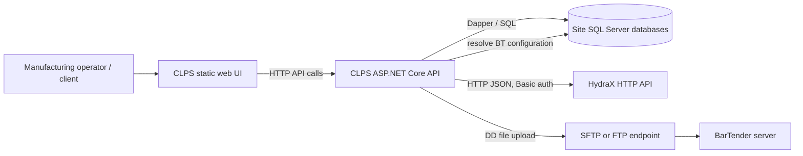
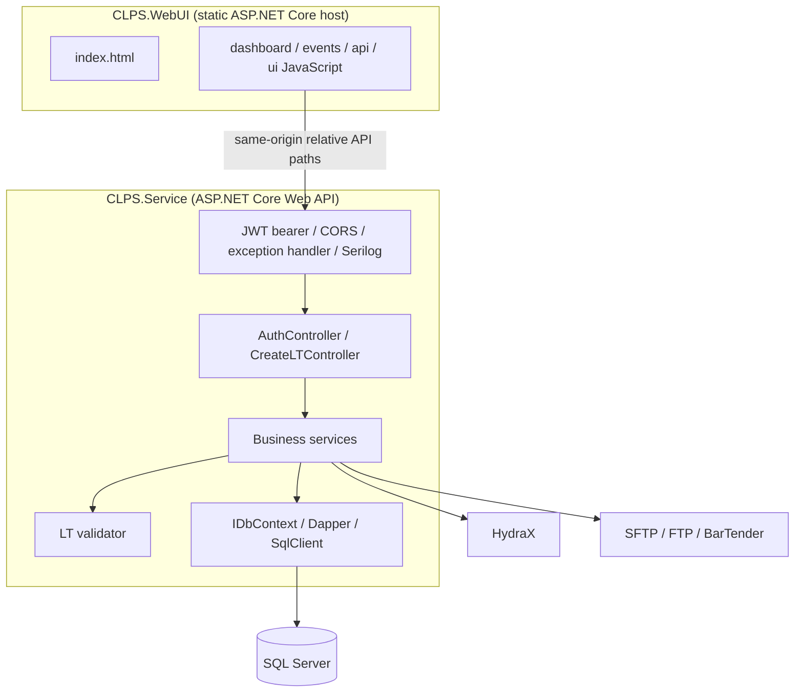
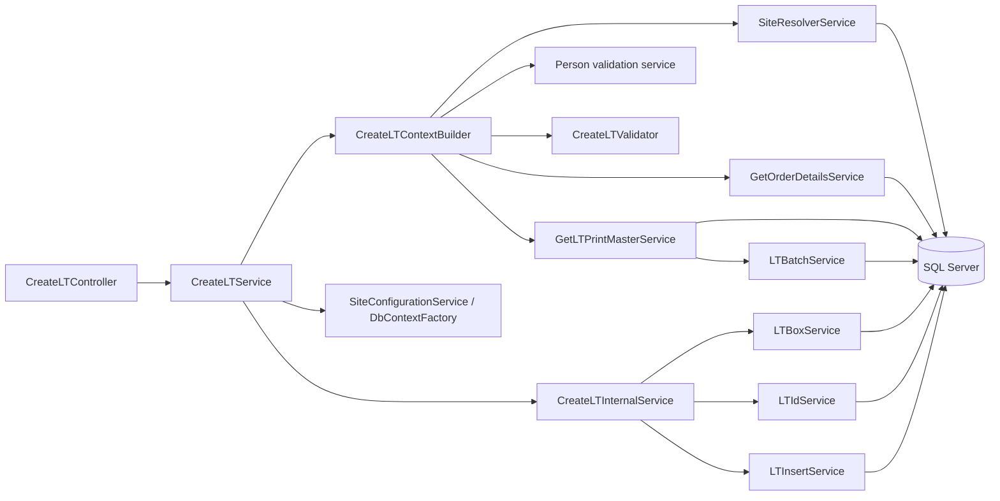
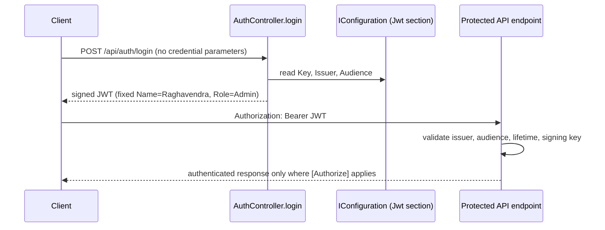
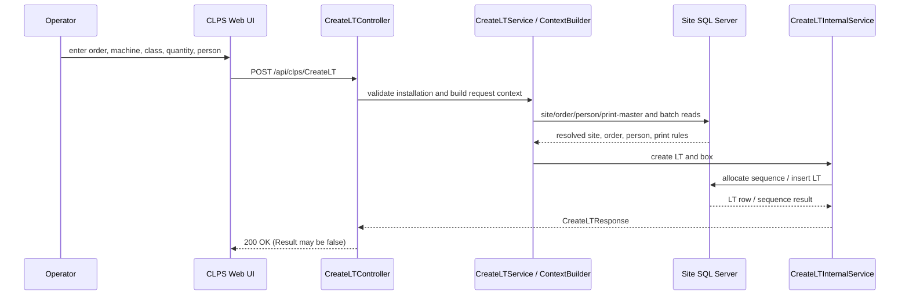
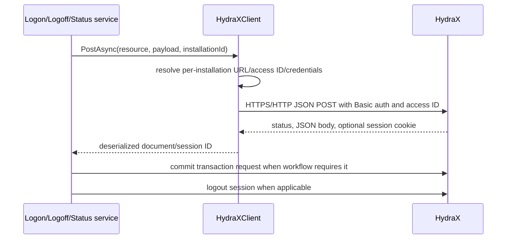
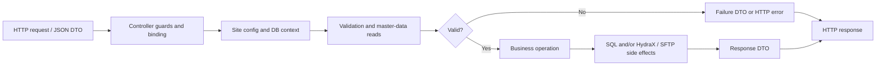
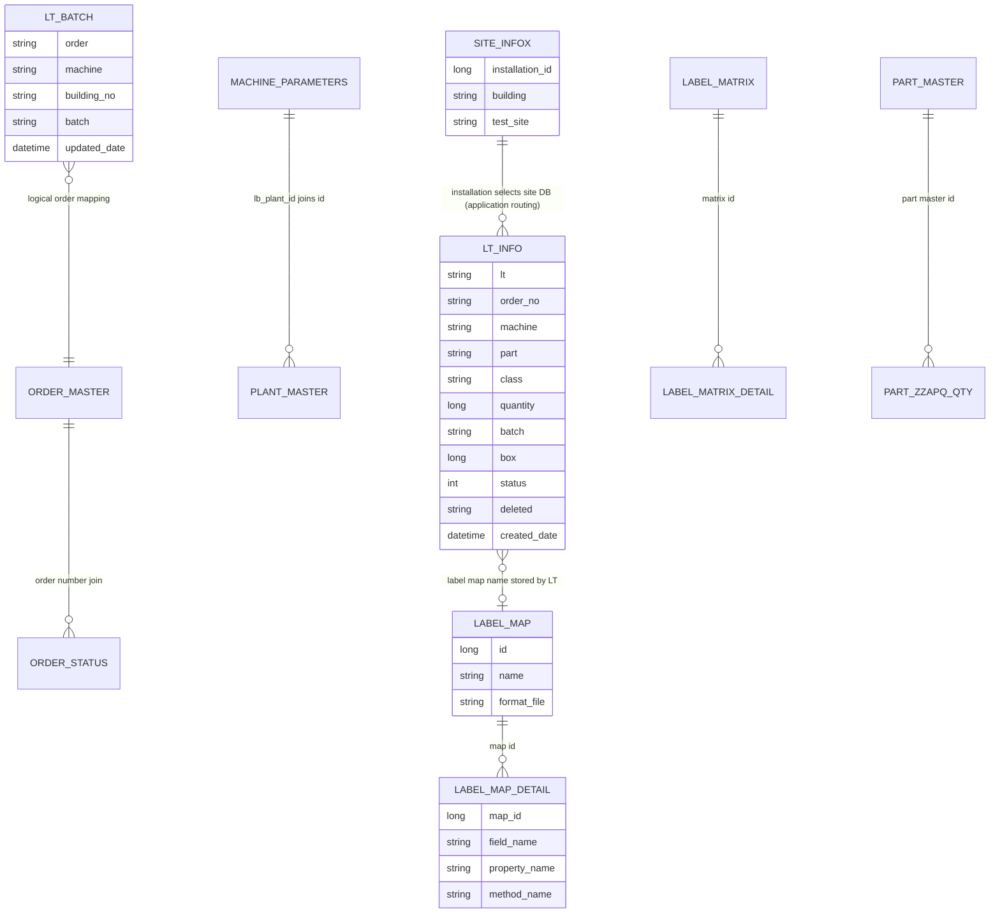

# CLPS Enterprise Architecture and Technical Analysis

**Evidence snapshot:** 2026-10-16  
**Scope:** the CLPS solution in `dotnet/CLPS` (service, static web host, and tests). This is a source review, not a database-server inspection, penetration test, or deployment-environment attestation. Neighboring repository product trees are not treated as CLPS components.

## Evidence conventions and scope limits

- **Confirmed** means directly visible in checked-in source, project files, or configuration.
- **Unknown** means source does not establish the answer; validate against the deployed database, environment, or operations documentation before relying on it.
- SQL names and joins below describe what application queries use. They do **not** prove physical primary keys, foreign keys, indexes, check constraints, or transaction isolation settings.
- `CLPS.Service/docs/Technical-Design.md` and other pre-existing documentation were not treated as authoritative where they conflict with executable source.
- No credential values are reproduced in this document. The checked-in service settings contain credential-like values and should be treated as exposed until rotated and moved to a managed secret source.

## 1. Executive Summary

### Purpose and business objectives

CLPS is a manufacturing label-tracking application. Its service creates Label Tracking (LT) identifiers and records, resolves plant/order/machine/label configuration, manages batch values, coordinates output-batch operations with HydraX, and generates/uploads BarTender print files. The browser UI is a static HTML/JavaScript application that calls the service API.

**Evidence:** the API and workflow names in [CreateLTController.cs](../Controllers/CreateLTController.cs), LT record insertion in [LTInsertService.cs](../Services/LTInsert/LTInsertService.cs), print orchestration in [PrintOutputBatchService.cs](../Services/PrintOutputBatch/PrintOutputBatchService.cs), and the static assets in [CLPS.WebUI/wwwroot](../../CLPS.WebUI/wwwroot).

### Target users and capabilities

The code supports manufacturing operators or client applications that need to:

| Capability | Source evidence |
|---|---|
| Resolve installation/site and machine plant context | `GetSiteInfo`, `SiteResolverService.ResolveSiteAsync`, `MipPlantResolverService.ResolveMipPlantAsync` |
| Validate machines and running orders | `MachineValidationService.ValidateMachineAsync`, `GetOrderDetailsService.GetOrderDetailsAsync`, `ValidateRunningOrderService.ValidateRunningOrderAsync` |
| Retrieve matching print master and create an LT | `GetLTPrintMasterService.GetLTPrintMasterAsync`, `CreateLTService.CreateLTAsync` |
| Resolve batches and track box numbers | `LTBatchService.ResolveBatchAsync`, `LTBoxService.GetLatestBoxAsync` |
| Log on/off output batches and associate materials | `LogonOutputBatchService.ExecuteAsync`, `LogoffOutputBatchService.ExecuteAsync`, `AssociateService.ExecuteAsync` |
| Generate label data and print | `CreateLabelDataService.CreateLabelDataAsync`, `PrintOutputBatchService.ExecuteAsync`, `PrintFileService.PrintFileAsync` |
| Retrieve LT data/lists and UI configuration | `GetLatestLTIdService`, `GetLTListService`, `IIniConfigurationService` implementations |

The repository does not define named user accounts, roles for manufacturing operators, or a production identity provider. The only implemented login endpoint issues a fixed demo identity; this is a security blocker, not evidence of a production user-management capability.

### High-level architecture

The solution is a small, layered ASP.NET Core application with two independently hostable web projects: a controller/service API and a static-file web host. It is not a microservice suite, event-driven system, CQRS design, or EF Core application. SQL Server is accessed with Dapper and `Microsoft.Data.SqlClient`; HydraX and BarTender/SFTP are external integrations.

### Confirmed top risks

1. **High — LT test/production marker is inverted at the call site.** `CreateLTInternalService` passes `ctx.IsTestSite` to `LTIdService.GenerateLTIDAsync`'s `isProduction` parameter. The ID generator uses `true` to select the production marker and `false` to select the test marker. This can create production-shaped IDs at test sites and test-shaped IDs at production sites. See [CreateLTInternalService.cs](../Services/CreateLT/Internal/CreateLTInternalService.cs) and [LTIdService.cs](../Services/LT/LTIdService.cs).
2. **High — LT creation is not one atomic database transaction.** The outer operation begins a transaction, but `LTInsertService.InsertLTAsync` opens and commits another transaction on a new connection. An outer failure can therefore leave a committed LT row while the enclosing operation reports failure. See [DbContextWrapper.cs](../Infrastructure/Database/DbContextWrapper.cs), [CreateLTInternalService.cs](../Services/CreateLT/Internal/CreateLTInternalService.cs), and [LTInsertService.cs](../Services/LTInsert/LTInsertService.cs).
3. **High — authentication is effectively not enforced for most operational routes.** Many endpoints are explicitly `[AllowAnonymous]`, the remaining endpoints have no authorization attributes, and `AuthController.login` accepts no credentials and mints an Admin JWT. See [Program.cs](../Program.cs), [AuthController.cs](../Controllers/AuthController.cs), and [CreateLTController.cs](../Controllers/CreateLTController.cs).
4. **High — hard-coded running-order filter.** `ValidateRunningOrderService` includes a fixed order-number predicate in its SQL, so the route does not validate arbitrary machine-running orders as its name suggests.
5. **High — embedded secrets and unencrypted integration configuration.** `appsettings.json` includes database and HydraX credential-like values; SQL connection creation explicitly sets `Encrypt = false`; sample HydraX endpoints use HTTP. See [appsettings.json](../appsettings.json) and [ConnectionFactory.cs](../Infrastructure/Database/ConnectionFactory.cs).
6. **Medium — in-memory locks/caches are not cluster-wide and are not site-scoped consistently.** The LT semaphore is static and process-wide; LT and box cache keys omit installation/database identity. See [CreateLTInternalService.cs](../Services/CreateLT/Internal/CreateLTInternalService.cs), [LTIdService.cs](../Services/LT/LTIdService.cs), and [LTBoxService.cs](../Services/Box/LTBoxService.cs).

## 2. High Level Design (HLD)

### Functional and data lifecycle overview

The main LT path obtains the site's SQL configuration, resolves site metadata and LT rules, confirms order/person/machine/print master, then generates an LT ID and writes an LT row. Later printing reads LT/label configuration, resolves printer and BarTender endpoint, builds data-file content, uploads it, and changes the LT status. Batch logon/logoff additionally call HydraX and may commit an external HydraX transaction.

The browser project contains static HTML, JavaScript, and CSS; its `Program.cs` only enables default/static files. It has no project reference to the API project and no server-side API proxy. Client/API endpoint mismatches are discussed in §5.

### Architecture style and rationale

| Style | Assessment | Evidence |
|---|---|---|
| Monolith / layered application | **Confirmed at service-project level.** One ASP.NET Core service hosts the controllers and business services, with infrastructure abstractions and models in the same project. | [CLPS.Service.csproj](../CLPS.Service.csproj), [Program.cs](../Program.cs) |
| N-tier | **Logical tiers are present** (static UI, API/service, SQL Server/external systems); independent deployment of each tier is possible, but deployment topology is unknown. | [CLPS.WebUI/Program.cs](../../CLPS.WebUI/Program.cs), [Program.cs](../Program.cs) |
| Clean / Hexagonal | **Not strict Clean Architecture/Hexagonal.** Interfaces exist around many services and DB access, but controller, domain/business logic, infrastructure, models, and composition root are co-located in the service project. | [Services](../Services), [Infrastructure](../Infrastructure), [Models](../Models) |
| Microservices | **Not evidenced.** No independently deployed domain services, service discovery, or service-to-service event contract appears in the CLPS solution. HydraX and SQL are dependencies, not CLPS microservices. | [CLPS.Service.sln](../CLPS.Service.sln) |
| Event-driven / CQRS | **Not evidenced.** Requests synchronously invoke service methods and database/external API operations; no message broker, event store, or distinct command/query model is present. | [CreateLTController.cs](../Controllers/CreateLTController.cs), [Program.cs](../Program.cs) |

### Context diagram



The operator and physical BarTender relationship are logical roles in the business flow. The code confirms the web UI, API calls, SQL Server access, HydraX calls, and file upload path; the actual network topology is unknown. Evidence: [CLPS.WebUI/Program.cs](../../CLPS.WebUI/Program.cs), [api.js](../../CLPS.WebUI/wwwroot/clps/js/api.js), [HydraXClient.cs](../Infrastructure/HydraX/HydraXClient.cs), and [SftpService.cs](../Services/SftpService/SftpService.cs).

### System architecture diagram



`api.js` uses relative `/api/clps/...` paths, but how UI and API are hosted under a common origin or reverse proxy is not declared in the solution.

### Component diagram



### Non-functional requirements observed

| Area | Confirmed implementation | Unknown or gap |
|---|---|---|
| Availability | Async ASP.NET Core and SQL access; retry wrappers exist in selected HydraX/printing flows. | No health/readiness probes, SLA, failover, or tested retry budget found. |
| Security | JWT bearer validation is configured; one endpoint has `[Authorize]`. | Most routes are anonymous; secret rotation and production identity are not shown. |
| Observability | Serilog console and daily rolling file sinks; structured logs in services. | No metrics, distributed tracing, alerting, log retention, or centralized sink is configured in source. |
| Performance | Several paired lookups run concurrently; in-memory caches exist for LT/box data. | No load-test evidence, execution plans, cache invalidation policy, or distributed cache. |
| Localization | Translation service/resources and 12 supported cultures configured. | Fallback/resource coverage and operational locale behavior are not assessed. |
| Data integrity | Parameterized Dapper query patterns and local SQL transactions are used in several services. | Physical constraints, isolation level, backups, and data reconciliation controls are unknown. |

## 3. Low Level Design (LLD)

### Solution and project inventory

The solution contains three projects, all targeting .NET 8:

| Project | Type | Responsibility | Dependencies |
|---|---|---|---|
| `CLPS.Service` | ASP.NET Core Web SDK, `net8.0` | REST API, manufacturing workflows, SQL access, HydraX and print-file integrations. | Dapper, SqlClient, JWT bearer, Serilog, SSH.NET packages. |
| `CLPS.WebUI` | ASP.NET Core Web SDK static-file host, `net8.0` | Serves `wwwroot` HTML/CSS/JavaScript; no backend API project reference. | Framework-shared ASP.NET Core only; no explicit package references. |
| `CLPS.Tests` | .NET test project, `net8.0` | Unit tests referencing the service project. | xUnit, Moq, Microsoft.NET.Test.Sdk, coverlet. |

Evidence: [CLPS.Service.sln](../CLPS.Service.sln), [CLPS.Service.csproj](../CLPS.Service.csproj), [CLPS.WebUI.csproj](../../CLPS.WebUI/CLPS.WebUI.csproj), and [CLPS.Tests.csproj](../../CLPS.Tests/CLPS.Tests.csproj).

### Folder hierarchy and major responsibilities

```text
dotnet/CLPS/
├── CLPS.Service/
│   ├── Controllers/          HTTP surface: AuthController, CreateLTController
│   ├── Services/             LT creation, validation, batch, print, site/order,
│   │                         HydraX, SFTP, lookup, localization workflows
│   ├── Infrastructure/
│   │   ├── Database/         site-specific connection/context wrappers
│   │   ├── HydraX/           HTTP client and per-site configuration
│   │   └── Transactions/     Hydra transaction action context
│   ├── Models/               request/response DTOs, contexts, entities
│   ├── Validators/           LT class/level/WIP validation
│   ├── Serialization/        System.Text.Json context/helpers
│   ├── Resources/            translation JSON resources
│   ├── Properties/           publish profiles, localization resource metadata
│   └── docs/                 existing design notes plus this analysis
├── CLPS.WebUI/
│   ├── wwwroot/              static UI, client scripts, styles, libraries
│   └── Properties/           publish profiles
└── CLPS.Tests/               xUnit tests and test helpers
```

### Service component catalogue

| Component area | Responsibility / key contracts | Dependencies and data flow |
|---|---|---|
| Controllers | `CreateLTController` dispatches site, order, LT, batch, print, and UI-config operations. `AuthController` issues a JWT. | Controller → service interface → implementation; route-level HTTP status mapping is inconsistent. |
| CreateLT | `ICreateLTService`, `ICreateLTContextBuilder`, `ICreateLTInternalService` separate input/site lookup, context assembly, and LT persistence/ID generation. | Uses site/order/person/validator/print master/batch/box/ID/insert services. See dedicated workflow below. |
| Batch / box / ID | `ILTBatchService`, `ILTBoxService`, `ILTIdService` resolve batch number, calculate box number, and generate LT ID. | Dapper plus SQL sequences and process-local static dictionaries. |
| Print master | `IGetLTPrintMasterService` selects a label-matrix match and detail, plant and part metadata, batch method, and label quantity. | Site SQL; calls `ILTBatchService.ResolveBatchAsync`. |
| Output batch / label generation | `IPrintOutputBatchService`, `ICreateLabelDataService`, `IPrintFileService` validate print eligibility, resolve printer/server, compose label data, upload `.dd`, then update status. | SQL, product/part-class/logo services, INI config, SFTP/FTP and BarTender. |
| HydraX batch operations | `ILogonOutputBatchService`, `ILogoffOutputBatchService`, `IAssociateService`, `IHydraXClient` coordinate material/session operations and external transaction commit. | HTTP JSON requests, per-installation HydraX settings, retry loops. |
| Site/machine/order/person | Resolvers and validation services map installation ID to DB and check site, machine, order status and operator/person. | Queries are issued through site-specific `IDbContext`. |
| Configuration/localization | `ISiteConfigurationService`, INI/Hydra configuration services, translation services. | JSON configuration, database/INI lookup, localized resource files. |
| Database infrastructure | `IDbContext`, `IDbContextFactory`, `IConnectionFactory`, `DbContextWrapper`. | `SqlConnection`, `SqlTransaction`, Dapper/direct commands. It is not EF Core. |

Dependency registration is in [Program.cs](../Program.cs); most business services are registered as scoped. No background service or hosted worker registration is present.

### LT Creation End-to-End Workflow Analysis

This describes the implementation path from `CreateLTController.CreateLT` through `CreateLTService.CreateLTAsync`, `CreateLTContextBuilder.BuildContextAsync`, and `CreateLTInternalService.CreateLTAsync`. The downstream collaborators are included where they affect validation, persistence, and failure semantics.

#### Sequence and decisions

```mermaid
sequenceDiagram
  autonumber
  participant Client
  participant C as CreateLTController
  participant S as CreateLTService
  participant SiteCfg as SiteConfigurationService / DbContextFactory
  participant B as CreateLTContextBuilder
  participant Site as SiteResolverService
  participant V as CreateLTValidator
  participant Order as GetOrderDetailsService
  participant Person as Person service
  participant PM as GetLTPrintMasterService
  participant Batch as LTBatchService
  participant I as CreateLTInternalService
  participant Box as LTBoxService
  participant ID as LTIdService
  participant Insert as LTInsertService
  participant DB as SQL Server

  Client->>C: POST /api/clps/CreateLT (CreateLTRequest)
  C->>C: null-body guard
  C->>S: CreateLTAsync(request)
  S->>S: null request + InstallationID guards
  S->>SiteCfg: resolve per-installation site config
  SiteCfg-->>S: site DB configuration or null
  S->>SiteCfg: create IDbContext
  S->>B: BuildContextAsync(request, dbContext)
  par Site metadata and LT input rules
    B->>Site: ResolveSiteAsync(InstallationID, dbContext)
    Site->>DB: select u_site_infox
    DB-->>Site: site/building/test-site metadata
    Site-->>B: SiteContext or null
  and Normalize and validate class/level/WIP
    B->>V: ValidateAsync(LtClass, Level, WipStage)
    V-->>B: normalized values or failure
  end
  B->>B: require valid site and normalized Level
  par Running order lookup and person validation
    B->>Order: GetOrderDetailsAsync(Order, Machine, dbContext)
    Order->>DB: query order status, machine, part, plant
    DB-->>Order: order details
    Order-->>B: running order / mismatch / error result
    B->>Person: ValidatePersonAsync(PersonId, dbContext)
    Person->>DB: person validation lookup
    DB-->>Person: person result
    Person-->>B: valid/invalid result
  end
  B->>PM: GetLTPrintMasterAsync(order, machine, part, class, level, WIP)
  PM->>DB: label matrix/detail, plant and part lookups
  PM->>Batch: ResolveBatchAsync(inputBatch="")
  Batch->>DB: SAP value or AUTO batch sequence/mapping
  PM-->>B: print master, batch, printer/map, label quantity
  B->>B: quantity=request positive value OR print-master positive value OR null->0
  B-->>S: CreateLTContext
  S->>I: CreateLTAsync(request, context)
  I->>I: acquire static process-wide semaphore
  I->>Box: GetLatestBoxAsync(order, class, dbContext)
  Box->>DB: latest LT box if process cache misses
  I->>DB: begin outer transaction; ensure/use LT sequence
  I->>ID: GenerateLTIDAsync(connection, transaction, prefix, building, ctx.IsTestSite)
  ID->>DB: sequence DDL/next value + last-LT lookup
  I->>Insert: InsertLTAsync(entity, null, dbContext)
  Note over Insert,DB: InsertLTAsync opens and commits a second connection/transaction.
  Insert->>DB: parameterized INSERT u_te_lb_lt_info
  I->>Box: IncrementBoxAsync (in-memory only)
  I->>ID: UpdateMemory (in-memory only, before outer commit)
  I->>DB: commit outer transaction
  I-->>S: success response / print-master data
  S-->>C: CreateLTResponse
  C-->>Client: HTTP 200 with Result/body
```

#### Stage-by-stage behavior

1. **HTTP boundary — `CreateLTController.CreateLT`.** The route is `POST /api/clps/CreateLT`; it is explicitly `[AllowAnonymous]`. A null body returns `400 BadRequest`; otherwise the controller calls `ICreateLTService.CreateLTAsync` and returns `200 Ok(result)` regardless of `result.Result`. Thus application-level validation failures are normally represented in the body, not as a failing HTTP status. Source: [CreateLTController.cs](../Controllers/CreateLTController.cs).
2. **Request/site guards — `CreateLTService.CreateLTAsync`.** It rejects null requests, requires `InstallationID`, gets the site-specific configuration, and creates an `IDbContext`. A missing configuration returns a failed `CreateLTResponse`. It then calls its internal path with no prebuilt dependencies. Source: [CreateLTService.cs](../Services/CreateLT/CreateLTService.cs).
3. **Context input checks — `CreateLTContextBuilder.ValidateRequest`.** The builder rejects null requests, requires installation ID unless a site is injected, and requires an order unless order info is injected. It runs site resolution and LT-rule validation concurrently with `Task.WhenAll`.
4. **LT rule validation — `CreateLTValidator.ValidateAsync`.** Blank class defaults to `3SI`; accepted values are `3SI`, `3S`, `4S`, case-normalized. Blank level defaults to `1`; allowed range is 1–3; `3SI` cannot exceed level 1. Blank WIP stage defaults to `FG`, and only `FG` is accepted. The builder also rejects invalid site or validation result and requires normalized `Level`.
5. **Order/person validation — `BuildContextAsync`.** It concurrently calls order lookup and person validation. `GetOrderDetailsService` requires an order, checks production indicator `L` and order status `L`, verifies a supplied machine matches the order machine, and requires a nonempty plant ID. A failed order/person result aborts context creation. `CreateLTController.ValidateMachine` is a separate endpoint; `BuildContextAsync` does **not** call `IMachineValidationService` directly. The order lookup still performs its own machine match and plant check.
6. **Print Master — `GetLTPrintMasterService.GetLTPrintMasterAsync`.** It resolves missing order part/tool and machine group/category, selects the highest-scoring label-matrix match and rejects ties, retrieves matching label-matrix detail, plant and part master data, and determines `LabelQuantity` from configured quantity modes (`ZZAPQ`, `PACKAGEUNIT`, `STDPACKAGE`, `CARTON`). It resolves batch using the detail's method. The context builder passes `Order`, resolved machine, installation, part, class, level, and WIP stage; it does not pass `CreateLTRequest.Batch`. In the current call path, a caller-supplied `Batch` therefore does not override the print-master batch. A failed batch lookup is converted to batch `"0"` while the print-master response can still be successful.
7. **Quantity selection.** Positive request quantity wins; otherwise positive print-master label quantity is used; otherwise `ResolveQuantity` returns null. The intended missing-quantity failure is commented out; the context receives `quantity.GetValueOrDefault()`, and LT creation persists quantity `0`. This is a silent fallback, not a confirmed business-approved default.
8. **Internal creation — `CreateLTInternalService.CreateLTAsync`.** It acquires one static `SemaphoreSlim` across all requests handled by the current process, gets the next box (cache-first; otherwise query last LT box by order and LT class), derives the LT prefix, and uses a UTC timestamp. The prefix helper maps `3S` and `3SI` to `3S`; it throws for all other class values. Consequently, although validation accepts `4S`, this path fails when `GetPrefix("4S")` is reached.
9. **ID generation and environment marker.** The internal service requires nonblank `PrintMaster.BuildingNo` and calls `LTIdService.GenerateLTIDAsync` with a SQL connection/transaction and `ctx.IsTestSite`. The callee names this argument `isProduction`: `true` produces the production digit and `false` produces `T` for test. `SiteResolverService` defines `IsTestSite` as true when the DB flag equals `"Y"`. The meanings are therefore reversed at the call boundary. LT ID generation creates/uses a per-building SQL sequence and combines prefix, alpha position, normalized building, environment position, and a seven-digit sequence; sequence consumption is not rolled back by SQL transaction rollback.
10. **LT row and box/cache update.** The row data includes building, order, machine, part, level, WIP stage, class, LT, quantity, batch, box, map, printer ID, status `1`, deleted flag `N`, person ID, and UTC creation timestamp. Dapper parameters are used for the `INSERT`. The insertion service validates nonnull LT, positive box, order/class/LT, then calls `context.ExecuteAsync` itself. Since `DbContextWrapper.ExecuteAsync` always opens its own connection and transaction, this insert commits separately from the outer transaction in the caller. Box increment and LT-ID cache update are in-memory and happen before the outer transaction commits.
11. **Success/error handling.** A false box result is returned as a failed internal result with print-master information. ID-generation failure is thrown as an exception by the caller; insert failures are wrapped and rethrown by `LTInsertService`; failures in the outer `DbContextWrapper` attempt rollback and rethrow. `CreateLTInternalService` releases the semaphore in `finally`, but does not broadly catch these exceptions. The global exception handler serializes exception message and stack trace. The outer SQL transaction and the independently committed insert do not form one atomic unit; the in-memory cache changes and SQL sequence values are also not rollback-aware.

#### Creation transaction boundaries and manufacturing traceability

| Operation | Resource / transaction | Atomic with LT insert? | Traceability consequence |
|---|---|---:|---|
| Site/order/person/print-master reads | One or more read wrappers, each opens a SQL transaction in `DbContextWrapper` | No | Configuration may change between preflight and insert; no isolation guarantee is visible. |
| LT ID SQL sequence access | Outer `ExecuteAsync` connection/transaction; DDL/sequence call | No, SQL sequence values are non-transactional | Gaps are expected after failures; do not treat sequence continuity as proof of missing records. |
| LT row INSERT | Nested `ExecuteAsync` from `LTInsertService` on a separate connection/transaction | **No** | Insert can commit even if outer operation later fails; response may not match durable state. |
| Box counter and LT cache | Static process memory, changed before outer commit | No | A failed commit can leave cache ahead; restart clears it; separate instances do not share it. |
| HydraX movement/status operations | Separate HTTP transactions in logon/logoff/print lifecycle | No | SQL and HydraX can diverge; reconciliation/idempotency is not demonstrated. |

The DB schema's unique constraints and duplicate-LT safeguards are not visible in the solution. Production traceability should be verified against actual DDL, and the create workflow should be tested under concurrent requests across multiple service instances.

### Batch, machine, site, and print lifecycle details

- **Batch.** `LTBatchService.ResolveBatchAsync` accepts a supplied batch only if `"0"` or 1–10 alphanumeric characters. Without an input batch, SAP mode reads `auftrags_bestand.user_c_56`; AUTO mode checks `u_te_lb_batch` for an order/machine/building mapping, creates/uses a building-specific sequence, and inserts a mapping. Errors are caught and returned with a failed response and batch `"0"`. During print-master resolution the batch error is swallowed into `"0"`; LT creation can continue with that value. Evidence: [LTBatchService.cs](../Services/Batch/LTBatchService.cs), [GetLTPrintMasterService.cs](../Services/LTPrintMaster/GetLTPrintMasterService.cs).
- **Machine.** `MachineValidationService` requires a row in `u_te_maschinen_parameters` with nonnull `lb_operating_mode`. It returns application-level failure messages on errors. The separate running-order validator also queries order state, but includes a hard-coded order number and should not be treated as generic machine/order validation. Evidence: [MachineValidationService.cs](../Services/Machine/MachineValidationService.cs), [ValidateRunningOrderService.cs](../Services/Order/ValidateRunningOrderService.cs).
- **Site.** `SiteConfigurationService` looks up a `Sites:{installationId}` settings section and builds a DB context. `SiteResolverService` queries `u_site_infox`, maps `test_site == "Y"` to `IsTestSite`, and returns building/application-server/site metadata. `MipPlantResolverService` joins machine parameters to plant master. Evidence: [SiteConfigurationService.cs](../Services/Configuration/SiteConfigurationService.cs), [SiteResolverService.cs](../Services/Site/SiteResolverService.cs), [MipPlantResolverService.cs](../Services/Site/MipPlantResolverService.cs).
- **Printing.** `CreatePrintLTService` executes logoff old LT → print old LT → logon new output batch, with configurable retry count. `PrintOutputBatchService` validates LT status/deleted flag and reprint eligibility, resolves printer, loads BT server and label data in parallel, writes/uploads a DD file, then updates status to PrintSuccess. Mid-flow failures attempt PrintError update. Material-comment failure is logged but does not fail the print. SQL status update and HydraX status update are separate operations. Evidence: [CreatePrintLTService.cs](../Services/CreatePrintLT/CreatePrintLTService.cs), [PrintOutputBatchService.cs](../Services/PrintOutputBatch/PrintOutputBatchService.cs), [LTStatusService.cs](../Services/LicenseTagStatus/LTStatusService%20.cs).

### Sequence diagrams

#### Authentication flow



JWT validation is configured, but the login endpoint does not authenticate a user and most operational endpoints permit anonymous access. Evidence: [AuthController.cs](../Controllers/AuthController.cs), [Program.cs](../Program.cs), [CreateLTController.cs](../Controllers/CreateLTController.cs).

#### Main business transaction flow



#### SQL transaction flow

```mermaid
sequenceDiagram
  participant Internal as CreateLTInternalService
  participant Wrapper as DbContextWrapper
  participant SQL as SQL Server
  participant Insert as LTInsertService
  Internal->>Wrapper: ExecuteAsync(action)
  Wrapper->>SQL: open connection A; begin tx A
  Internal->>SQL: generate/use LT sequence with tx A
  Internal->>Insert: InsertLTAsync(entity, dbContext)
  Insert->>Wrapper: ExecuteAsync(insert action)
  Wrapper->>SQL: open connection B; begin tx B
  Insert->>SQL: INSERT u_te_lb_lt_info on tx B
  SQL-->>Insert: one row affected
  Wrapper->>SQL: commit tx B
  Insert-->>Internal: inserted
  Internal->>Internal: update process caches
  Wrapper->>SQL: commit tx A
  Note over SQL: A failure after tx B commits cannot undo the LT row.
```

#### External API interaction flow (HydraX)



The configured protocol is taken from per-site settings; checked-in examples use `http://`, not TLS. `HydraXClient` does not call `EnsureSuccessStatusCode` for its logout call. See [HydraXClient.cs](../Infrastructure/HydraX/HydraXClient.cs).

### Request, processing, response data flow



## 4. Database Design

### Access model and schema evidence

`IDbContext` is a custom SQL wrapper, not an Entity Framework `DbContext`. `DbContextWrapper.ExecuteAsync` opens `SqlConnection`, starts a `SqlTransaction`, invokes the supplied callback, and commits or attempts rollback. Queries use Dapper or `SqlCommand`. There is no EF Core package, EF model configuration, or migration in the CLPS solution. The solution scan found no checked-in `.sql` DDL script; the only `.sln` file is `CLPS.Service.sln`.

Evidence: [IDbContext.cs](../Infrastructure/Database/IDbContext.cs), [DbContextWrapper.cs](../Infrastructure/Database/DbContextWrapper.cs), [CLPS.Service.csproj](../CLPS.Service.csproj).

### Tables and logical entities used by code

| Table/object name seen in source | Role and evidence | Key/constraint status |
|---|---|---|
| `u_te_lb_lt_info` | LT master/lifecycle row: insert, latest LT/box lookup, read and status update. Fields include LT, order, machine, part, class, quantity, batch, box, label map, status, deleted, person and timestamps. | Physical PK/FKs/indexes/uniqueness unknown. |
| `u_te_lb_batch` | AUTO batch mapping by order, machine, building, batch and update date. | Physical constraints unknown. |
| `u_te_lb_label_map`, `u_te_lb_label_map_detail` | Label map metadata and configured field/value/property/method definitions. | `map_id` join is used; constraint/index unknown. |
| `u_te_lb_label_matrix` and detail objects | Match part/tool/machine/group/category to LT class, level, WIP, label settings and methods. | Exact deployed schema/constraints unknown; SQL assembled in model helper methods. |
| `u_te_lb_part_master`, `u_te_lb_part_zzapq_qty` | Part package quantity, revision/RoHS and plant/class-specific standard quantity. | `part_master_id` relation used in query; constraints unknown. |
| `u_te_lb_plant_master`, `u_te_maschinen_parameters` | Machine-to-plant and plant/building/site mapping; activation and class-tab settings. | `lb_plant_id`/`id` join used; constraints unknown. |
| `u_site_infox` | Installation/site alias, building, application server and test-site flag. | `installation_id` lookup used; physical key unknown. |
| `auftrags_bestand`, `auftrag_status`, `maschinen`, `res_bestand` | Existing manufacturing/order/machine master data used for running-order, part/tool, machine group/category and SAP batch lookups. | External/legacy schema constraints unknown. |
| `sys.sequences` / generated SQL sequences | LT ID and AUTO batch number allocation; names are generated per building. | SQL Server sequences are not transactional and can have gaps. |

Examples: [LTInsertService.cs](../Services/LTInsert/LTInsertService.cs), [LTBatchService.cs](../Services/Batch/LTBatchService.cs), [GetLTPrintMasterService.cs](../Services/LTPrintMaster/GetLTPrintMasterService.cs), [GetOrderDetailsService.cs](../Services/Order/GetOrderDetailsService.cs), [SiteResolverService.cs](../Services/Site/SiteResolverService.cs).

### Entity relationship diagram (logical, inferred from SQL joins)



This diagram is **logical only**: application queries and DTOs establish the joins/data fields, not enforceable database relationships. LT map data is stored by a string map value in the LT entity, so the relationship drawn there is not a confirmed FK.

### Transaction, concurrency, and integrity findings

- `DbContextWrapper` starts a transaction even around read callbacks and silently suppresses rollback exceptions. There is no explicit isolation level or retry policy in this wrapper.
- `LTInsertService` starts its own transaction when called with a context; it has no API to accept the caller's existing connection/transaction. This creates the non-atomic LT creation behavior described above.
- SQL Server sequences are allocated using `NEXT VALUE FOR`; sequence gaps after a failed transaction are expected.
- `CreateLTInternalService._ltLock` serializes LT creation only within one process. There is no distributed lock or explicit application-level unique-constraint handling in the source.
- `LTIdService._lastLtCache` key is prefix + normalized building; `LTBoxService._boxCache` key is order + LT class. Neither key includes installation ID/database. Shared worker processes serving multiple sites can mix cached state when key values overlap.
- **Unknown:** physical PK/FK/index/unique constraints, transaction isolation, replication/failover, backup/restore, and database permissions. Validate against deployed SQL Server metadata and DBA-approved DDL.

## 5. API Specification

### API-wide behavior

- Service routes are in `CreateLTController` with `api/clps` prefix; login route is `api/auth/login`.
- Many actions return `BadRequest` for failed service results, but `CreateLT` returns HTTP 200 for any returned result and `GetUIConfig` returns HTTP 200 even for missing/invalid config.
- Authentication middleware validates JWT signature, issuer, audience and lifetime. Only `Associate` has `[Authorize]`; many endpoints have `[AllowAnonymous]`; endpoints without either attribute are also accessible because no fallback authorization policy is configured.
- No Swagger/OpenAPI registration or API versioning is present in `Program.cs`.

Evidence: [CreateLTController.cs](../Controllers/CreateLTController.cs), [AuthController.cs](../Controllers/AuthController.cs), [Program.cs](../Program.cs).

### Endpoints

| Verb and route | Controller action → service | Request → response | Validation / HTTP failure behavior | Authentication |
|---|---|---|---|---|
| `POST /api/auth/login` | `AuthController.login` → inline token creation | No credentials/body → `{ token }` | Requires configured JWT key; no actual user/password validation; 1-day token. | Anonymous by default |
| `POST /api/clps/CreateLT` | `CreateLTController.CreateLT` → `ICreateLTService.CreateLTAsync` | `CreateLTRequest` → `CreateLTResponse` | Null body returns 400. Service failure still returned as 200 with `Result=false`. Request/order/site/LT/person/Print Master validations in workflow section. | `[AllowAnonymous]` |
| `GET /api/clps/SiteInfo` | `GetSiteInfo` → site resolver; optional MIP resolver | Query `installationId`, optional `machine` → anonymous site/MIP object | ID <= 0 returns 400; missing site returns 404. | `[AllowAnonymous]` |
| `POST /api/clps/LogonOutputBatch` | `LogonOutputBatch` → `ILogonOutputBatchService.ExecuteAsync` | `LogonOutputBatchRequest` → `LogonOutputBatchResponse` | Null body/failed result return 400. Service validates and coordinates SQL/HydraX. | `[AllowAnonymous]` |
| `GET /api/clps/OrderDetails` | `GetOrderDetails` → `IGetOrderDetailsService.GetOrderDetailsAsync` | Query `orderOperation`, optional `machine` → `GetOrderDetailsResult` | Failed result returns 400; validates running state, optional machine match, plant. | `[AllowAnonymous]` |
| `POST /api/clps/LTPrintMaster` | `GetLTPrintMaster` → `IGetLTPrintMasterService.GetLTPrintMasterAsync` | `GetLTPrintMasterRequest` → `GetLTPrintMasterResult` | Failed result returns 400; requires order and machine, resolves configuration. | `[AllowAnonymous]` |
| `GET /api/clps/LTData` | `GetLTData` → `IGetLTDataService.GetLTDataAsync` | Query `lt`, `installationId` → `GetLTDataResponse` | Failed result returns 400. | `[AllowAnonymous]` |
| `POST /api/clps/LogoffOutputBatch` | `LogoffOutputBatch` → `ILogoffOutputBatchService.ExecuteAsync` | Query `lt`, `qty`, `installationId` → `LogoffOutputBatchResponse` | Failed result returns 400; validates and invokes HydraX movement/transaction. | `[AllowAnonymous]` |
| `POST /api/clps/GetLatestLTID` | `GetLatestLTId` → `IGetLatestLTIdService.GetLatestLTIdAsync` | `GetLatestLTIdRequest` → latest-LT result | Failed result returns 400. | `[AllowAnonymous]` |
| `POST /api/clps/GetLTList` | `GetLTList` → `IGetLTListService.GetLTListAsync` | `GetLTListRequest` → `GetLTListResult` | Failed result returns 400. | `[AllowAnonymous]` |
| `GET /api/clps/batch` | `GetBatch` → `ILTBatchService.ResolveBatchAsync` | Query `order`, `machine`, `buildingNo`, `batchMethod`, optional `inputBatch`, `installationId` → result/order/machine/batch/message | Returns 200 wrapper regardless of `Result`; service catches errors and returns batch `"0"`. | No attribute; anonymous by default |
| `POST /api/clps/CreateLabelData` | `CreateLabelData` → `ICreateLabelDataService.CreateLabelDataAsync` | `CreateLabelDataRequest` → `CreateLabelDataResult` | Null body/failed result return 400. | `[AllowAnonymous]` |
| `POST /api/clps/Associate` | `Associate` → `IAssociateService.ExecuteAsync` | `AssociateRequest` → `AssociateResponse` | Failed result returns 400; operation may update SQL and HydraX. | `[Authorize]` |
| `POST /api/clps/PrintOutputBatch` | `PrintOutputBatch` → `IPrintOutputBatchService.ExecuteAsync` | `PrintOutputBatchRequest` → `PrintOutputBatchResponse` | Failed result returns 400; print failure may also update LT error status. | `[AllowAnonymous]` |
| `POST /api/clps/CreatePrintLT` | `CreatePrintLT` → `ICreatePrintLTService.ExecuteAsync` | `CreatePrintLTRequest` → `CreatePrintLTResponse` | Null body/failed result return 400; service coordinates logoff → print → logon with retries and may represent partial success. | `[AllowAnonymous]` |
| `GET /api/clps/ValidateMachine` | `ValidateMachine` → `IMachineValidationService.ValidateMachineAsync` | Query `machine`, `installationId` → `MachineValidationResponse` | Failed result returns 400. | `[AllowAnonymous]` |
| `GET /api/clps/ValidateRunningOrder` | `ValidateRunningOrder` → `IValidateRunningOrderService.ValidateRunningOrderAsync` | Query `machine`, `installationId` → running-order response | Failed result returns 400; implementation SQL contains a hard-coded order filter. | `[AllowAnonymous]` |
| `GET /api/clps/GetClassTabs` | `GetClassTabs` → `IGetClassTabsService.GetClassTabsAsync` | Query `machine`, optional `installationID` → `GetClassTabsResult` | Blank machine/failed result return 400. | No attribute; anonymous by default |
| `GET /api/clps/GetUIConfig` | `GetUIConfig` → `IIniConfigurationService.GetValueAsync` | Query `installationId` → refresh interval/message object | Missing/invalid setting and exceptions return 200 with a 30-second fallback; seconds are clamped to minimum 10. Exception text is included in response. | No attribute; anonymous by default |
| `GET /api/clps/culture` | `Culture` → framework culture | No request DTO → current culture and UI culture | Returns 200. | No attribute; anonymous by default |
| `GET /api/clps/public` | `GetPublic` → reads `wwwroot/pages/welcome.html` | No DTO → HTML | Missing file returns 404. | `[AllowAnonymous]` |

Request and response class declarations are under [Models/Requests](../Models/Requests) and [Models/Responses](../Models/Responses). `[ApiController]` is applied to `CreateLTController`, but endpoint-specific route binding remains mixed (body DTOs and query parameters).

### UI-to-API contract discrepancy

The UI client includes requests for `/api/clps/PrintLT` and `/api/clps/ChangeOutputBatch` in [api.js](../../CLPS.WebUI/wwwroot/clps/js/api.js). No corresponding actions are declared in the scanned `CreateLTController` or `AuthController`. Their behavior therefore cannot be confirmed from the CLPS API source; check routing/reverse-proxy configuration or update the client/server contract.

## 6. Security Review

This is a source-based risk assessment, not an exploitability test. Findings are rated using the impact and reach apparent from the code; deployment exposure and compensating controls are unknown.

| Severity | Finding and evidence | Risk | Recommended mitigation |
|---|---|---|---|
| **Critical** | `AuthController.login` accepts no credentials, hard-codes an Admin user/role, and issues a 1-day JWT. | Anyone who can reach the route can mint an administrator token; role claims are not tied to verified identity. | Disable/remove demo login from production; use an approved identity provider, validate credentials/claims, use short-lived tokens, and rotate JWT signing key. |
| **High** | Most operational endpoints are `[AllowAnonymous]` or have no `[Authorize]`; only `Associate` is explicitly protected. JWT middleware does not imply authorization by itself. | Unauthenticated callers may create LTs, print, change batch status, or invoke integrations if API network access permits. | Add a global/fallback authorization policy; protect all state-changing and sensitive routes; apply policy/role/claim checks per operation. |
| **High** | `appsettings.json` contains credential-like values for SQL and HydraX; `ConnectionFactory` forces SQL `Encrypt=false`; sample HydraX base URLs use HTTP. | Credential disclosure, interception, replay, and lateral access to manufacturing databases/systems. | Rotate any exposed credentials; move secrets to a vault/environment injection; enforce TLS with certificate validation for SQL and HydraX; avoid committing environment secrets. |
| **High** | `UseCors("AllowAll")` permits any origin, header and method. | Cross-origin browser requests can reach the service; risk is compounded by anonymous mutating routes and any future cookie-based auth. | Use explicit trusted origins/methods/headers; retain no credentialed wildcard CORS; pair with endpoint authorization. |
| **High** | Global exception response includes raw exception message and stack trace; several service failures also concatenate exception messages into user-facing results. | Internal implementation details, SQL/server names, paths, or identifiers may be disclosed. | Return correlation ID and generic client errors; log full exceptions server-side with redaction; never serialize stack traces to clients. |
| **High** | LT-ID environment argument is inverted as described in the LT workflow. | Misclassified production/test traceability identifier; potential downstream label/ERP data correctness impact. | Correct the call contract and add production/test-specific integration tests plus a release gate. |
| **Medium** | `ValidateRunningOrderService` SQL has a fixed order number predicate. | Validation behavior may be bypassed or may reject valid orders, impairing manufacturing control. | Remove the debug predicate; bind all intended filters as parameters and test multiple orders. |
| **Medium** | `GetUIConfig` returns exception text in a successful HTTP 200 body. | Information leakage and confusing success semantics. | Return a stable fallback code/message; log diagnostic details privately. |
| **Medium** | `SftpService` accepts both SFTP and FTP schemes. | FTP can transmit credentials/files without transport encryption if configured. | Disallow FTP in production or enforce secure FTPS/SFTP policy; validate host keys and deployment endpoint configuration. |
| **Medium** | Static in-process caches/lock are not distributed and keys omit installation/database. | Cross-site ID/box cache contamination and multi-instance races can harm identifier uniqueness/traceability. | Scope keys by installation/database; use database uniqueness/sequence guarantees and distributed-safe coordination where required. |
| **Low / unverified** | SQL access mostly uses Dapper parameters; SQL identifiers for generated sequences are interpolated after building normalization or alphanumeric validation in the inspected flows. | No direct injection path was confirmed in these inspected queries, but a full threat test is not represented by source inspection. | Continue parameterizing values; validate/quote identifiers centrally; run security tests against all dynamic SQL. |
| **Unknown** | No Azure AD, ASP.NET Identity, Data Protection, certificate management, secret-store, or encryption-at-rest setup is visible in the CLPS source. | Controls may exist outside this repository but cannot be credited from source. | Verify infrastructure configuration and document ownership/evidence. |

XSS and CSRF cannot be conclusively assessed solely from the controller declarations. The UI uses JavaScript and the API accepts bearer tokens; no cookie authentication is configured in the inspected startup. This does not mitigate the anonymous operational endpoints.

## 7. Integration Analysis

| Integration | Purpose / protocol | Authentication/configuration | Failure behavior / operational concern |
|---|---|---|---|
| Site-specific SQL Server | Site/order/machine/label/batch/LT data access; SQL Server protocol via `Microsoft.Data.SqlClient` and Dapper. | `Sites:{installationId}` settings; SQL login or integrated security. | `DbContextWrapper` propagates action errors after rollback attempt; callers vary between failed DTO and thrown exception. SQL encryption is explicitly disabled in `ConnectionFactory`. |
| HydraX | Logon/logoff/material modification/status and transaction commit; HTTP JSON POST. | Per-installation BaseUrl, access ID, username/password; Basic auth header and session cookie. | Some services implement retries and transaction commit; `PostAsync` throws on non-success HTTP. Retry idempotency and compensation are not proven. Configured endpoint scheme may be HTTP. |
| BarTender print queue | Upload generated `.dd` label data file. | BarTender endpoint settings obtained through BT server/printer/configuration services; SFTP username/password. | `PrintFileService` retries upload based on INI settings and attempts temp-file cleanup. SFTP or plaintext FTP is supported by `SftpService`. |
| Product/part master | Resolve product data for generated labels; source uses `IProductMasterService` and site DB. | Site database/configuration. | Failure returned through label-data result; detailed service behavior depends on source and external DB contents. |
| Translation/INI configuration | Translate service messages and read site-level refresh/retry/print config. | Resources plus database/configuration services. | Defaults/fallbacks are caller-specific; `GetUIConfig` currently returns a default success-shaped response on errors. |
| File processing | Builds UTF-8 DD content in a temp path and uploads via SFTP/FTP. | Runtime temp directory and remote endpoint credentials. | Local file path cleanup is attempted after upload; failure/cleanup semantics should be exercised operationally. |

No message queue, event broker, cloud SDK, or separate external API client beyond HydraX is evident in the CLPS project. Exact authentication/authorization enforced by the remote systems is unknown.

## 8. Deployment Guide

### Hosting and deployment evidence

- `CLPS.Service` is an ASP.NET Core Web SDK application, targets `net8.0`, enables HTTPS redirection, serves static files, and maps controllers. `Program.cs` is the composition root; no `Startup.cs` is present.
- `CLPS.WebUI` is also an ASP.NET Core Web SDK application; its `Program.cs` only enables default files and static files, then runs.
- Folder publish profiles exist under `Properties/PublishProfiles`; the WebUI project declares `win-x64` runtime. These establish folder publishing configuration, not the deployed host.
- The CLPS solution scan found no Dockerfile, docker-compose file, Kubernetes manifest, checked-in pipeline YAML, or SQL migration/DDL script. No Azure/AWS/IIS production deployment configuration is confirmed.
- Service `appsettings.Development.json` only contains logging settings. Base `appsettings.json` contains environment-sensitive site/JWT/integration configuration. Production configuration and secret injection are not shown.

Evidence: [CLPS.Service.csproj](../CLPS.Service.csproj), [CLPS.WebUI.csproj](../../CLPS.WebUI/CLPS.WebUI.csproj), [CLPS.WebUI/Program.cs](../../CLPS.WebUI/Program.cs), [Properties/PublishProfiles](../Properties/PublishProfiles), [CLPS.WebUI/Properties/PublishProfiles](../../CLPS.WebUI/Properties/PublishProfiles).

### Local build/run baseline

From `dotnet/CLPS`:

```powershell
dotnet build .\CLPS.Service\CLPS.Service.sln
dotnet test .\CLPS.Service\CLPS.Service.sln
dotnet run --project .\CLPS.Service\CLPS.Service.csproj
dotnet run --project .\CLPS.WebUI\CLPS.WebUI.csproj
```

The API needs valid per-site SQL configuration and JWT settings. The web UI uses relative `/api/clps/...` paths, so separate local ports require a same-origin proxy or client configuration; no proxy is declared in the solution. Do not use checked-in example credentials in a deployed environment.

### Environment matrix

| Environment | Evidence in solution | Operational conclusion |
|---|---|---|
| Development | `appsettings.Development.json` contains log levels; launch settings exist. | Site credentials/addresses are still in base config; isolate local/test data and use secrets outside source. |
| Test | `SiteContext.IsTestSite` and site `test_site` flag influence ID generation. | Current argument inversion must be fixed and verified before relying on site test/production distinction. |
| UAT | No UAT-specific config/deployment manifest found. | Unknown; establish environment-specific secrets and SQL/Hydra endpoints. |
| Production | No production profile or deployment manifest found. | Unknown; require identity enforcement, TLS, secret management, health/monitoring, backup/restore, and deployment rollback evidence. |

## 9. Technical Debt Assessment

### Register

| ID | Priority | Debt / evidence | Impact | Recommended action |
|---|---|---|---|---|
| TD-01 | Critical | Demo login issues fixed Admin JWT; most APIs anonymous. | Unauthorized manufacturing data changes and print/ERP operations. | Replace with verified identity and deny-by-default endpoint authorization before production exposure. |
| TD-02 | High | `ctx.IsTestSite` passed to parameter `isProduction`; the callee uses the opposite meaning. | Test/production LT identifier semantics are reversed. | Correct naming/call, add tests for both flags and representative site data. |
| TD-03 | High | LT insert runs a nested transaction on a separate connection from sequence allocation. | Partial commit and ambiguous response/data states. | Pass the caller's `SqlConnection`/`SqlTransaction` to insert or define an explicit outbox/compensation strategy. |
| TD-04 | High | Static caches/lock are process-local; cache keys omit site identity. | Multi-instance concurrency and cross-installation state collision. | Use DB-side uniqueness/atomic allocation, site-scoped keys, cache invalidation and cluster tests. |
| TD-05 | High | `ValidateRunningOrderService` includes an order literal in SQL. | Generic validation contract is false; machine/order logic can be incorrect. | Remove debug filter and add tests for distinct orders. |
| TD-06 | High | `CreateLTValidator` accepts `4S`, but internal prefix generation throws for `4S`. | Validated request later fails unexpectedly. | Align validator and generation support; use one source of accepted class values. |
| TD-07 | Medium | Missing quantity falls through to `GetValueOrDefault()` and is stored as zero. | Incorrect quantity undermines material and label traceability. | Reject missing/invalid quantity or formally define a domain-approved quantity source. |
| TD-08 | Medium | Print-master batch failure becomes `"0"` and LT creation continues; request `Batch` is not passed to print master. | LT may be recorded without the expected batch or with a placeholder. | Make fallback policy explicit; validate batch before LT commit; wire or remove request Batch contract. |
| TD-09 | High | Error handler returns exception message and stack trace; varied controller status semantics. | Information disclosure and unreliable client retries/monitoring. | Standardize ProblemDetails/error codes, status codes and correlation IDs. |
| TD-10 | High | Checked-in config contains credential-like material; SQL encryption disabled; Hydra examples use HTTP. | Secret disclosure and transport interception. | Rotate, externalize secrets, force TLS and validate certificates. |
| TD-11 | Medium | No checked-in migrations/DDL; entity DTOs are not an authoritative schema contract. | Deployments can silently drift from app assumptions. | Version schema migrations and add schema compatibility checks. |
| TD-12 | Medium | Unit-test methods in several test files are commented out; only three active `[Fact]` declarations were found in `LTBoxServiceTests.cs`. | High-risk flows (ID, create LT, print, HydraX) have no active automated test coverage visible in source. | Re-enable/replace tests; add DB/Hydra contract and concurrent-create integration tests. |
| TD-13 | Medium | API client refers to `PrintLT` and `ChangeOutputBatch`, but no matching controller actions were found. | UI actions can fail at runtime unless external routing exists. | Reconcile generated/hand-maintained API contracts and add endpoint smoke tests. |
| TD-14 | Medium | Broad exception catches and message-shaped failure DTOs coexist with thrown exceptions and HTTP 200 fallbacks. | Operational observability and safe retries are inconsistent. | Use consistent typed errors and centralized logging/response handling. |
| TD-15 | Low | `TransactionContext` stores synchronous `Action` callbacks, but no call sites were found in the inspected workflow. | Dead/unclear transaction abstraction can mislead maintainers. | Remove if obsolete or integrate with a documented transaction coordinator. |

### SOLID and maintainability observations

- The code does use interface-backed services and constructor injection, which supports test seams.
- `CreateLTController` has a large constructor and routes many distinct workflows through one controller, increasing change coupling.
- `CreateLTContextBuilder` receives `ILTBatchService` but does not use the injected field; batch resolution is performed by Print Master service instead.
- `CreatePrintLTService` and other services hold mutable per-operation fields (for example `installationId`); they are registered scoped, but reentrancy and parallel calls within a scope are not established.
- Database table names and SQL are distributed across feature services; no central schema/migration layer is present.
- No complexity analyzer or static-analysis policy is evident from the project files.

### Performance and scalability

**Hot paths:** `CreateLT` performs site, order, person, print-master/matrix, plant/part and batch lookups before sequence/insert; print generation performs LT retrieval, printer/BT resolution and label-data generation before remote upload. Some independent reads run in parallel (`Task.WhenAll` in context builder and print workflow), which limits serial latency.

**Risks inferred directly from code:**

- All LT creations in one process wait on a global static semaphore, even across distinct sites/orders; this limits throughput and creates queueing under bursts.
- Each `DbContextWrapper.ExecuteAsync` creates a new SQL connection and transaction. Nested wrapper use means at least two connections for LT insert.
- Several cache keys omit site identity; cache misses trigger DB reads, but no TTL/eviction/invalidation policy is visible.
- `SELECT TOP 1 ... ORDER BY created_date DESC` lookups may need workload-appropriate indexes; no DDL/query plan evidence exists to confirm or reject this.
- Printing writes a local temp file and performs synchronous-size file generation before SFTP transfer; maximum label payload and memory limits are unspecified.
- HydraX retries wrap operations that can have external side effects; without idempotency keys, retries may duplicate operations.

**Recommendations:** instrument SQL and end-to-end latency; capture production query plans; remove the process-wide critical section by relying on database-safe allocation; batch or combine redundant read transactions; scope/cache with explicit expiration; bound payload sizes and remote retry timeouts; validate idempotency before retrying mutations.

## 10. Production Readiness Assessment

Scores are source-based readiness ratings, not measured service-level performance. **10 means strong demonstrated readiness.**

| Dimension | Score / 10 | Rationale |
|---|---:|---|
| Reliability | 4 | Async access and selected retries exist, but transaction split, silent fallback values, mixed exception behavior, and unverified compensation weaken correctness. |
| Scalability | 3 | Static global semaphore serializes LT operations per process; no distributed coordination, load tests, or horizontal scaling design shown. |
| Security | 1 | Demo Admin token issuance, mostly anonymous operational API, wildcard CORS, credential-like config, SQL encryption disabled, and stack-trace disclosure are production blockers. |
| Maintainability | 4 | Interface seams and feature folders help, but large controller/services, duplicated SQL/config patterns, missing schema migrations, commented tests and contract drift raise risk. |
| Observability | 3 | Serilog structured console/file logging is present; health checks, metrics, tracing, alert routing and log lifecycle are not found. |
| Monitoring / alerting | 1 | No monitoring or alert rules are specified in the solution. |
| Disaster recovery | 1 | Database backups, restore tests, RPO/RTO, HydraX recovery and print-queue reconciliation are unknown. |
| Manufacturing traceability | 3 | LT records capture key fields, but environment marker inversion, batch/quantity fallbacks and non-atomic writes threaten data correctness. |

### Readiness gate

**Do not treat the inspected source as production-ready without evidence of remediation.** Minimum release blockers: replace demo auth, protect all operational routes, rotate/externalize secrets, enable TLS, correct test/production LT marker, make LT persistence atomic, remove hard-coded order predicate, and demonstrate active tests for concurrent LT creation and failure recovery.

## 11. Recommendations

### Immediate actions (0–30 days)

1. Remove/disable the dummy JWT login in all non-development environments; integrate an approved identity provider and apply deny-by-default authorization.
2. Rotate database/HydraX credentials that appear in tracked settings; move secrets to a managed provider and enforce SQL/HydraX TLS.
3. Fix and test the `IsTestSite`/`isProduction` argument contract and align `4S` validation with ID generation.
4. Remove the hard-coded order filter from running-order SQL.
5. Make LT insertion participate in the same SQL transaction as ID allocation, or provide a reviewed compensating workflow.
6. Reject missing quantity and failed batch resolution unless a documented, approved business rule explicitly permits fallback values.
7. Replace stack-trace/error-message responses with safe error contracts and correlation IDs; restrict CORS to the actual UI origin.
8. Re-enable/add active tests for CreateLT validation, production/test ID generation, batch selection, transaction rollback, and concurrent requests.

### Short-term improvements (1–3 months)

1. Add database migrations/schema verification for LT, batch, label-map and plant data; confirm PK/FK/unique/index definitions with DBAs.
2. Scope all caches by installation/database, define expiry/invalidation, and remove reliance on process-local locking for correctness.
3. Define idempotency and reconciliation for HydraX mutations and BarTender uploads; ensure retries cannot duplicate production movements/prints.
4. Add health/readiness endpoints, metrics, tracing, structured error codes, centralized logs and operational alerts.
5. Reconcile UI API client routes with server actions; publish an OpenAPI contract and add route smoke tests.
6. Add integration tests against representative SQL schema and a HydraX test endpoint; document test data and cleanup.

### Medium-term improvements (3–6 months)

1. Separate controller/API contracts, application workflows and infrastructure implementations into independently testable projects with a clearly enforced dependency direction.
2. Establish deployment pipelines and environment-specific configuration, database migration gates, release approvals and rollback strategy.
3. Add load/concurrency tests for LT generation, batch allocation, DB pool behavior, and print throughput.
4. Baseline SQL execution plans and add evidence-backed indexes; reduce connection churn and read transaction overhead.
5. Define retention, backup/restore, RPO/RTO, and reconciliation processes covering SQL, HydraX, and remote print queues.

### Long-term modernization roadmap

1. Establish a domain model for LT lifecycle transitions and enforce legal status changes centrally.
2. Replace ambient static in-memory state with durable, site-scoped concurrency mechanisms and idempotent commands.
3. Use an outbox/reconciliation pattern if SQL and HydraX must maintain eventual consistency; do not imply distributed atomicity where none exists.
4. Modernize identity/authorization, certificate and secret management, observability, and deployment as platform capabilities shared across environments.
5. Version the API and generate clients from OpenAPI; retain manufacturing traceability metadata and audit events according to business/regulatory requirements.

## Appendix A — Technology and NuGet inventory

### Platform

| Concern | Confirmed technology |
|---|---|
| Target framework | .NET 8 (`net8.0`) for all three projects. |
| ASP.NET Core | Web SDK / ASP.NET Core 8 application model; exact installed runtime patch is deployment-dependent. |
| C# | Project does not pin `LangVersion`; .NET 8 SDK defaults to C# 12. |
| Data access | Dapper 2.1.72 and Microsoft.Data.SqlClient 7.0.1; no EF Core. |
| Database | Microsoft SQL Server. |
| Logging | Serilog 4.3.1, ASP.NET Core integration and console/file sinks. |
| Authentication | Microsoft JWT bearer middleware and `System.IdentityModel.Tokens.Jwt`; no Identity/Azure AD integration evidenced. |
| Caching | `ConcurrentDictionary` static in-process caches; no distributed cache configuration. |
| External/API | `IHttpClientFactory`/`HttpClient` for HydraX, JSON via `System.Text.Json`. |
| File transfer | SSH.NET 2025.1.0 and Renci.SshNet.Async 1.4.0; implementation also permits FTP. |
| API framework | ASP.NET Core MVC controllers; no OpenAPI/Swagger package found. |
| ORM | None. |

### Direct package references

| Project | Direct package references (version) |
|---|---|
| `CLPS.Service` | Dapper (2.1.72); Microsoft.AspNetCore.Authentication.JwtBearer (8.0.0); Microsoft.Data.SqlClient (7.0.1); Microsoft.Extensions.Configuration.Binder (8.0.0); Renci.SshNet.Async (1.4.0); Serilog (4.3.1); Serilog.AspNetCore (8.0.0); Serilog.Extensions.Logging (10.0.0); Serilog.Sinks.Console (6.1.1); Serilog.Sinks.File (7.0.0); SSH.NET (2025.1.0). |
| `CLPS.Tests` | coverlet.collector (6.0.0); Microsoft.NET.Test.Sdk (17.8.0); Moq (4.20.72); xunit (2.5.3); xunit.runner.visualstudio (2.5.3). |
| `CLPS.WebUI` | No explicit package references. |

The projects also contain explicit assembly references under local `dll` paths; these are build references rather than additional `<PackageReference>` entries. Resolved/transitive package assets are recorded in the service/test `packages.lock.json` files.

## Appendix B — Verification and unknowns

### Repository verification performed

- Inspected the complete CLPS solution/project manifests, API controllers, service registrations, key LT/batch/order/machine/site/print services, SQL wrapper, configuration, static UI assets, and test source.
- Searched the CLPS solution tree for SQL scripts, EF/migration declarations, Docker/Kubernetes manifests, and pipeline YAML. None were found outside generated/build artifacts; the solution contains one `.sln`.
- The test source contains only three active `[Fact]` declarations, all in `LTBoxServiceTests.cs`; numerous test methods in other files are commented out. A test run should be recorded separately from source-coverage claims.

### Important unknowns (not inferred)

- Actual SQL Server schemas, constraints, indexes, isolation/locking, permissions, encryption-at-rest, HA, backup and restore behavior.
- Production appsettings/secret-provider overlays, TLS termination, reverse proxy, allowed UI origins, deployment platform, firewall/network segmentation and endpoint exposure.
- HydraX-side authentication policy, transaction idempotency, API rate limits and recovery semantics.
- BarTender server acknowledgement semantics, printer-side duplicate handling, FTP/SFTP host-key policy and remote retention.
- User roles and manufacturing authorization policy; no business approval requirements are encoded in the scanned service.
- Regulatory/retention requirements for traceability records and audit history.

