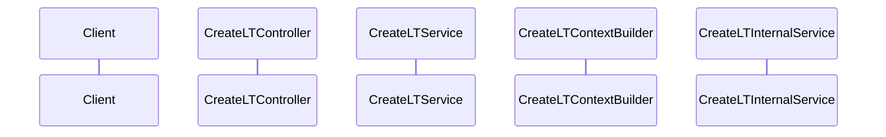

# CLPS Enterprise Architecture & Repository Analysis Document

> **IMPORTANT ANALYSIS CONSTRAINT**
>
> - Do NOT make assumptions.
> - Every statement must be supported by source code evidence.
> - Clearly distinguish Confirmed Findings, Unknowns, and Assumptions Avoided.
> - For every finding provide: File Name, Class Name, Method Name, and Source Code Evidence.

---

# SECTION 1 - EXECUTIVE SUMMARY

## Application Purpose

## Business Objectives

## Target Users

## Business Capabilities

## Key Workflows

## High-Level Architecture Summary

---

# SECTION 2 - SYSTEM OVERVIEW

## Functional Overview

## Major Modules

## User Interactions

## Data Lifecycle

## Non-Functional Requirements Discovered

---

# SECTION 3 - HIGH LEVEL DESIGN (HLD)

## Architecture Style Assessment

Evaluate:

- Monolithic
- Layered
- N-Tier
- Clean Architecture
- Hexagonal Architecture
- Microservices
- Event Driven
- CQRS

### Evidence-Based Conclusion

## Context Diagram

```mermaid
flowchart TD
```

## System Architecture Diagram

```mermaid
flowchart TD
```

## Component Diagram

```mermaid
flowchart TD
```

---

# SECTION 4 - SOLUTION STRUCTURE

## Solution Overview

### Projects

| Project | Type | Responsibility | Dependencies |
|----------|----------|----------|----------|

### Folder Hierarchy

```text
Solution
```

### Major Folder Analysis

| Folder | Purpose | Key Classes |
|----------|----------|----------|

---

# SECTION 5 - TECHNOLOGY STACK

## Platform

- .NET Version
- ASP.NET Core Version
- C# Version

## Data Access

- ORM
- Database
- Connection Strategy

## Application Services

- Logging Frameworks
- Caching Technologies
- Authentication Frameworks
- Authorization Frameworks
- API Frameworks

## NuGet Package Inventory

| Package | Version | Purpose |
|----------|----------|----------|

---

# SECTION 6 - LOW LEVEL DESIGN (LLD)

## Component Analysis

For each component document:

- Responsibility
- Interfaces
- Implementations
- Dependencies
- Public Methods
- Data Flow

## Dependency Diagrams

```mermaid
graph TD
```

---

# SECTION 7 - DATABASE DESIGN

## Database Architecture

### DbContexts

### Entities

### Tables

### Views

### Stored Procedures

### Migrations

## Constraints

- Primary Keys
- Foreign Keys
- Unique Constraints
- Indexes

## Mermaid ER Diagram

```mermaid
erDiagram
```

---

# SECTION 8 - API DOCUMENTATION

## API Inventory

| Route | Verb | Controller | Service | Request | Response |
|---------|---------|---------|---------|---------|---------|

### Endpoint Details

#### Route

- HTTP Verb
- Controller
- Service Called
- Request Model
- Response Model
- Validation
- Authentication
- Authorization
- Error Handling

---

# SECTION 9 - BUSINESS LOGIC ANALYSIS

## Business Rules

## Validation Rules

## Decision Points

## Manufacturing Logic

## Processing Rules

## Source Code References

---

# LT Creation End-to-End Workflow Analysis

## Workflow Scope

Analyze the exact execution path:

```text
CreateLTController
    -> CreateLTService
        -> CreateLTContextBuilder
            -> CreateLTInternalService
```

## Request Flow

### Step 1 - Controller Entry

### Step 2 - CreateLTService Execution

### Step 3 - Site Configuration Resolution

### Step 4 - DB Context Creation

### Step 5 - CreateLTContextBuilder Execution

#### Request Validation

#### Site Resolution Workflow

#### Order Validation Workflow

#### Machine Validation Workflow

#### Person Validation Workflow

#### Print Master Retrieval Workflow

#### Quantity Resolution Workflow

### Step 6 - CreateLTInternalService Execution

#### LT Generation Lifecycle

#### Batch Management Lifecycle

#### Box Allocation Lifecycle

#### Label Printing Workflow

#### Manufacturing Traceability Data Population

### Database Transaction Boundaries

### Concurrency Control Mechanisms

### Error Handling Flow

### Success Response Flow

## Sequence Diagram



## Confirmed Findings

## Risks

## Unknowns

---

# SECTION 10 - SECURITY REVIEW

## Authentication Analysis

## Authorization Analysis

## JWT Usage

## Azure AD / Identity Integration

## Secrets Management

## Data Protection

## Vulnerability Assessment

### SQL Injection

### Cross Site Scripting (XSS)

### CSRF

### Broken Authentication

### Sensitive Data Exposure

### Privilege Escalation

## Risk Register

| Finding | Severity | Evidence | Recommendation |
|----------|----------|----------|----------|

---

# SECTION 11 - INTEGRATION ANALYSIS

## External Systems

| Integration | Purpose | Protocol | Authentication | Failure Handling |
|-------------|----------|----------|----------------|------------------|

---

# SECTION 12 - LOGGING AND ERROR HANDLING

## Logging Framework

## Log Levels

## Exception Handling Strategy

## Global Exception Middleware

## Retry Mechanisms

## Resilience Patterns

---

# SECTION 13 - SEQUENCE DIAGRAMS

## 1. User Authentication Flow

```mermaid
sequenceDiagram
```

## 2. Main Business Transaction Flow

```mermaid
sequenceDiagram
```

## 3. Database Transaction Flow

```mermaid
sequenceDiagram
```

## 4. External API Interaction Flow

```mermaid
sequenceDiagram
```

---

# SECTION 14 - DATA FLOW DIAGRAMS

## Request Flow

```mermaid
flowchart TD
```

## Processing Flow

```mermaid
flowchart TD
```

## Response Flow

```mermaid
flowchart TD
```

---

# SECTION 15 - DEPLOYMENT ARCHITECTURE

## Hosting Model

- IIS
- Docker
- Kubernetes
- Azure
- AWS

## Deployment Diagram

```mermaid
flowchart TD
```

## Environment Analysis

### Development

### Test

### UAT

### Production

---

# SECTION 16 - PERFORMANCE ANALYSIS

## Hot Paths

## Database Bottlenecks

## Memory Concerns

## N+1 Query Risks

## Lock Contention

## Concurrency Issues

## Caching Opportunities

## Optimization Recommendations

---

# SECTION 17 - TECHNICAL DEBT ASSESSMENT

## Code Smells

## High Complexity Methods

## Tight Coupling

## Duplication

## SOLID Violations

## Maintainability Risks

## Technical Debt Register

| ID | Finding | Impact | Priority | Recommendation |
|----|----------|----------|----------|---------------|

---

# SECTION 18 - PRODUCTION READINESS REVIEW

| Area | Score (/10) | Evidence | Notes |
|--------|--------|--------|--------|
| Reliability | | | |
| Scalability | | | |
| Security | | | |
| Maintainability | | | |
| Observability | | | |
| Monitoring | | | |
| Alerting | | | |
| Disaster Recovery | | | |

---

# SECTION 19 - RECOMMENDATIONS

## Immediate Actions (0–30 Days)

## Short-Term Improvements (1–3 Months)

## Medium-Term Improvements (3–6 Months)

## Long-Term Modernization Roadmap

---

# APPENDICES

## Confirmed Findings

## Unknowns

## Assumptions Avoided

## Source Code Evidence Index
