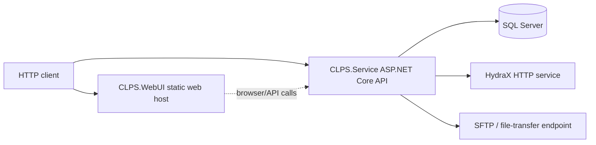
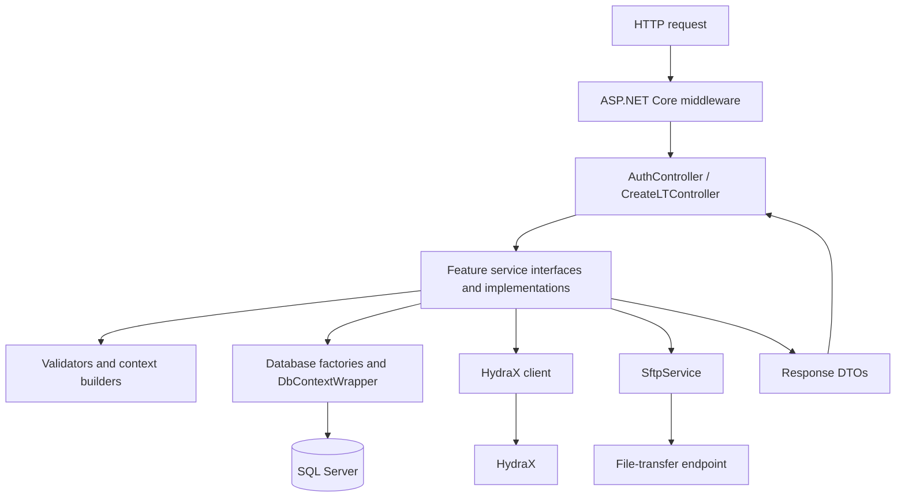
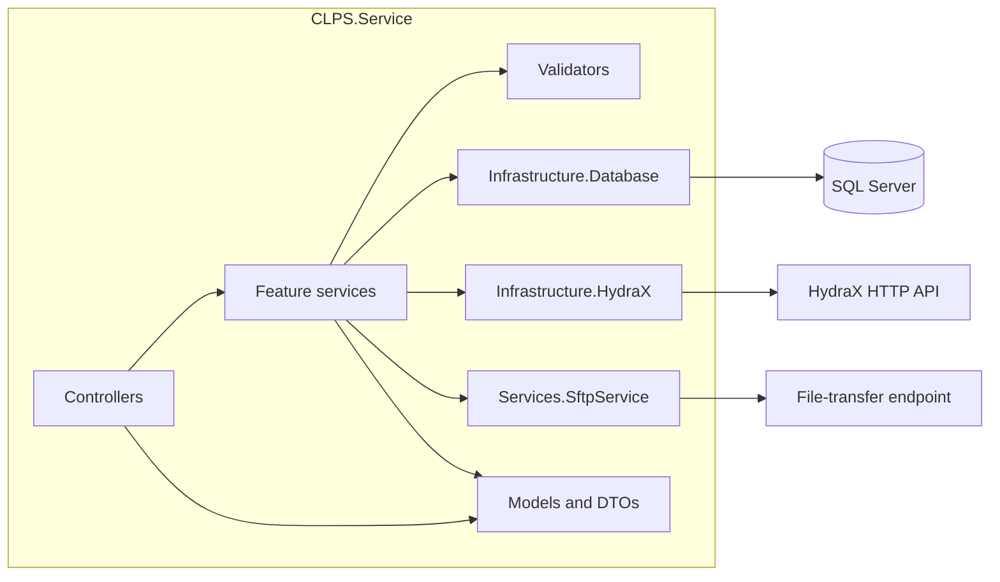
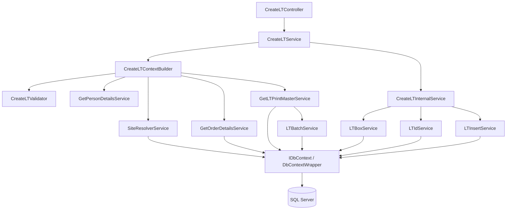
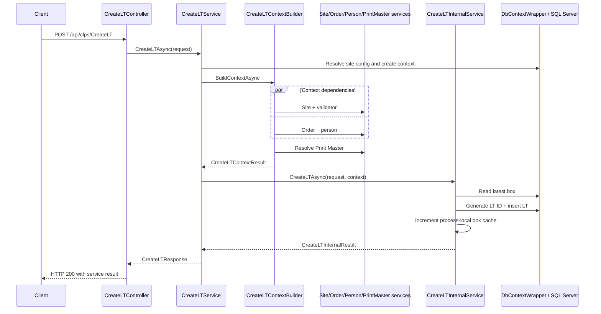
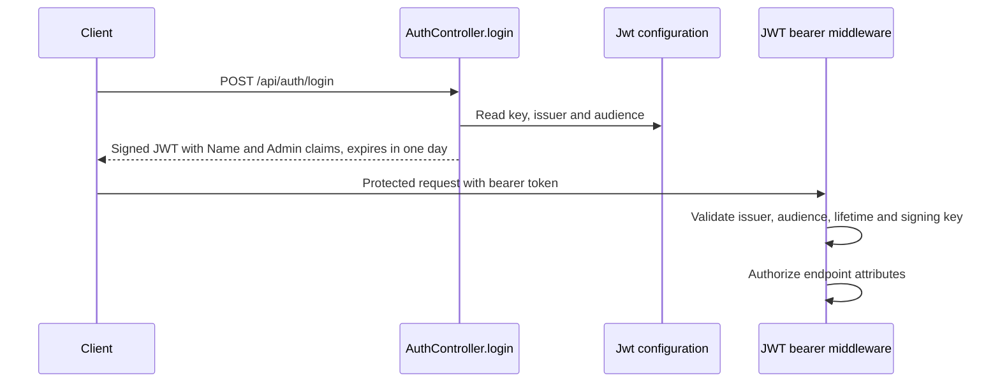
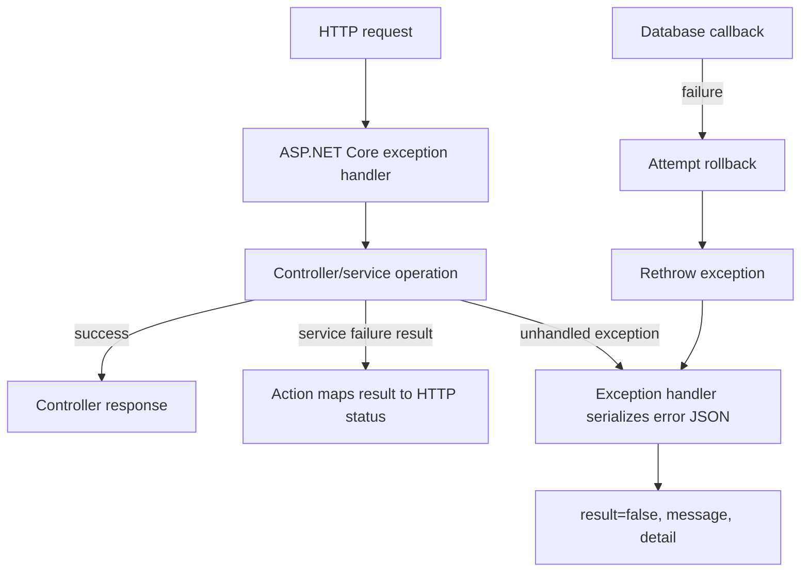

# CLPS .NET Web Service — Enterprise Architecture and Technical Design

**Scope:** Projects and implementation in `CLPS.Service.sln`: `CLPS.Service`, `CLPS.WebUI`, and `CLPS.Tests`. The API, database and integration details below describe the .NET solution. Configuration values that contain credentials or signing material are intentionally not reproduced.

## 1. Executive Summary

### Application purpose

The solution implements a manufacturing Label Tracking (LT) service. Its HTTP API manages LT creation and retrieval, output-batch workflows, label data, printing, association, and site/order/machine queries. The separate `CLPS.WebUI` application serves static web content.

### Business capabilities and features

| Capability | Implemented behavior |
|---|---|
| Label Tracking lifecycle | Create an LT using site, order, person and print-master data; generate an LT ID; select a box; persist the LT record. |
| Manufacturing lookups | Resolve site and plant details; query order, machine, person, printer, product and LT data. |
| Batch operations | Resolve a supplied/SAP/AUTO batch according to the service implementation and expose logon/logoff operations. |
| Label preparation and printing | Resolve print configuration, generate label data, create print-file content, upload it and update LT status. |
| LT association | Associate LT records and update parent/sub-status/quantity fields through the association workflow. |
| UI support endpoints | Return class tabs, UI refresh configuration, culture information and a public static welcome page. |

### Intended users and core workflows

The API accepts HTTP clients carrying manufacturing/site parameters and request DTOs. The code describes workflows around orders, machines, people, batches, labels and LTs; named user personas are **Not identified in analyzed source code.**

1. **Create LT:** request → site configuration/context → site and LT validation → order/person lookup → Print Master resolution → box and LT ID generation → SQL insert → response.
2. **Output-batch logon/logoff:** controller → batch workflow service → SQL and, where used by the operation, HydraX.
3. **Print:** LT lookup/eligibility → printer and BT server resolution → label-data construction → print-file upload → print-status update.
4. **Associate:** request → association service → SQL updates and associated print operation where invoked.
5. **Resolve a batch:** request parameters → batch method handling and database lookups/inserts → result wrapper.

### High-level architecture summary

`CLPS.Service` is an ASP.NET Core Web API with controllers, feature services, validation, model contracts and infrastructure organized within one project. SQL Server access uses `Microsoft.Data.SqlClient`, Dapper and a callback-oriented connection/transaction abstraction. HydraX is accessed over HTTP. `CLPS.WebUI` is a separate static-file host; `CLPS.Tests` contains the xUnit test project.

### Evidence

| File | Class | Method | Evidence |
|------|-------|--------|----------|
| [CLPS.Service.sln](../CLPS.Service.sln) | Solution | — | Declares the service, test and WebUI projects. |
| [Controllers/CreateLTController.cs](../Controllers/CreateLTController.cs) | `CreateLTController` | Actions | Routes to LT, site, batch, print, association and validation operations. |
| [Services/CreateLT/CreateLTService.cs](../Services/CreateLT/CreateLTService.cs) | `CreateLTService` | `CreateLTAsync` | Resolves site configuration and delegates LT processing. |
| [Services/CreateLT/ContextBuilder/CreateLTContextBuilder.cs](../Services/CreateLT/ContextBuilder/CreateLTContextBuilder.cs) | `CreateLTContextBuilder` | `BuildContextAsync` | Coordinates site, LT, order, person and print-master context. |
| [Services/CreateLT/Internal/CreateLTInternalService.cs](../Services/CreateLT/Internal/CreateLTInternalService.cs) | `CreateLTInternalService` | `CreateLTAsync` | Coordinates box selection, identifier generation and insert. |
| [Services/PrintOutputBatch/PrintOutputBatchService.cs](../Services/PrintOutputBatch/PrintOutputBatchService.cs) | `PrintOutputBatchService` | `ExecuteAsync` | Implements print-output processing. |
| [CLPS.WebUI/Program.cs](../../CLPS.WebUI/Program.cs) | Top-level application | — | Configures default and static-file middleware. |

## 2. System Overview

### Functional overview and major modules

| Module | Responsibility | Main implementation areas |
|---|---|---|
| HTTP API | Bind requests, invoke feature services and map service outcomes to HTTP responses. | `Controllers` |
| Authentication | Issue JWTs and validate bearer tokens. | `AuthController`, `Program.cs` |
| LT and batch processing | Validate and create LTs, resolve batches/boxes/IDs, retrieve records. | `Services/CreateLT`, `Batch`, `Box`, `LT`, `LTInsert`, `LTData`, `LatestLT` |
| Manufacturing and site data | Resolve order/person/machine/site/plant and print-master data. | `Services/Order`, `Person`, `Machine`, `Site`, `LTPrintMaster` |
| Output and HydraX | Execute logon, logoff and association workflows, including HydraX calls where used. | `Services/LogonOutputBatch`, `LogoffOutputBatch`, `Associate`, `Infrastructure/HydraX` |
| Labels and printing | Resolve label/printer data, build label data and send print files. | `Services/CreateLabelData`, `PrintOutputBatch`, `ZLabel4Service`, `SftpService` |
| SQL access | Build site-specific connections and execute operations within connection/transaction callbacks. | `Infrastructure/Database` |
| Localization | Resolve translated messages and configure supported request cultures. | `Services/Localization`, `Resources`, `Program.cs` |
| Static web host | Serve the WebUI static assets. | `CLPS.WebUI/Program.cs`, `CLPS.WebUI/wwwroot` |

### Layer responsibilities

- **Presentation:** `AuthController` and `CreateLTController` declare HTTP endpoints and response mapping.
- **Application services:** feature services coordinate validation, database access and integration calls.
- **Validation:** `CreateLTValidator` normalizes and validates LT class, level and WIP stage.
- **Infrastructure:** database factories/wrapper, HydraX HTTP client, and file-transfer service.
- **Contracts and workflow state:** request/response DTOs, entity-like models and internal context objects under `Models`.
- **WebUI:** independent Web SDK project that enables default-file and static-file middleware.

### Request lifecycle

For the service project, `Program.cs` configures the host, JWT bearer authentication, MVC controllers, Serilog, CORS, localization options and dependency injection. The configured pipeline calls exception handling, static files, HTTPS redirection, CORS, authentication, authorization, controller mapping, request localization and `Run`. A controller action invokes its injected service; the service uses feature dependencies and returns a DTO/result; the action maps that result to an HTTP response.

### Data lifecycle

`SiteConfigurationService.GetSiteConfigAsync` reads the selected `Sites:{installationId}` configuration section into `SiteContext`. `DbContextFactory.Create` builds a site-specific `DbContextWrapper`. The wrapper opens a `SqlConnection`, begins a `SqlTransaction`, runs a callback, commits on success and attempts rollback before rethrowing on failure. Feature services execute Dapper queries or ADO.NET commands. In LT creation, the generated LT entity is inserted using the transaction connection supplied to `LTInsertService`.

### Evidence

| File | Class | Method | Evidence |
|------|-------|--------|----------|
| [Program.cs](../Program.cs) | Top-level application | — | Configures authentication, MVC, logging, DI, CORS, localization and middleware. |
| [Controllers/CreateLTController.cs](../Controllers/CreateLTController.cs) | `CreateLTController` | Actions | Invokes injected service interfaces and maps their outcomes. |
| [Services/Configuration/SiteConfigurationService.cs](../Services/Configuration/SiteConfigurationService.cs) | `SiteConfigurationService` | `GetSiteConfigAsync` | Reads configuration by installation ID and creates `SiteContext`. |
| [Infrastructure/Database/DbContextFactory.cs](../Infrastructure/Database/DbContextFactory.cs) | `DbContextFactory` | `Create`, `CreateMaster` | Creates wrapper instances for site and master connection strings. |
| [Infrastructure/Database/DbContextWrapper.cs](../Infrastructure/Database/DbContextWrapper.cs) | `DbContextWrapper` | `ExecuteAsync` | Opens SQL connection, begins transaction and commits/rolls back callbacks. |
| [Services/LTInsert/LTInsertService.cs](../Services/LTInsert/LTInsertService.cs) | `LTInsertService` | `InsertLTAsync` | Executes parameterized LT insert with the supplied connection and transaction. |

## 3. High Level Design (HLD)

### Architecture patterns evidenced by the solution

| Pattern | Finding | Relevant projects/namespaces | Architectural justification |
|---|---|---|---|
| Layered architecture | Implemented as logical organization inside `CLPS.Service`. | `CLPS.Service.Controllers`, `CLPS.Service.Services`, `CLPS.Service.Infrastructure`, `CLPS.Service.Models`, `CLPS.Validators` | Controllers invoke service interfaces; services depend on infrastructure abstractions and model contracts. |
| N-tier architecture | A presentation/application/data-access separation is visible in code, but the application and data-access implementations are deployed in the same service project. | `CLPS.Service` | Controller, service and database infrastructure folders provide the observed tiers within one project. |
| Clean/Onion architecture | **Not identified in analyzed source code.** | — | The solution does not separate domain/application/infrastructure into independently referenced projects; service code uses infrastructure types. |
| Hexagonal architecture | Ports-and-adapters elements are present, not a full independently deployable hexagonal structure. | Service interfaces, `Infrastructure/Database`, `Infrastructure/HydraX` | Feature interfaces are injected, with concrete SQL and HTTP adapter implementations registered in `Program.cs`. |
| CQRS | **No implementation identified in the analyzed source code.** | — | Controller actions invoke feature service methods directly; no command/query dispatcher is registered. |
| Event-driven architecture | **No implementation identified in the analyzed source code.** | — | The service composition root has no message-broker or event-handler registration. |

### System Context Diagram



The API-to-SQL and API-to-HydraX links are represented in infrastructure/service code. The file-transfer link is represented by the `SftpService` implementation and its dependencies. Browser-to-API relationships appear in the WebUI files; deployment topology is not implied by the diagram.

### Application Architecture Diagram



### Component Diagram



### Evidence

| File | Class | Method | Evidence |
|------|-------|--------|----------|
| [CLPS.Service.sln](../CLPS.Service.sln) | Solution | — | Declares three projects. |
| [Program.cs](../Program.cs) | Top-level application | — | Wires service interfaces to implementations and registers HTTP clients. |
| [Infrastructure/Database/IDbContext.cs](../Infrastructure/Database/IDbContext.cs) | `IDbContext` | `ExecuteAsync` | Defines a SQL connection/transaction callback abstraction. |
| [Infrastructure/HydraX/HydraXClient.cs](../Infrastructure/HydraX/HydraXClient.cs) | `IHydraXClient`, `HydraXClient` | `PostAsync`, `CommitTransactionAsync` | Implements HydraX HTTP operations. |
| [Services/SftpService/SftpService.cs](../Services/SftpService/SftpService.cs) | `SftpService` | `UploadFileAsync` | Implements file upload integration. |

## 4. Solution Structure

### Project inventory

| Project | Project type | Responsibility | Project references | External package references |
|---|---|---|---|---|
| `CLPS.Service` | `Microsoft.NET.Sdk.Web`, `net8.0` | API, service workflows, validation, database and integration code. | No project reference declared. | Dapper, JWT bearer, SqlClient, configuration binder, SSH.NET and Serilog packages. |
| `CLPS.WebUI` | `Microsoft.NET.Sdk.Web`, `net8.0` | Serves static UI files; declares `win-x64` runtime identifier. | No project reference declared. | No `PackageReference` declared. |
| `CLPS.Tests` | `Microsoft.NET.Sdk`, `net8.0`, test project | Unit tests for service logic. | References `CLPS.Service`. | Coverlet, .NET test SDK, Moq and xUnit packages. |

### Solution hierarchy

```text
CLPS.Service.sln
├── CLPS.Service/
│   ├── Controllers/                 AuthController, CreateLTController
│   ├── Infrastructure/
│   │   ├── Database/                connection/context factories and wrapper
│   │   ├── HydraX/                  HydraX client and config resolver
│   │   └── Transactions/            TransactionContext
│   ├── Models/
│   │   ├── Constants/               LT status values
│   │   ├── Context/                 site and create-LT contexts
│   │   ├── Entities/                persistence-shaped records
│   │   ├── Internal/CreateLT/       internal workflow results
│   │   ├── LabelMatrix/             label-matrix matching model/query
│   │   ├── LabelMatrixDetail/       label-matrix detail query model
│   │   ├── Requests/                API and service requests
│   │   └── Responses/               API/service result contracts
│   ├── Serialization/               JSON context and helpers
│   ├── Services/
│   │   ├── Associate/               LT association
│   │   ├── Batch/                   batch resolution
│   │   ├── Box/                     box numbering/cache
│   │   ├── BTServer/                print-server resolution
│   │   ├── ClassTabs/               class-tab lookup
│   │   ├── Configuration/           site, INI and Hydra configuration
│   │   ├── CreateLabelData/         label-data generation
│   │   ├── CreateLT/                LT orchestration/context/internal workflow
│   │   ├── CreatePrintLT/           print-LT workflow
│   │   ├── LatestLT/                LT ID/list retrieval
│   │   ├── LicenseTagStatus/        LT status update
│   │   ├── Localization/            translation lookup
│   │   ├── LogoffOutputBatch/       output logoff workflow
│   │   ├── LogonOutputBatch/        output logon workflow
│   │   ├── LT/                      LT ID generation/cache
│   │   ├── LTData/                  LT record retrieval
│   │   ├── LTInsert/                LT persistence
│   │   ├── LTPrintMaster/           print-master resolution
│   │   ├── Machine/                 machine validation
│   │   ├── MaterialComment/         material-comment operation
│   │   ├── Order/                   order detail and running-order validation
│   │   ├── PartClass/               part-class lookup
│   │   ├── Person/                  person validation/details
│   │   ├── PrintOutputBatch/        printer resolution, output and file creation
│   │   ├── ProductMaster/           product-master lookup
│   │   ├── Resources/               message keys
│   │   ├── SftpService/             print-file transfer
│   │   ├── Site/                    site and MIP plant resolution
│   │   └── ZLabel4Service/           ZLabel4 data
│   ├── Validators/                  Create-LT validator and validation contracts
│   ├── Resources/                   localized JSON text resources
│   ├── Properties/                  resources and publish/launch settings
│   ├── docs/                        repository documentation
│   ├── wwwroot/pages/               static welcome page
│   ├── Program.cs
│   ├── CLPS.Service.csproj
│   ├── CLPS.Service.http
│   └── appsettings*.json
├── CLPS.WebUI/
│   ├── Program.cs
│   ├── Properties/
│   └── wwwroot/
│       ├── clps/                    client JavaScript, styles and locales
│       ├── lib/                     browser libraries
│       └── index.html
└── CLPS.Tests/
    ├── Client.cs
    ├── CreateLTServiceTests.cs
    ├── CreateLTValidatorTests.cs
    ├── LTBoxServiceTests.cs
    ├── LTIdServiceTests.cs
    ├── LogonOutputBatchServiceTests.cs
    ├── PrintOutputBatchServiceTests.cs
    └── TestableLTIdService.cs
```

### Major folder roles

| Folder | Purpose and key classes | Architectural role |
|---|---|---|
| `Controllers` | `AuthController`, `CreateLTController` | HTTP presentation, input binding and response mapping. |
| `Services` | Feature interfaces and implementations such as `CreateLTService`, `LTBatchService`, `PrintOutputBatchService` | Business and integration workflows. |
| `Infrastructure/Database` | `IDbContext`, `DbContextWrapper`, `ConnectionFactory`, `DbContextFactory` | SQL connection/transaction access. |
| `Infrastructure/HydraX` | `IHydraXClient`, `HydraXClient`, configuration resolver | External HTTP adapter. |
| `Infrastructure/Transactions` | `TransactionContext` | Stores in-memory commit and rollback callbacks. |
| `Models/Requests`, `Models/Responses` | Operation request and result types | Data-transfer contracts. |
| `Models/Entities`, `Models/Context` | `LTEntity`, `LTBatchRecord`, `SiteContext`, `CreateLTContext` | Data and workflow state. |
| `Validators` | `CreateLTValidator`, `IValidator<T>`, `ValidationResult<T>` | LT request validation. |
| `Serialization` | `CLPSJsonContext`, `JsonHelper`, `JsonResponse` | JSON serialization support. |
| `Resources` | Text JSON and resource files | Localized message data. |
| `CLPS.Tests` | xUnit tests and test helper | Automated unit tests. |

### Test coverage observed

`LTBoxServiceTests` contains three active `[Fact]` tests: incrementing a box, repeated latest-box reads without incrementing the cache, and uniqueness under parallel increments. The test source files for LT creation, LT validation, LT ID generation, logon and print contain commented-out test declarations. No integration-test project or integration-test fixture is identified in analyzed source code.

No `Startup.cs` class, hosted/background service registration, or integration-test project is used by the solution composition shown in source.

### Evidence

| File | Class | Method | Evidence |
|------|-------|--------|----------|
| [CLPS.Service.sln](../CLPS.Service.sln) | Solution | — | Lists service, test and WebUI projects. |
| [CLPS.Service.csproj](../CLPS.Service.csproj) | Project | — | Declares Web SDK, `net8.0` and service dependencies. |
| [CLPS.WebUI/CLPS.WebUI.csproj](../../CLPS.WebUI/CLPS.WebUI.csproj) | Project | — | Declares Web SDK, `net8.0` and Windows runtime identifier. |
| [CLPS.Tests/CLPS.Tests.csproj](../../CLPS.Tests/CLPS.Tests.csproj) | Project | — | Declares test dependencies and service project reference. |
| [Program.cs](../Program.cs) | Top-level application | — | Registers feature implementations and infrastructure. |
| [CLPS.Tests/LTBoxServiceTests.cs](../../CLPS.Tests/LTBoxServiceTests.cs) | `LTBoxServiceTests` | Three active `[Fact]` methods | Tests box increments, repeated reads without increment, and distinct parallel increments. |
| [CLPS.Tests/CreateLTServiceTests.cs](../../CLPS.Tests/CreateLTServiceTests.cs), [CLPS.Tests/CreateLTValidatorTests.cs](../../CLPS.Tests/CreateLTValidatorTests.cs), [CLPS.Tests/LTIdServiceTests.cs](../../CLPS.Tests/LTIdServiceTests.cs), [CLPS.Tests/LogonOutputBatchServiceTests.cs](../../CLPS.Tests/LogonOutputBatchServiceTests.cs), [CLPS.Tests/PrintOutputBatchServiceTests.cs](../../CLPS.Tests/PrintOutputBatchServiceTests.cs) | Test classes | — | Test declarations in these files are commented out. |

## 5. Technology Stack

### Runtime and framework

| Area | Implemented technology |
|---|---|
| .NET target | `net8.0` in all three project files. |
| ASP.NET Core | Web SDK and ASP.NET Core hosting/MVC middleware through .NET 8. |
| C# language version | No explicit `LangVersion` property is set; compiler language version follows the SDK used for the build. |
| Database access | Dapper 2.1.72, ADO.NET `SqlConnection`/`SqlTransaction`, and `Microsoft.Data.SqlClient` 7.0.1. |
| Database provider | Microsoft SQL Server. |
| EF Core | No implementation identified in analyzed source code. |
| Dapper | Used in feature service SQL queries. |
| ADO.NET | Used by `DbContextWrapper` and services that execute commands on SQL connections. |
| Authentication | ASP.NET Core JWT bearer authentication. |
| Authorization | ASP.NET Core authorization middleware and `[Authorize]`/`[AllowAnonymous]` attributes. |
| Logging | Serilog with console and rolling file sinks; ASP.NET Core integration. |
| Telemetry | No telemetry SDK or exporter implementation identified in analyzed source code. |
| API documentation | No Swagger/OpenAPI registration identified in analyzed source code. |
| Validation | In-house `IValidator<T>` / `CreateLTValidator`; no external validation framework package declared. |
| External service/file transfer | `HttpClient` for HydraX; SSH.NET-related packages for file-transfer functionality. |
| Tests | xUnit, Moq, Microsoft.NET.Test.Sdk and coverlet collector. |

### Complete declared NuGet package inventory

The table lists every `PackageReference` declared in the three project files. `CLPS.Service/packages.lock.json` records the resolved versions for service dependencies.

| Package | Version | Project | Purpose evidenced by source/project |
|---|---:|---|---|
| Dapper | 2.1.72 | `CLPS.Service` | SQL query mapping and command execution. |
| Microsoft.AspNetCore.Authentication.JwtBearer | 8.0.0 | `CLPS.Service` | JWT bearer authentication middleware. |
| Microsoft.Data.SqlClient | 7.0.1 | `CLPS.Service` | SQL Server connections and transactions. |
| Microsoft.Extensions.Configuration.Binder | 8.0.0 | `CLPS.Service` | Binds HydraX configuration sections to configuration models. |
| Renci.SshNet.Async | 1.4.0 | `CLPS.Service` | Declared async SSH.NET package; the project also declares SSH.NET. |
| Serilog | 4.3.1 | `CLPS.Service` | Structured logging. |
| Serilog.AspNetCore | 8.0.0 | `CLPS.Service` | ASP.NET Core host logging integration. |
| Serilog.Extensions.Logging | 10.0.0 | `CLPS.Service` | Microsoft logging abstraction integration. |
| Serilog.Sinks.Console | 6.1.1 | `CLPS.Service` | Console log output. |
| Serilog.Sinks.File | 7.0.0 | `CLPS.Service` | Rolling file log output. |
| SSH.NET | 2025.1.0 | `CLPS.Service` | SSH/SFTP implementation dependency. |
| coverlet.collector | 6.0.0 | `CLPS.Tests` | Test coverage collector. |
| Microsoft.NET.Test.Sdk | 17.8.0 | `CLPS.Tests` | .NET test execution infrastructure. |
| Moq | 4.20.72 | `CLPS.Tests` | Test doubles for service dependencies. |
| xunit | 2.5.3 | `CLPS.Tests` | Unit-test framework. |
| xunit.runner.visualstudio | 2.5.3 | `CLPS.Tests` | Visual Studio test adapter. |

### Evidence

| File | Class | Method | Evidence |
|------|-------|--------|----------|
| [CLPS.Service.csproj](../CLPS.Service.csproj) | Project | — | Declares target framework and service packages. |
| [CLPS.Tests/CLPS.Tests.csproj](../../CLPS.Tests/CLPS.Tests.csproj) | Project | — | Declares test packages and test target framework. |
| [CLPS.WebUI/CLPS.WebUI.csproj](../../CLPS.WebUI/CLPS.WebUI.csproj) | Project | — | Declares Web SDK target and no package references. |
| [packages.lock.json](../packages.lock.json) | Lock file | — | Records resolved versions for the service dependency graph. |
| [Program.cs](../Program.cs) | Top-level application | — | Configures JWT, Serilog, controllers and localization. |
| [Infrastructure/Database/DbContextWrapper.cs](../Infrastructure/Database/DbContextWrapper.cs) | `DbContextWrapper` | `ExecuteAsync` | Uses `SqlConnection` and `SqlTransaction`. |

## 6. Low Level Design (LLD)

### Controllers and services

The API controller is `CreateLTController` at route prefix `/api/clps`; `AuthController` exposes `/api/auth/login`. `CreateLTController` receives feature services through constructor injection. `AuthController` receives `IConfiguration`.

| Service contract | Implementation | Public operation(s) | Responsibility evidenced by code |
|---|---|---|---|
| `ICreateLTService` | `CreateLTService` | `CreateLTAsync` | Resolves site config/context and delegates LT creation. |
| `ICreateLTContextBuilder` | `CreateLTContextBuilder` | `BuildContextAsync` | Resolves/validates site, LT parameters, order, person and Print Master. |
| `ICreateLTInternalService` | `CreateLTInternalService` | `CreateLTAsync` | Gets box, generates ID and inserts LT in a serialized workflow. |
| `ILTBatchService` | `LTBatchService` | `ResolveBatchAsync` | Resolves requested batch method. |
| `ILTBoxService` | `LTBoxService` | `GetLatestBoxAsync`, `IncrementBoxAsync` | Resolves and advances box number state. |
| `ILTIdService` | `LTIdService` | `GenerateLTIDAsync`, `UpdateMemory`, `ClearCache` | Generates LT identifiers and maintains cache. |
| `ILTInsertService` | `LTInsertService` | `InsertLTAsync` | Validates entity fields and inserts LT record. |
| `IGetOrderDetailsService` | `GetOrderDetailsService` | `GetOrderDetailsAsync` | Retrieves order and machine-related details. |
| `IGetPersonDetailsService` | `GetPersonDetailsService` | `ValidatePersonAsync` | Validates/resolves person data. |
| `IGetLTPrintMasterService` | `GetLTPrintMasterService` | `GetLTPrintMasterAsync` | Resolves label matrix/detail and print-master values. |
| `ISiteResolverService` | `SiteResolverService` | `ResolveSiteAsync` | Resolves site metadata from SQL by installation ID. |
| `IMipPlantResolverService` | `MipPlantResolverService` | `ResolveMipPlantAsync` | Resolves machine plant/site information. |
| `ILogonOutputBatchService` | `LogonOutputBatchService` | `ExecuteAsync` | Processes logon output batch. |
| `ILogoffOutputBatchService` | `LogoffOutputBatchService` | `ExecuteAsync` | Processes logoff output batch. |
| `IAssociateService` | `AssociateService` | `ExecuteAsync`, `AssociateInternalAsync` | Runs association database workflow. |
| `IPrintOutputBatchService` | `PrintOutputBatchService` | `ExecuteAsync` | Coordinates print-output work. |
| `IPrintFileService` | `PrintFileService` | `PrintFileAsync` | Builds/transfers print file. |
| `IPrinterResolutionService` | `PrinterResolutionService` | `ResolvePrinterAsync` | Resolves printer configuration. |
| `ICreatePrintLTService` | `CreatePrintLTService` | `ExecuteAsync` | Coordinates create/print LT operation. |
| `ICreateLabelDataService` | `CreateLabelDataService` | `CreateLabelDataAsync` | Builds label data from label-map and related data. |
| `IMachineValidationService` | `MachineValidationService` | `ValidateMachineAsync` | Checks machine activation data. |
| `IValidateRunningOrderService` | `ValidateRunningOrderService` | `ValidateRunningOrderAsync` | Validates/retrieves running-order data. |
| `IGetLTDataService` | `GetLTDataService` | `GetLTDataAsync` | Retrieves LT records. |
| `IGetLatestLTIdService` | `GetLatestLTIdService` | `GetLatestLTIdAsync` | Retrieves latest LT data. |
| `IGetLTListService` | `GetLTListService` | `GetLTListAsync` | Retrieves an LT list and pagination data. |
| `IGetClassTabsService` | `GetClassTabsService` | `GetClassTabsAsync` | Reads configured visible class tabs. |
| `IHydraXClient` | `HydraXClient` | `PostAsync`, `LogoutAsync`, `CommitTransactionAsync`, `CreateSessionClient` | Performs HydraX HTTP requests and session/transaction operations. |
| `IConnectionFactory` | `ConnectionFactory` | `BuildConnectionString` | Builds a SQL Server connection string from `SiteContext`. |
| `IDbContextFactory` | `DbContextFactory` | `Create`, `CreateMaster` | Creates the SQL wrapper for site or master connection. |
| `IDbContext` | `DbContextWrapper` | `Table`, `ExecuteAsync` | Provides schema naming and callback-based SQL transactions. |
| `IValidator<CreateLTValidationModel>` | `CreateLTValidator` | `ValidateAsync` | Normalizes and validates LT class, level and WIP stage. |
| `ITranslationService` | `TranslationService` | `Get` | Resolves localized strings. |

Additional service registrations are visible in the DI evidence table below. Services are registered with scoped lifetimes except the framework-provided types.

### Dependency injection registrations

`Program.cs` registers these service abstractions as scoped dependencies:

| Abstraction | Implementation |
|---|---|
| `ICreateLTContextBuilder` | `CreateLTContextBuilder` |
| `ISiteConfigurationService` | `SiteConfigurationService` |
| `IConnectionFactory` | `ConnectionFactory` |
| `IDbContextFactory` | `DbContextFactory` |
| `ICreateLTService` | `CreateLTService` |
| `ICreateLTInternalService` | `CreateLTInternalService` |
| `IValidator<CreateLTValidationModel>` | `CreateLTValidator` |
| `ISiteResolverService` | `SiteResolverService` |
| `IGetOrderDetailsService` | `GetOrderDetailsService` |
| `IGetPersonDetailsService` | `GetPersonDetailsService` |
| `IGetLTPrintMasterService` | `GetLTPrintMasterService` |
| `IGetLatestLTIdService` | `GetLatestLTIdService` |
| `ILTBatchService` | `LTBatchService` |
| `ILTBoxService` | `LTBoxService` |
| `ILTIdService` | `LTIdService` |
| `ILTInsertService` | `LTInsertService` |
| `IHydraXConfigResolver` | `HydraXConfigResolver` |
| `IHydraXClient` | `HydraXClient` |
| `ILogonOutputBatchService` | `LogonOutputBatchService` |
| `ILogoffOutputBatchService` | `LogoffOutputBatchService` |
| `IAssociateService` | `AssociateService` |
| `IGetLTDataService` | `GetLTDataService` |
| `IPrinterResolutionService` | `PrinterResolutionService` |
| `IBTServerService` | `BTServerService` |
| `IPartClassCodeService` | `PartClassCodeService` |
| `IZLabel4Service` | `ZLabel4Service` |
| `ICreateLabelDataService` | `CreateLabelDataService` |
| `IProductMasterService` | `ProductMasterService` |
| `ISftpService` | `SftpService` |
| `IPrintOutputBatchService` | `PrintOutputBatchService` |
| `IPrintFileService` | `PrintFileService` |
| `IIniConfigurationService` | `IniConfigurationService` |
| `IHydraConfigurationService` | `HydraConfigurationService` |
| `ILTStatusService` | `LTStatusService` |
| `IReportMaterialCommentService` | `ReportMaterialCommentService` |
| `ICreatePrintLTService` | `CreatePrintLTService` |
| `IMachineValidationService` | `MachineValidationService` |
| `IValidateRunningOrderService` | `ValidateRunningOrderService` |
| `ITranslationService` | `TranslationService` |
| `IGetLTListService` | `GetLTListService` |
| `IGetClassTabsService` | `GetClassTabsService` |
| `IMipPlantResolverService` | `MipPlantResolverService` |

The composition root also registers `AddHttpClient`, `IHttpContextAccessor`, localization and request-localization options. `ISftpService` is registered twice with the same implementation in the source.

### Repositories and database access

No repository classes or repository interfaces are identified in analyzed source code. Feature services issue SQL through Dapper or ADO.NET, using `IDbContext` when a wrapper-managed transaction is needed. `LTInsertService.InsertLTAsync` accepts an existing SQL connection and transaction.

### Middleware and exception processing sequence

The configured `CLPS.Service` pipeline is:

1. `UseExceptionHandler`
2. `UseStaticFiles`
3. `UseHttpsRedirection`
4. `UseCors("AllowAll")`
5. `UseAuthentication`
6. `UseAuthorization`
7. `MapControllers`
8. `UseRequestLocalization`
9. `Run`

No custom middleware class is identified in analyzed source code; the exception handler is configured inline in `Program.cs`.

### Validator details

| Validator/method | Associated model | Implemented rule | Error result |
|---|---|---|---|
| `CreateLTValidator.ValidateAsync` | `CreateLTValidationModel` | Blank class defaults to `3SI`; accepted values are `3SI`, `3S`, `4S`; input is trimmed and uppercased. | Translation key for invalid LT class. |
| `CreateLTValidator.ValidateAsync` | `CreateLTValidationModel` | Blank level defaults to 1; accepted range is 1–3; `3SI` cannot exceed level 1; level 2 is limited to `3S` or `4S`. | Translation keys for level/class rule violations. |
| `CreateLTValidator.ValidateAsync` | `CreateLTValidationModel` | Blank WIP stage defaults to `FG`; only `FG` is accepted. | Translation key for invalid WIP stage. |
| `CreateLTContextBuilder.BuildContextAsync` | `CreateLTRequest` and optional dependencies | Requires valid request/site, order, person, validation and print-master results; quantity comes from positive request quantity or positive print-master label quantity. | Failed `CreateLTContextResult` with translated message. |
| `LTInsertService.ValidateEntity` | `LTEntity` | Requires an entity, positive box, nonblank order/class/LT. | Throws translated `InvalidOperationException` for failed checks. |

### Dependency mapping



### Evidence

| File | Class | Method | Evidence |
|------|-------|--------|----------|
| [Controllers/CreateLTController.cs](../Controllers/CreateLTController.cs) | `CreateLTController` | Constructor/actions | Constructor-injects services and actions route requests to them. |
| [Program.cs](../Program.cs) | Top-level application | — | Registers service interfaces to concrete implementations. |
| [Program.cs](../Program.cs) | Top-level application | — | Registers feature, database, HydraX, SFTP, localization and validation dependencies as scoped services. |
| [Services/CreateLT/ContextBuilder/CreateLTContextBuilder.cs](../Services/CreateLT/ContextBuilder/CreateLTContextBuilder.cs) | `CreateLTContextBuilder` | `BuildContextAsync` | Builds workflow context and runs parallel site/validation and order/person lookups. |
| [Validators/CreateLTValidator.cs](../Validators/CreateLTValidator.cs) | `CreateLTValidator` | `ValidateAsync` | Applies accepted values/defaults and returns validation results. |
| [Infrastructure/Database/DbContextWrapper.cs](../Infrastructure/Database/DbContextWrapper.cs) | `DbContextWrapper` | `ExecuteAsync` | Owns connection and transaction lifetime for callbacks. |
| [Services/LTInsert/LTInsertService.cs](../Services/LTInsert/LTInsertService.cs) | `LTInsertService` | `ValidateEntity`, `InsertLTAsync` | Validates required entity fields and executes insert. |

## 7. Database Design

### Data-access design

The service uses SQL Server through `Microsoft.Data.SqlClient`, Dapper and ADO.NET. `DbContextWrapper` supplies an explicit transaction around callback operations. A custom database schema value may be configured for the wrapper's `Table` helper; feature SQL shown in the source also contains direct table names. EF Core `DbContext`, `DbSet`, entity configuration classes and EF migrations are not identified in analyzed source code. Standalone SQL scripts are not identified in the service source tree; the SQL statements used by services are embedded in C#.

### Entity and table usage

| Entity/model or SQL table | Key | Relationships evidenced by query use | Configuration |
|---|---|---|---|
| `LTEntity` / `u_te_lb_lt_info` | Not identified in analyzed source code. | LT queries use LT, order, machine, part, class, batch, box, person, label-map and parent-LT fields. | `LTInsertService` parameterized insert; LT data/list/status/association/box services query or update this table. |
| `LTBatchRecord` / `u_te_lb_batch` | Not identified in analyzed source code. | Batch lookups use order/machine/building; insert behavior appears in batch service. | C# model has machine, order, batch, building and update date. |
| `u_site_infox` | Not identified in analyzed source code. | Site resolver filters by installation ID. | Selected by `SiteResolverService`. |
| `u_te_maschinen_parameters` | Not identified in analyzed source code. | Machine number is used for plant/site joins and class-tab lookup. | Queried by machine, site and class-tab services. |
| `u_te_lb_plant_master` | Not identified in analyzed source code. | Joined to machine parameters by plant ID; queried for plant metadata. | Read by Print Master, MIP plant resolution and label-data generation. |
| `u_te_lb_label_matrix` | `LabelMatrix.Id` represents selected `id`; database PK status is Not identified in analyzed source code. | Matched by part, tool, machine, group and category. | SQL in `LabelMatrix.getLabelMatrixSQL`; resolver ranks specificity. |
| `u_te_lb_label_matrix_detail` | Not identified in analyzed source code. | Filtered by matrix ID, level, label class and WIP stage; joins label map and printer master. | SQL in `LabelMatrixDetail.getLabelMatrixDetailSQL`. |
| `u_te_lb_label_map` | `LabelMapDb.Id` maps the queried `id`; database PK status is Not identified in analyzed source code. | Joined from label-map detail by label-map ID. | Read by label-data generation and matrix-detail query. |
| `u_te_lb_label_map_detail` | Not identified in analyzed source code. | Joined to label map using map ID; carries field/property/method mappings. | Read by `CreateLabelDataService`. |
| `u_te_lb_printer_master` | Not identified in analyzed source code. | Joined from matrix detail by printer ID and from LT list by printer ID. | Used for print-master/printer selection. |
| `u_te_lb_part_master` | Not identified in analyzed source code. | Part-number lookup; related to package quantity lookup. | Read by product/part and Print Master services. |
| `u_te_lb_part_zzapq_qty` | Not identified in analyzed source code. | Filtered by plant, part-master ID and package type. | Supplies standard package quantity to Print Master processing. |
| `u_te_lb_sftp_bt_master` | Not identified in analyzed source code. | BT server configuration lookup. | Queried by `BTServerService`. |
| `u_te_lb_configuration` | Not identified in analyzed source code. | Configuration read by installation/config key. | Queried by `IniConfigurationService`. |
| `u_te_lb_machine_association` | Not identified in analyzed source code. | Machine association lookup and insert. | Read/written by `AssociateService`. |
| `u_te_lb_zlabel4` | Not identified in analyzed source code. | ZLabel4 class lookup. | Read by `ZLabel4Service` and `PartClassCodeService`. |
| `u_te_lb_country_codes` | Not identified in analyzed source code. | Country-code lookup used during label data generation. | Read by `CreateLabelDataService`. |
| Manufacturing source tables (`auftrags_bestand`, `auftrag_status`, `maschinen`, `res_bestand`) | Not identified in analyzed source code. | Used in order/machine queries and joins. | Queried by manufacturing lookup services. |

`LTEntity`, `LTBatchRecord`, `LabelMapDb`, `LabelMapDetailDb`, `PrinterConfiguration` and `ZLabel4Record` are plain C# models; explicit ORM keys/relationships are not identified in analyzed source code. Where the table above identifies joins or filters, those describe SQL query behavior and do not assert physical foreign-key constraints.

### Logical entity diagram

```mermaid
erDiagram
  u_te_lb_lt_info {
    string lt
    string order_no
    string machine
    string part
    string class
    string batch
    string parent_lt
  }
  u_te_lb_batch {
    string machine
    string order
    string batch
    string building_no
  }
  u_site_infox {
    long installation_id
    string te_hydrax_alias
    string lb_building
  }
  u_te_maschinen_parameters {
    string masch_nr
    long lb_plant_id
  }
  u_te_lb_plant_master {
    long id
    string building_no
    string country_key
  }
  u_te_lb_label_matrix {
    long id
    string part_name
    string tool_name
    string machine_name
    string machine_group
    string machine_category
  }
  u_te_lb_label_matrix_detail {
    long label_matrix_id
    int level
    string label_class
    string wip_stage
    long label_map_id
    long printer_id
  }
  u_te_lb_label_map {
    long id
    string name
  }
  u_te_lb_label_map_detail {
    string field_name
    string property_name
    string method_name
  }
  u_te_lb_printer_master {
    long id
    string name
  }
  u_te_lb_part_master {
    long id
    string part_number
  }
  u_te_lb_part_zzapq_qty {
    long plant_id
    long part_master_id
    string package_type
    long std_qty
  }
  u_te_lb_sftp_bt_master {
    long id
    string server
    string userid
    string password
    string label_format_folder
    string datafile_folder
  }
  u_te_lb_configuration {
    string ini_name
    string section
    string key
    string value
  }
  u_te_lb_machine_association {
    string machine
    string part
    string orderno
    string batch
  }
  u_te_lb_zlabel4 {
    string zlabel4_class
    string zlabel4_logo
    string zlabel4_file_name
    string zlabel_4_reg_nmbr_caption
    string zlabel4_building_ind
    string zlabel4_building_appr_name
  }
```



The diagram inventories SQL entities directly referenced by the service. Attribute names are source-query fields; the listed types are application-level notation, not physical SQL DDL. Joins and filters that are explicit in source include label-matrix detail → label map by label-map ID, label-matrix detail → printer master by printer ID, machine parameters → plant master by plant ID, and machine association → LT information by LT fields. Physical primary/foreign keys and index definitions are **Not identified in analyzed source code.**

### Evidence

| File | Class | Method | Evidence |
|------|-------|--------|----------|
| [Infrastructure/Database/ConnectionFactory.cs](../Infrastructure/Database/ConnectionFactory.cs) | `ConnectionFactory` | `BuildConnectionString` | Maps `SiteContext` to `SqlConnectionStringBuilder`. |
| [Infrastructure/Database/DbContextWrapper.cs](../Infrastructure/Database/DbContextWrapper.cs) | `DbContextWrapper` | `ExecuteAsync` | Opens a SQL connection and wraps callback work in a transaction. |
| [Services/LTInsert/LTInsertService.cs](../Services/LTInsert/LTInsertService.cs) | `LTInsertService` | `InsertLTAsync` | Inserts fields into `u_te_lb_lt_info`. |
| [Models/LabelMatrix/LabelMatrix.cs](../Models/LabelMatrix/LabelMatrix.cs) | `LabelMatrix` | `getLabelMatrixSQL`, `ResolveLabelMatrix` | Queries and ranks matching matrix records. |
| [Models/LabelMatrixDetail/LabelMatrixDetail.cs](../Models/LabelMatrixDetail/LabelMatrixDetail.cs) | `LabelMatrixDetail` | `getLabelMatrixDetailSQL` | Queries details and joins label-map/printer tables. |
| [Services/Associate/AssociateService.cs](../Services/Associate/AssociateService.cs) | `AssociateService` | `AssociateInternalAsync` | Reads/writes machine association and LT records. |
| [Services/Site/SiteResolverService.cs](../Services/Site/SiteResolverService.cs) | `SiteResolverService` | `ResolveSiteAsync` | Queries `u_site_infox` by installation ID. |

## 8. API Specification

### API reference and contract

`CreateLTController` uses route prefix `/api/clps`. `AuthController` uses `/api/[controller]`, resolving to `/api/auth`. For actions whose body type is a complex object and which do not explicitly state `[FromBody]`, `[ApiController]` supplies framework binding behavior.

| Endpoint | HTTP verb | Controller/action | Service called | Request | Response | Authentication | Validation and status behavior |
|---|---|---|---|---|---|---|---|
| `/api/auth/login` | POST | `AuthController.login` | Inline token generation | None | `{ token }` | No action-level authorization attribute. | Throws if JWT key is empty; otherwise 200. |
| `/api/clps/CreateLT` | POST | `CreateLTController.CreateLT` | `ICreateLTService.CreateLTAsync` | `CreateLTRequest` body | `CreateLTResponse` | `[AllowAnonymous]` | Null request → 400; service response → 200. |
| `/api/clps/SiteInfo` | GET | `GetSiteInfo` | `ISiteResolverService`; optional `IMipPlantResolverService` | Query `installationId`, optional `machine` | Anonymous site/MIP object | `[AllowAnonymous]` | ID ≤ 0 → 400; no site → 404; otherwise 200. |
| `/api/clps/LogonOutputBatch` | POST | `LogonOutputBatch` | `ILogonOutputBatchService.ExecuteAsync` | `LogonOutputBatchRequest` body | `LogonOutputBatchResponse` | `[AllowAnonymous]` | Null or failed result → 400; otherwise 200. |
| `/api/clps/OrderDetails` | GET | `GetOrderDetails` | `IGetOrderDetailsService.GetOrderDetailsAsync` | Query `orderOperation`, optional `machine` | `GetOrderDetailsResult` | `[AllowAnonymous]` | Failed result → 400; otherwise 200. |
| `/api/clps/LTPrintMaster` | POST | `GetLTPrintMaster` | `IGetLTPrintMasterService.GetLTPrintMasterAsync` | `GetLTPrintMasterRequest` body | `GetLTPrintMasterResult` | `[AllowAnonymous]` | Failed result → 400; otherwise 200. |
| `/api/clps/LTData` | GET | `GetLTData` | `IGetLTDataService.GetLTDataAsync` | Query `lt`, `installationId` | `GetLTDataResult` | `[AllowAnonymous]` | Failed result → 400; otherwise 200. |
| `/api/clps/LogoffOutputBatch` | POST | `LogoffOutputBatch` | `ILogoffOutputBatchService.ExecuteAsync` | Query `lt`, `qty`, `installationId` | `LogoffOutputBatchResponse` | `[AllowAnonymous]` | Failed result → 400; otherwise 200. |
| `/api/clps/GetLatestLTID` | POST | `GetLatestLTId` | `IGetLatestLTIdService.GetLatestLTIdAsync` | `GetLatestLTIdRequest` | `GetLatestLTIdResult` | `[AllowAnonymous]` | Failed result → 400; otherwise 200. |
| `/api/clps/GetLTList` | POST | `GetLTList` | `IGetLTListService.GetLTListAsync` | `GetLTListRequest` body | `GetLTListResult` | `[AllowAnonymous]` | Failed result → 400; otherwise 200. |
| `/api/clps/batch` | GET | `GetBatch` | `ILTBatchService.ResolveBatchAsync` | Query `order`, `machine`, `buildingNo`, `batchMethod`; optional `inputBatch`, `installationId` | Anonymous subset: result/order/machine/batch/message | No action attribute | Returns 200 wrapper; service result contains status. |
| `/api/clps/CreateLabelData` | POST | `CreateLabelData` | `ICreateLabelDataService.CreateLabelDataAsync` | `CreateLabelDataRequest` body | `CreateLabelDataResult` | `[AllowAnonymous]` | Null or failed result → 400; otherwise 200. |
| `/api/clps/Associate` | POST | `Associate` | `IAssociateService.ExecuteAsync` | `AssociateRequest` | `AssociateResponse` | `[Authorize]` | Failed result → 400; otherwise 200. |
| `/api/clps/PrintOutputBatch` | POST | `PrintOutputBatch` | `IPrintOutputBatchService.ExecuteAsync` | `PrintOutputBatchRequest` body | `PrintOutputBatchResponse` | `[AllowAnonymous]` | Failed result → 400; otherwise 200. |
| `/api/clps/CreatePrintLT` | POST | `CreatePrintLT` | `ICreatePrintLTService.ExecuteAsync` | `CreatePrintLTRequest` body | `CreatePrintLTResponse` | `[AllowAnonymous]` | Null or failed result → 400; otherwise 200. |
| `/api/clps/ValidateMachine` | GET | `ValidateMachine` | `IMachineValidationService.ValidateMachineAsync` | Query `machine`, `installationId` | `MachineValidationResponse` | `[AllowAnonymous]` | Failed result → 400; otherwise 200. |
| `/api/clps/ValidateRunningOrder` | GET | `ValidateRunningOrder` | `IValidateRunningOrderService.ValidateRunningOrderAsync` | Query `machine`, `installationId` | `RunningOrderValidationResponse` | `[AllowAnonymous]` | Failed result → 400; otherwise 200. |
| `/api/clps/GetClassTabs` | GET | `GetClassTabs` | `IGetClassTabsService.GetClassTabsAsync` | Query `machine`, optional `installationID` | `GetClassTabsResult` | No action attribute | Blank machine or failed result → 400; otherwise 200. |
| `/api/clps/GetUIConfig` | GET | `GetUIConfig` | `IIniConfigurationService.GetValueAsync` | Query `installationId` | Refresh-value object | No action attribute | Missing/invalid config and caught exception return 200 with `result=false` and fallback value 30; valid value is floored at 10. |
| `/api/clps/culture` | GET | `Culture` | Framework culture properties | None | Current `Culture` and `UICulture` | No action attribute | 200. |
| `/api/clps/public` | GET | `GetPublic` | Reads `wwwroot/pages/welcome.html` | None | HTML | `[AllowAnonymous]` | Missing file → 404; otherwise 200. |
| `/api/clps/clear-lt-cache` | POST | `ClearLtCache` | `ILTIdService.ClearCache` | None | Text response | No action attribute | Outside Development → 404; Development → clear cache and 200. |

The action result types above follow service interface result DTOs or inline anonymous objects. Error-handler responses for uncaught exceptions are documented in §11.

### Evidence

| File | Class | Method | Evidence |
|------|-------|--------|----------|
| [Controllers/CreateLTController.cs](../Controllers/CreateLTController.cs) | `CreateLTController` | All actions | Declares route prefix, endpoint attributes, action parameters, service calls and HTTP result mapping. |
| [Controllers/AuthController.cs](../Controllers/AuthController.cs) | `AuthController` | `login` | Declares `/api/auth/login` and token response generation. |
| [Models/Requests](../Models/Requests) | Request DTOs | — | Defines request types such as `CreateLTRequest`, `AssociateRequest` and `PrintOutputBatchRequest`. |
| [Models/Responses](../Models/Responses) | Response DTOs | — | Defines service result contracts. |
| [Program.cs](../Program.cs) | Top-level application | — | Configures authentication, authorization middleware and controller routing. |

## 9. Business Logic Analysis

### Explicit business rules

| File | Class | Method | Rule |
|---|---|---|---|
| [Validators/CreateLTValidator.cs](../Validators/CreateLTValidator.cs) | `CreateLTValidator` | `ValidateAsync` | LT class defaults to `3SI`; valid classes are `3SI`, `3S`, `4S`; values are trimmed/uppercased. |
| [Validators/CreateLTValidator.cs](../Validators/CreateLTValidator.cs) | `CreateLTValidator` | `ValidateAsync` | Level defaults to 1 and must be 1–3; `3SI` is level 1 only; level 2 is accepted only for `3S`/`4S`. |
| [Validators/CreateLTValidator.cs](../Validators/CreateLTValidator.cs) | `CreateLTValidator` | `ValidateAsync` | WIP stage defaults to `FG`; only `FG` is accepted. |
| [Services/CreateLT/ContextBuilder/CreateLTContextBuilder.cs](../Services/CreateLT/ContextBuilder/CreateLTContextBuilder.cs) | `CreateLTContextBuilder` | `ResolveQuantity` | Positive request quantity takes precedence; otherwise positive Print Master label quantity is used. |
| [Services/CreateLT/Internal/CreateLTInternalService.cs](../Services/CreateLT/Internal/CreateLTInternalService.cs) | `CreateLTInternalService` | `GetPrefix` | Maps `3S` and `3SI` to prefix `3S`; other classes throw `ArgumentException` during LT creation. |
| [Models/LabelMatrix/LabelMatrix.cs](../Models/LabelMatrix/LabelMatrix.cs) | `LabelMatrix` | `getLabelMatrixSQL`, `ResolveLabelMatrix` | Matches configured part/tool/machine/group/category data, scores specificity, and rejects unresolved or ambiguous records. |
| [Services/Batch/LTBatchService.cs](../Services/Batch/LTBatchService.cs) | `LTBatchService` | `ResolveBatchAsync` | SAP mode trims the order's SAP batch, rejects values over 10 characters and returns `0` for blank/zero; AUTO mode reuses an order/machine/building mapping or generates and stores a batch using a building-specific SQL sequence. |
| [Services/LT/LTIdService.cs](../Services/LT/LTIdService.cs) | `LTIdService` | `GenerateLTIDAsync` | Normalizes building and validates prefix, forms ID from prefix/building/site marker/sequence, and advances alphanumeric positions when sequence rollover occurs. |
| [Services/LTInsert/LTInsertService.cs](../Services/LTInsert/LTInsertService.cs) | `LTInsertService` | `ValidateEntity` | Insert requires a positive box and nonblank order, class and LT. |
| [Controllers/CreateLTController.cs](../Controllers/CreateLTController.cs) | `CreateLTController` | `GetUIConfig` | Refresh values below 10 are clamped to 10; missing or invalid values produce default 30. |
| [Controllers/CreateLTController.cs](../Controllers/CreateLTController.cs) | `CreateLTController` | `ClearLtCache` | Cache clearing is allowed only when the host environment is Development; otherwise the action returns 404. |
| [Services/CreatePrintLT/CreatePrintLTService.cs](../Services/CreatePrintLT/CreatePrintLTService.cs) | `CreatePrintLTService` | `ExecuteAsync` | Runs logoff, print and logon sequentially; a successful logon can return overall success with an explicit print-failed message. |

### Technical processing rules

| File | Class | Method | Processing behavior |
|---|---|---|---|
| [Services/CreateLT/ContextBuilder/CreateLTContextBuilder.cs](../Services/CreateLT/ContextBuilder/CreateLTContextBuilder.cs) | `CreateLTContextBuilder` | `BuildContextAsync` | Site resolution and LT validation run concurrently; order and person lookups then run concurrently. |
| [Services/CreateLT/Internal/CreateLTInternalService.cs](../Services/CreateLT/Internal/CreateLTInternalService.cs) | `CreateLTInternalService` | `CreateLTAsync` | A static `SemaphoreSlim` serializes its LT-create critical section. |
| [Infrastructure/Database/DbContextWrapper.cs](../Infrastructure/Database/DbContextWrapper.cs) | `DbContextWrapper` | `ExecuteAsync` | Commits callback work on success; attempts rollback and rethrows after callback failure. |
| [Services/Box/LTBoxService.cs](../Services/Box/LTBoxService.cs) | `LTBoxService` | `GetLatestBoxAsync`, `IncrementBoxAsync` | Reads the latest database box when uncached; increments the process-level concurrent cache without a database update in `IncrementBoxAsync`. |
| [Services/Associate/AssociateService.cs](../Services/Associate/AssociateService.cs) | `AssociateService` | `ExecuteWithRetry`, `AssociateInternalAsync` | Uses a retry helper for selected SQL operations and records association updates. |
| [Infrastructure/HydraX/HydraXClient.cs](../Infrastructure/HydraX/HydraXClient.cs) | `HydraXClient` | `PostAsync` | Posts JSON to configured HydraX resource and throws `HttpRequestException` for non-success status. |

### LT creation sequence



### Evidence

| File | Class | Method | Evidence |
|------|-------|--------|----------|
| [Validators/CreateLTValidator.cs](../Validators/CreateLTValidator.cs) | `CreateLTValidator` | `ValidateAsync` | Implements LT class, level and WIP validation/defaults. |
| [Services/CreateLT/ContextBuilder/CreateLTContextBuilder.cs](../Services/CreateLT/ContextBuilder/CreateLTContextBuilder.cs) | `CreateLTContextBuilder` | `BuildContextAsync`, `ResolveQuantity` | Implements dependency ordering and quantity selection. |
| [Models/LabelMatrix/LabelMatrix.cs](../Models/LabelMatrix/LabelMatrix.cs) | `LabelMatrix` | `ResolveLabelMatrix` | Implements matching priority and ambiguity failure. |
| [Services/LT/LTIdService.cs](../Services/LT/LTIdService.cs) | `LTIdService` | `GenerateLTIDAsync` | Implements LT ID assembly, sequence and cache processing. |
| [Services/CreateLT/Internal/CreateLTInternalService.cs](../Services/CreateLT/Internal/CreateLTInternalService.cs) | `CreateLTInternalService` | `CreateLTAsync` | Executes the serialized creation sequence. |
| [Services/Batch/LTBatchService.cs](../Services/Batch/LTBatchService.cs) | `LTBatchService` | `ResolveBatchAsync` | Implements SAP and AUTO batch selection, sequence allocation and mapping persistence. |
| [Services/PrintOutputBatch/PrintOutputBatchService.cs](../Services/PrintOutputBatch/PrintOutputBatchService.cs) | `PrintOutputBatchService` | `ExecuteAsync` | Loads LT data, validates print eligibility, resolves printer/server and label data, uploads print file and handles status updates. |
| [Services/CreatePrintLT/CreatePrintLTService.cs](../Services/CreatePrintLT/CreatePrintLTService.cs) | `CreatePrintLTService` | `ExecuteAsync` | Performs the logoff/print/logon sequence and represents partial outcomes in its response. |

## 10. Authentication and Authorization Analysis

### Authentication flow

`Program.cs` configures JWT bearer authentication as the default authenticate and challenge scheme. Token validation enables issuer, audience, lifetime and signing-key validation, using the `Jwt` configuration section. `AuthController.login` issues a signed token containing fixed Name and Admin role claims; its source comment describes user validation as dummy validation. The action sets a one-day expiration.

### Authorization flow and security boundary

`UseAuthentication` precedes `UseAuthorization`. `Associate` is marked `[Authorize]`; several other actions explicitly use `[AllowAnonymous]`. Actions with neither attribute are not marked as protected in their own source. No authorization policy is registered in the composition root.

The token contains `Name` and `Role` claims, but no role-specific or claims/policy authorization rule is configured in the application composition. Azure AD/Microsoft Entra authentication and ASP.NET Identity integration are not identified in analyzed source code.

| Endpoint | Authentication | Authorization | Evidence |
|---|---|---|---|
| `/api/auth/login` | No action-level authorization attribute | No action-level authorization attribute | `AuthController.login`. |
| `/api/clps/Associate` | JWT bearer authentication required by `[Authorize]` | No role/policy parameter on attribute | `CreateLTController.Associate`. |
| `/api/clps/CreateLT`, `/SiteInfo`, `/LogonOutputBatch`, `/OrderDetails`, `/LTPrintMaster`, `/LTData`, `/LogoffOutputBatch`, `/GetLatestLTID`, `/GetLTList`, `/CreateLabelData`, `/PrintOutputBatch`, `/CreatePrintLT`, `/ValidateMachine`, `/ValidateRunningOrder`, `/public` | Explicitly allowed anonymously | No additional action policy | Corresponding `[AllowAnonymous]` attributes in `CreateLTController`. |
| `/api/clps/batch`, `/GetClassTabs`, `/GetUIConfig`, `/culture`, `/clear-lt-cache` | No action-level attribute | No action-level policy | Corresponding action declarations in `CreateLTController`. |

### Authentication flow diagram



### Evidence

| File | Class | Method | Evidence |
|------|-------|--------|----------|
| [Program.cs](../Program.cs) | Top-level application | — | Configures JWT bearer token validation and auth middleware. |
| [Controllers/AuthController.cs](../Controllers/AuthController.cs) | `AuthController` | `login` | Creates JWT with fixed Name/Admin claims and configured signing credentials. |
| [Controllers/CreateLTController.cs](../Controllers/CreateLTController.cs) | `CreateLTController` | `Associate` and other actions | Declares endpoint-level `[Authorize]`/`[AllowAnonymous]` attributes. |
| [appsettings.json](../appsettings.json) | Configuration | — | Contains `Jwt` key names and issuer/audience settings; values are not reproduced here. |

## 11. Error Handling and Logging Analysis

### Exception handling

The service registers inline `UseExceptionHandler`. Its handler retrieves the current exception and writes a JSON object with `result=false`, the exception message and the exception stack trace in `detail`. Service code also returns explicit result DTO failures; some services log and rethrow exceptions. `DbContextWrapper` attempts transaction rollback and rethrows the original callback failure.

### Logging configuration

Serilog is set to minimum `Debug`; `Microsoft` and `System` categories have `Information` overrides. Console and date-rolling file sinks are configured, with file path pattern `logs/app-.log`, and Serilog is installed as the host logger. Source calls use `Debug`, `Information`, `Warning` and `Error` levels.

### Error and resilience behavior

| Behavior | Implementation |
|---|---|
| Unhandled HTTP exception | Inline exception handler serializes result/message/detail. |
| Database callback exception | Wrapper attempts rollback and rethrows. |
| HydraX non-success status | Client throws `HttpRequestException` with response status/body text. |
| Site resolution exception | `SiteResolverService` logs error and rethrows. |
| Association SQL operations | `AssociateService` contains retry helper usage for selected operations. |
| Localized business validation | `CreateLTValidator` and feature services resolve messages through `ITranslationService`. |

### Exception processing diagram



### Evidence

| File | Class | Method | Evidence |
|------|-------|--------|----------|
| [Program.cs](../Program.cs) | Top-level application | — | Configures exception-handler JSON and Serilog sinks/levels. |
| [Infrastructure/Database/DbContextWrapper.cs](../Infrastructure/Database/DbContextWrapper.cs) | `DbContextWrapper` | `ExecuteAsync` | Commits or attempts rollback and rethrows. |
| [Infrastructure/HydraX/HydraXClient.cs](../Infrastructure/HydraX/HydraXClient.cs) | `HydraXClient` | `PostAsync` | Raises `HttpRequestException` on unsuccessful HydraX response. |
| [Services/Site/SiteResolverService.cs](../Services/Site/SiteResolverService.cs) | `SiteResolverService` | `ResolveSiteAsync` | Logs site lookup errors and rethrows. |
| [Services/Associate/AssociateService.cs](../Services/Associate/AssociateService.cs) | `AssociateService` | `ExecuteWithRetry` | Contains retry helper used by selected data operations. |

## 12. Deployment Guide

### Hosting and runtime configuration

- `CLPS.Service` and `CLPS.WebUI` use `Microsoft.NET.Sdk.Web` and target `net8.0`.
- The service uses ASP.NET Core host defaults, HTTPS redirection middleware and static-file middleware.
- `CLPS.WebUI` calls `UseDefaultFiles`, then `UseStaticFiles`, then `Run`.
- Service launch settings define a `http` project profile, Development environment, local application URL and launch URL. These values are development launch configuration.
- Two service publish profiles declare filesystem publishing and a target directory. Publish-profile entries do not define IIS or Kestrel endpoint configuration.
- Explicit Kestrel endpoint settings and IIS-specific hosting configuration are **Not identified in analyzed source code.**
- The service reads standard host configuration plus application settings. It uses `Jwt`, `Sites`, `ConnectionStrings`/master connection, `Database:Schema` and logging settings as implemented by configuration consumers. Site-specific values are selected by installation ID. Actual secret values are intentionally omitted.
- `HydraXConfig` binds `BaseUrl`, `AccessId`, `Username` and `Password` from `Sites:{installationId}:HydraX`; `HydraXConfigResolver` rejects absent or failed bindings. `SiteConfigurationService` maps site database settings into `SiteContext`; its fallback values for `TrustServerCertificate` and `UseIntegratedSecurity` are `true`. `DbContextFactory` reads `ConnectionStrings:CLPSDatabase` for the master connection and defaults `Database:Schema` to `dbo`.
- `appsettings.Development.json` contains logging-level configuration.
- Supported request cultures are configured in `Program.cs` and include `en-US`, `en-GB`, `fr-FR`, `de-DE`, `de-AT`, `de-CH`, `ja-JP`, `pt-BR`, `ko-KR`, `th-TH`, `vi-VN` and `zh-CN`.
- `PublishAot` and `PublishTrimmed` are false in the service project. The WebUI project specifies `win-x64`, framework-dependent publishing and runtime framework `8.0.29`.

### Repository-backed publish settings

`CLPS.Service/Properties/PublishProfiles/FolderProfile.pubxml` and `FolderProfile1.pubxml` declare `FileSystem` publishing and a publish destination. Build/publish commands are not embedded in these project files. Container/orchestrator configuration is **Not identified in analyzed source code.**

### Evidence

| File | Class | Method | Evidence |
|------|-------|--------|----------|
| [CLPS.Service.csproj](../CLPS.Service.csproj) | Project | — | Defines `net8.0`, Web SDK, AOT and trimming settings. |
| [CLPS.WebUI/CLPS.WebUI.csproj](../../CLPS.WebUI/CLPS.WebUI.csproj) | Project | — | Defines `net8.0`, `win-x64`, framework-dependent and runtime framework settings. |
| [CLPS.WebUI/Program.cs](../../CLPS.WebUI/Program.cs) | Top-level application | — | Configures default/static-file handling. |
| [Properties/launchSettings.json](../Properties/launchSettings.json) | Launch profile | — | Defines local project launch profile and Development environment. |
| [Properties/PublishProfiles/FolderProfile.pubxml](../Properties/PublishProfiles/FolderProfile.pubxml) | Publish profile | — | Declares filesystem publishing properties. |
| [Properties/PublishProfiles/FolderProfile1.pubxml](../Properties/PublishProfiles/FolderProfile1.pubxml) | Publish profile | — | Declares filesystem publishing properties and target framework. |
| [appsettings.json](../appsettings.json) | Configuration | — | Defines application configuration sections; sensitive values are excluded from this document. |
| [Services/Configuration/SiteConfigurationService.cs](../Services/Configuration/SiteConfigurationService.cs) | `SiteConfigurationService` | `GetSiteConfigAsync` | Binds per-installation database settings into `SiteContext`; defines fallback booleans. |
| [Infrastructure/HydraX/HydraXConfig.cs](../Infrastructure/HydraX/HydraXConfig.cs) | `HydraXConfig` | — | Defines typed HydraX endpoint/access/user configuration properties. |
| [Infrastructure/HydraX/HydraXConfigResolver.cs](../Infrastructure/HydraX/HydraXConfigResolver.cs) | `HydraXConfigResolver` | `Resolve` | Binds the per-installation HydraX section and rejects missing configuration. |
| [Infrastructure/Database/DbContextFactory.cs](../Infrastructure/Database/DbContextFactory.cs) | `DbContextFactory` | `Create`, `CreateMaster` | Reads database schema and master connection configuration. |
| [Program.cs](../Program.cs) | Top-level application | — | Configures request localization and the service middleware pipeline. |
