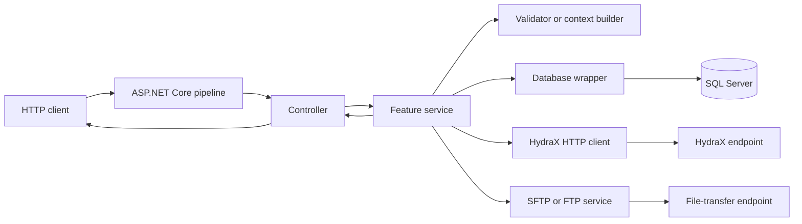
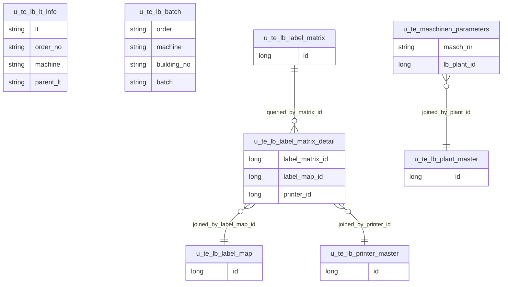
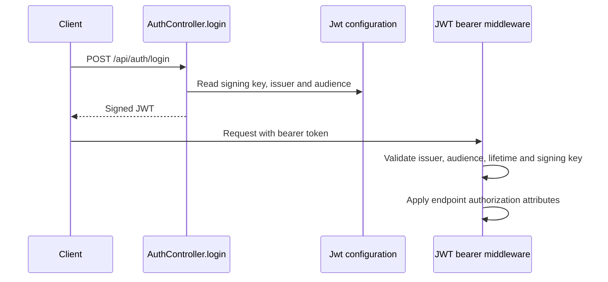
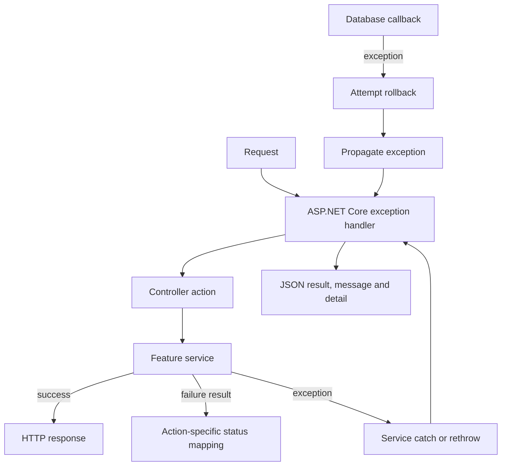

# CLPS .NET Web Service — Technical Design Document

## Document scope

This document covers the .NET solution declared by `CLPS.Service.sln`: `CLPS.Service`, `CLPS.WebUI`, and `CLPS.Tests`. It describes behavior implemented by source code and project/configuration files. Application settings may contain credentials and signing material; values of that kind are not reproduced here.

## 1. Executive Summary

The solution implements an ASP.NET Core service for manufacturing Label Tracking (LT) operations. Capabilities represented in the service include LT creation and retrieval, batch logon/logoff and resolution, label-data generation, printing, association, and site/order/machine lookups. A separate WebUI project serves static content.

The service is organized as a layered application within one Web project: MVC controllers call injected feature services; feature services coordinate validation, SQL access and external integrations. SQL Server access uses Dapper and `Microsoft.Data.SqlClient` through `IDbContext`/`DbContextWrapper`. HydraX is accessed through `HttpClient`; print-file transfer supports SFTP and FTP schemes in `SftpService`.

### Evidence

| File | Class | Method | Evidence |
|---|---|---|---|
| [CLPS.Service.sln](../CLPS.Service.sln) | Solution | — | Lists `CLPS.Service`, `CLPS.Tests`, and `CLPS.WebUI`. |
| [Controllers/CreateLTController.cs](../Controllers/CreateLTController.cs) | `CreateLTController` | Actions | Defines LT, batch, label, print, association, site and validation endpoints. |
| [Services/CreateLT/CreateLTService.cs](../Services/CreateLT/CreateLTService.cs) | `CreateLTService` | `CreateLTAsync` | Resolves site configuration and initiates LT processing. |
| [Services/CreateLT/ContextBuilder/CreateLTContextBuilder.cs](../Services/CreateLT/ContextBuilder/CreateLTContextBuilder.cs) | `CreateLTContextBuilder` | `BuildContextAsync` | Resolves site/order/person/print-master data and validates LT inputs. |
| [Infrastructure/Database/DbContextWrapper.cs](../Infrastructure/Database/DbContextWrapper.cs) | `DbContextWrapper` | `ExecuteAsync` | Provides transaction-scoped SQL callback execution. |
| [Infrastructure/HydraX/HydraXClient.cs](../Infrastructure/HydraX/HydraXClient.cs) | `HydraXClient` | `PostAsync` | Implements HTTP calls to HydraX. |
| [Services/SftpService/SftpService.cs](../Services/SftpService/SftpService.cs) | `SftpService` | `UploadFileAsync` | Implements SFTP/FTP file upload selection. |

## 2. Solution Structure

### Projects

| Project | Project type and target | Responsibility | Project references |
|---|---|---|---|
| `CLPS.Service` | `Microsoft.NET.Sdk.Web`, `net8.0` | HTTP API, feature services, validation, SQL and integrations. | No project reference declared. |
| `CLPS.WebUI` | `Microsoft.NET.Sdk.Web`, `net8.0`; `win-x64` runtime identifier | Static web application host. | No project reference declared. |
| `CLPS.Tests` | `Microsoft.NET.Sdk`, `net8.0`, test project | Unit tests and test helpers. | References `CLPS.Service`. |

### Project hierarchy

```text
CLPS.Service.sln
├── CLPS.Service/
│   ├── Controllers/                 AuthController, CreateLTController
│   ├── Infrastructure/
│   │   ├── Database/                SQL factories, interfaces, wrapper
│   │   ├── HydraX/                  HydraX client and configuration
│   │   └── Transactions/            TransactionContext
│   ├── Models/
│   │   ├── Context/                 site and workflow context
│   │   ├── Entities/                LT, label, printer and batch models
│   │   ├── Internal/                internal workflow result types
│   │   ├── LabelMatrix/             label-matrix query and selection
│   │   ├── LabelMatrixDetail/       label-matrix detail query
│   │   ├── Requests/                request DTOs
│   │   └── Responses/               response DTOs
│   ├── Serialization/               JSON helpers/context
│   ├── Services/                    feature interfaces and implementations
│   ├── Validators/                  LT validation contracts/implementation
│   ├── Resources/                   localized JSON text
│   ├── Properties/                  resources and publish/launch settings
│   ├── docs/
│   ├── wwwroot/pages/
│   ├── Program.cs
│   └── CLPS.Service.csproj
├── CLPS.WebUI/
│   ├── Program.cs
│   └── wwwroot/                     HTML, JavaScript, CSS, locales and libraries
└── CLPS.Tests/
    ├── LTBoxServiceTests.cs
    ├── CreateLTServiceTests.cs
    ├── CreateLTValidatorTests.cs
    ├── LTIdServiceTests.cs
    ├── LogonOutputBatchServiceTests.cs
    └── PrintOutputBatchServiceTests.cs
```

The `Services` directory contains feature areas including `Associate`, `Batch`, `Box`, `ClassTabs`, `Configuration`, `CreateLT`, `CreateLabelData`, `CreatePrintLT`, `LatestLT`, `LicenseTagStatus`, `Localization`, `LogoffOutputBatch`, `LogonOutputBatch`, `LT`, `LTData`, `LTInsert`, `LTPrintMaster`, `Machine`, `MaterialComment`, `Order`, `PartClass`, `Person`, `PrintOutputBatch`, `ProductMaster`, `SftpService`, `Site`, and `ZLabel4Service`.

### Evidence

| File | Class | Method | Evidence |
|---|---|---|---|
| [CLPS.Service.sln](../CLPS.Service.sln) | Solution | — | Declares the three projects and their relative paths. |
| [CLPS.Service.csproj](../CLPS.Service.csproj) | Project | — | Declares Web SDK and `net8.0`. |
| [CLPS.WebUI/CLPS.WebUI.csproj](../../CLPS.WebUI/CLPS.WebUI.csproj) | Project | — | Declares Web SDK, `net8.0`, and `win-x64`. |
| [CLPS.Tests/CLPS.Tests.csproj](../../CLPS.Tests/CLPS.Tests.csproj) | Project | — | Declares test project and reference to `CLPS.Service`. |
| [Program.cs](../Program.cs) | Top-level application | — | Registers feature and infrastructure implementations. |
| [CLPS.WebUI/Program.cs](../../CLPS.WebUI/Program.cs) | Top-level application | — | Configures default-file and static-file handling. |

## 3. Application Architecture

### Architectural organization

The service uses a layered organization inside `CLPS.Service`:

- **Presentation:** MVC controllers bind requests and map outcomes to HTTP responses.
- **Application/services:** feature services coordinate operations and business processing.
- **Validation:** `CreateLTValidator` checks and normalizes LT request values.
- **Infrastructure:** SQL connection/transaction wrappers, HydraX HTTP client, and SFTP/FTP transfer service.
- **Contracts and workflow data:** request/response DTOs, entities and contexts under `Models`.

The solution does not split the service, domain and infrastructure into separate application projects. No CQRS dispatcher or event-bus registration appears in the service composition root.

### Request and data flow



The `CLPS.Service` pipeline is configured in this order: exception handler, static files, HTTPS redirection, CORS, authentication, authorization, controller mapping, request localization, and `Run`.

### LT creation workflow

```mermaid
sequenceDiagram
  participant Client
  participant API as CreateLTController
  participant Create as CreateLTService
  participant Builder as CreateLTContextBuilder
  participant Services as Site, order, person, print-master
  participant Internal as CreateLTInternalService
  participant DB as DbContextWrapper and SQL Server
  Client->>API: POST /api/clps/CreateLT
  API->>Create: CreateLTAsync(request)
  Create->>DB: Resolve site configuration and context
  Create->>Builder: BuildContextAsync
  Builder->>Services: Resolve site and validate LT options
  Builder->>Services: Resolve order and person
  Builder->>Services: Resolve Print Master
  Builder-->>Create: CreateLTContextResult
  Create->>Internal: CreateLTAsync(request, context)
  Internal->>DB: Resolve box and generate LT ID
  Internal->>DB: Insert LT record in transaction
  Internal-->>Create: CreateLTInternalResult
  Create-->>API: CreateLTResponse
  API-->>Client: HTTP response
```

### Evidence

| File | Class | Method | Evidence |
|---|---|---|---|
| [Program.cs](../Program.cs) | Top-level application | — | Configures the service pipeline and DI. |
| [Controllers/CreateLTController.cs](../Controllers/CreateLTController.cs) | `CreateLTController` | `CreateLT` | Calls `ICreateLTService.CreateLTAsync`. |
| [Services/CreateLT/CreateLTService.cs](../Services/CreateLT/CreateLTService.cs) | `CreateLTService` | `CreateLTAsync`, `CreateLTInternalAsync` | Resolves site settings and coordinates builder/internal service. |
| [Services/CreateLT/ContextBuilder/CreateLTContextBuilder.cs](../Services/CreateLT/ContextBuilder/CreateLTContextBuilder.cs) | `CreateLTContextBuilder` | `BuildContextAsync` | Orchestrates validation and required lookup services. |
| [Services/CreateLT/Internal/CreateLTInternalService.cs](../Services/CreateLT/Internal/CreateLTInternalService.cs) | `CreateLTInternalService` | `CreateLTAsync` | Resolves box, ID and insert operations. |

## 4. Configuration

### Application configuration

Configuration is consumed through `IConfiguration` and typed section binding:

| Section/key | Usage |
|---|---|
| `Jwt` | Signing key, issuer and audience used by token creation and bearer validation. |
| `Sites:{installationId}` | Database server/catalog, credentials and connection security options used to build site context. |
| `Sites:{installationId}:HydraX` | HydraX base URL, access ID and credentials bound to `HydraXConfig`. |
| `ConnectionStrings:CLPSDatabase` | Master database connection read by `DbContextFactory.CreateMaster`. |
| `Database:Schema` | Optional schema name; `DbContextFactory` falls back to `dbo`. |
| `Logging` | Logging levels in the JSON settings. |

`Program.cs` configures default request culture `en-US` and supports `en-US`, `en-GB`, `fr-FR`, `de-DE`, `de-AT`, `de-CH`, `ja-JP`, `pt-BR`, `ko-KR`, `th-TH`, `vi-VN`, and `zh-CN`. Configuration values that may be secrets are intentionally not copied into this document.

### Evidence

| File | Class | Method | Evidence |
|---|---|---|---|
| [appsettings.json](../appsettings.json) | Configuration | — | Declares `Jwt`, `Sites`, logging and allowed-host sections. |
| [appsettings.Development.json](../appsettings.Development.json) | Configuration | — | Declares development logging levels. |
| [Program.cs](../Program.cs) | Top-level application | — | Reads JWT settings and configures request-localization cultures. |
| [Services/Configuration/SiteConfigurationService.cs](../Services/Configuration/SiteConfigurationService.cs) | `SiteConfigurationService` | `GetSiteConfigAsync` | Reads the installation-specific site section and maps it to `SiteContext`. |
| [Infrastructure/HydraX/HydraXConfig.cs](../Infrastructure/HydraX/HydraXConfig.cs) | `HydraXConfig` | — | Declares typed HydraX configuration properties. |
| [Infrastructure/HydraX/HydraXConfigResolver.cs](../Infrastructure/HydraX/HydraXConfigResolver.cs) | `HydraXConfigResolver` | `Resolve` | Binds per-installation HydraX configuration and rejects absent configuration. |
| [Infrastructure/Database/DbContextFactory.cs](../Infrastructure/Database/DbContextFactory.cs) | `DbContextFactory` | `Create`, `CreateMaster` | Reads schema and master connection configuration. |

## 5. API Design

### Route conventions

`CreateLTController` has route prefix `/api/clps`; `AuthController` has route template `/api/[controller]`, resolving to `/api/auth`. The endpoint table records authentication attributes as declared on actions. “No action attribute” means neither `[Authorize]` nor `[AllowAnonymous]` appears on that action.

| Endpoint | Verb | Action | Service/operation | Request | Result and implemented status handling | Authentication attribute |
|---|---|---|---|---|---|---|
| `/api/auth/login` | POST | `AuthController.login` | Inline JWT creation | None | `{ token }`; HTTP 200 unless an exception occurs. | None |
| `/api/clps/CreateLT` | POST | `CreateLT` | `ICreateLTService.CreateLTAsync` | `CreateLTRequest` body | Null body → 400; otherwise service result with 200. | `[AllowAnonymous]` |
| `/api/clps/SiteInfo` | GET | `GetSiteInfo` | Site resolver; optional MIP plant resolver | `installationId`, optional `machine` query | Invalid ID → 400; missing site → 404; otherwise 200 site result. | `[AllowAnonymous]` |
| `/api/clps/LogonOutputBatch` | POST | `LogonOutputBatch` | `ILogonOutputBatchService.ExecuteAsync` | `LogonOutputBatchRequest` body | Null/failed result → 400; otherwise 200. | `[AllowAnonymous]` |
| `/api/clps/OrderDetails` | GET | `GetOrderDetails` | `IGetOrderDetailsService.GetOrderDetailsAsync` | `orderOperation`, optional `machine` query | Failed result → 400; otherwise 200. | `[AllowAnonymous]` |
| `/api/clps/LTPrintMaster` | POST | `GetLTPrintMaster` | `IGetLTPrintMasterService.GetLTPrintMasterAsync` | `GetLTPrintMasterRequest` body | Failed result → 400; otherwise 200. | `[AllowAnonymous]` |
| `/api/clps/LTData` | GET | `GetLTData` | `IGetLTDataService.GetLTDataAsync` | `lt`, `installationId` query | Failed result → 400; otherwise 200. | `[AllowAnonymous]` |
| `/api/clps/LogoffOutputBatch` | POST | `LogoffOutputBatch` | `ILogoffOutputBatchService.ExecuteAsync` | `lt`, `qty`, `installationId` query | Failed result → 400; otherwise 200. | `[AllowAnonymous]` |
| `/api/clps/GetLatestLTID` | POST | `GetLatestLTId` | `IGetLatestLTIdService.GetLatestLTIdAsync` | `GetLatestLTIdRequest` | Failed result → 400; otherwise 200. | `[AllowAnonymous]` |
| `/api/clps/GetLTList` | POST | `GetLTList` | `IGetLTListService.GetLTListAsync` | `GetLTListRequest` body | Failed result → 400; otherwise 200. | `[AllowAnonymous]` |
| `/api/clps/batch` | GET | `GetBatch` | `ILTBatchService.ResolveBatchAsync` | Order, machine, building, method; optional batch/site query | Returns 200 with result/order/machine/batch/message fields. | None |
| `/api/clps/CreateLabelData` | POST | `CreateLabelData` | `ICreateLabelDataService.CreateLabelDataAsync` | `CreateLabelDataRequest` body | Null/failed result → 400; otherwise 200. | `[AllowAnonymous]` |
| `/api/clps/Associate` | POST | `Associate` | `IAssociateService.ExecuteAsync` | `AssociateRequest` | Failed result → 400; otherwise 200. | `[Authorize]` |
| `/api/clps/PrintOutputBatch` | POST | `PrintOutputBatch` | `IPrintOutputBatchService.ExecuteAsync` | `PrintOutputBatchRequest` body | Failed result → 400; otherwise 200. | `[AllowAnonymous]` |
| `/api/clps/CreatePrintLT` | POST | `CreatePrintLT` | `ICreatePrintLTService.ExecuteAsync` | `CreatePrintLTRequest` body | Null/failed result → 400; otherwise 200. | `[AllowAnonymous]` |
| `/api/clps/ValidateMachine` | GET | `ValidateMachine` | `IMachineValidationService.ValidateMachineAsync` | `machine`, `installationId` query | Failed result → 400; otherwise 200. | `[AllowAnonymous]` |
| `/api/clps/ValidateRunningOrder` | GET | `ValidateRunningOrder` | `IValidateRunningOrderService.ValidateRunningOrderAsync` | `machine`, `installationId` query | Failed result → 400; otherwise 200. | `[AllowAnonymous]` |
| `/api/clps/GetClassTabs` | GET | `GetClassTabs` | `IGetClassTabsService.GetClassTabsAsync` | `machine`, optional `installationID` query | Blank machine/failed result → 400; otherwise 200. | None |
| `/api/clps/GetUIConfig` | GET | `GetUIConfig` | `IIniConfigurationService.GetValueAsync` | `installationId` query | Returns 200; missing/invalid/error gives result false and value 30; valid values are clamped to at least 10. | None |
| `/api/clps/culture` | GET | `Culture` | Framework culture values | None | Current culture and UI culture; 200. | None |
| `/api/clps/public` | GET | `GetPublic` | Reads static welcome page | None | Missing file → 404; otherwise HTML with 200. | `[AllowAnonymous]` |
| `/api/clps/clear-lt-cache` | POST | `ClearLtCache` | `ILTIdService.ClearCache` | None | Non-Development → 404; Development → clears cache and returns 200. | None |

### DTO coverage

Request/response types reside under `Models/Requests` and `Models/Responses`. API contracts include `CreateLTRequest`/`CreateLTResponse`, `LogonOutputBatchRequest`/`LogonOutputBatchResponse`, `GetLTPrintMasterRequest`/`GetLTPrintMasterResult`, `GetLTDataRequest`/`GetLTDataResult`, `GetLatestLTIdRequest`/`GetLatestLTIdResult`, `GetLTListRequest`/`GetLTListResult`, `AssociateRequest`/`AssociateResponse`, `PrintOutputBatchRequest`/`PrintOutputBatchResponse`, and `CreatePrintLTRequest`/`CreatePrintLTResponse`.

### Evidence

| File | Class | Method | Evidence |
|---|---|---|---|
| [Controllers/CreateLTController.cs](../Controllers/CreateLTController.cs) | `CreateLTController` | All action methods | Declares route/action attributes, parameters, service calls and HTTP response mapping. |
| [Controllers/AuthController.cs](../Controllers/AuthController.cs) | `AuthController` | `login` | Declares `/api/auth/login` and token result. |
| [Models/Requests](../Models/Requests) | Request DTOs | — | Defines action request contracts. |
| [Models/Responses](../Models/Responses) | Response DTOs | — | Defines operation result contracts. |

## 6. Service Design

### Feature service contracts

| Interface | Implementation | Responsibility evidenced by implementation |
|---|---|---|
| `ICreateLTService` | `CreateLTService` | Resolve site context and orchestrate LT creation. |
| `ICreateLTContextBuilder` | `CreateLTContextBuilder` | Resolve site/order/person/print-master dependencies and validate LT context. |
| `ICreateLTInternalService` | `CreateLTInternalService` | Select box, generate LT ID and insert LT. |
| `IValidator<CreateLTValidationModel>` | `CreateLTValidator` | Normalize/validate LT class, level and WIP stage. |
| `ISiteResolverService` | `SiteResolverService` | Resolve site fields from the site database. |
| `IGetOrderDetailsService` | `GetOrderDetailsService` | Retrieve order and machine information. |
| `IGetPersonDetailsService` | `GetPersonDetailsService` | Validate person information. |
| `IGetLTPrintMasterService` | `GetLTPrintMasterService` | Resolve label matrix/detail and print-master values. |
| `ILTBatchService` | `LTBatchService` | Resolve batches using supported batch modes. |
| `ILTBoxService` | `LTBoxService` | Read and advance box number state. |
| `ILTIdService` | `LTIdService` | Generate LT identifiers and maintain last-ID cache. |
| `ILTInsertService` | `LTInsertService` | Validate and insert LT entities. |
| `ILogonOutputBatchService` | `LogonOutputBatchService` | Create LT and execute HydraX logon/material operations. |
| `ILogoffOutputBatchService` | `LogoffOutputBatchService` | Process output-batch logoff. |
| `IAssociateService` | `AssociateService` | Execute machine/LT association workflow. |
| `IPrintOutputBatchService` | `PrintOutputBatchService` | Validate LT print request, resolve print data, upload and update status. |
| `ICreatePrintLTService` | `CreatePrintLTService` | Coordinate logoff, print and logon steps. |
| `ICreateLabelDataService` | `CreateLabelDataService` | Build label data from configured maps and related records. |
| `ISftpService` | `SftpService` | Transfer files using supported SFTP/FTP schemes. |

`Program.cs` registers feature and infrastructure implementations with scoped lifetime. It also registers `AddHttpClient`, `IHttpContextAccessor`, localization, and request-localization options.

### Evidence

| File | Class | Method | Evidence |
|---|---|---|---|
| [Program.cs](../Program.cs) | Top-level application | — | Registers service interfaces and implementations with `AddScoped`. |
| [Services/CreateLT/CreateLTService.cs](../Services/CreateLT/CreateLTService.cs) | `CreateLTService` | `CreateLTAsync`, `CreateLTInternalAsync` | Orchestrates LT workflow through injected dependencies. |
| [Services/CreateLT/ContextBuilder/CreateLTContextBuilder.cs](../Services/CreateLT/ContextBuilder/CreateLTContextBuilder.cs) | `CreateLTContextBuilder` | `BuildContextAsync` | Performs dependency lookups and assembles context. |
| [Validators/CreateLTValidator.cs](../Validators/CreateLTValidator.cs) | `CreateLTValidator` | `ValidateAsync` | Applies LT class/level/WIP rules. |
| [Services/CreateLT/Internal/CreateLTInternalService.cs](../Services/CreateLT/Internal/CreateLTInternalService.cs) | `CreateLTInternalService` | `CreateLTAsync` | Coordinates box, ID generation and persistence. |
| [Services/PrintOutputBatch/PrintOutputBatchService.cs](../Services/PrintOutputBatch/PrintOutputBatchService.cs) | `PrintOutputBatchService` | `ExecuteAsync` | Coordinates print processing. |

## 7. Data Access Design

### SQL access model

The data-access abstraction consists of `IConnectionFactory`, `IDbContextFactory`, `IDbContext` and `DbContextWrapper`. `ConnectionFactory` builds a SQL Server connection string from `SiteContext`. `DbContextFactory.Create` creates a site-specific wrapper; `CreateMaster` reads the master connection string. `DbContextWrapper.ExecuteAsync` opens a `SqlConnection`, begins a `SqlTransaction`, invokes a callback, commits on success, and attempts rollback before rethrowing when the callback fails.

Feature services contain parameterized Dapper queries and direct ADO.NET operations. No separate repository abstraction is identified in analyzed source code. Entity Framework Core usage is not identified in analyzed source code.

### Integrations

- `HydraXClient` sends JSON HTTP requests to a per-installation HydraX endpoint and implements session logout and transaction commit operations.
- `SftpService.UploadFileAsync` accepts SFTP or FTP URI schemes and routes to the corresponding transfer implementation.
- Database/provider implementation is Microsoft SQL Server through `Microsoft.Data.SqlClient`.

### Evidence

| File | Class | Method | Evidence |
|---|---|---|---|
| [Infrastructure/Database/IConnectionFactory.cs](../Infrastructure/Database/IConnectionFactory.cs) | `IConnectionFactory` | `BuildConnectionString` | Defines connection-string construction contract. |
| [Infrastructure/Database/ConnectionFactory.cs](../Infrastructure/Database/ConnectionFactory.cs) | `ConnectionFactory` | `BuildConnectionString` | Populates `SqlConnectionStringBuilder` from `SiteContext`. |
| [Infrastructure/Database/IDbContext.cs](../Infrastructure/Database/IDbContext.cs) | `IDbContext` | `ExecuteAsync` | Defines callback signatures carrying SQL connection and transaction. |
| [Infrastructure/Database/DbContextWrapper.cs](../Infrastructure/Database/DbContextWrapper.cs) | `DbContextWrapper` | `ExecuteAsync` | Implements SQL connection, transaction, commit and rollback behavior. |
| [Infrastructure/Database/DbContextFactory.cs](../Infrastructure/Database/DbContextFactory.cs) | `DbContextFactory` | `Create`, `CreateMaster` | Creates wrapper for site or master database configuration. |
| [Infrastructure/HydraX/HydraXClient.cs](../Infrastructure/HydraX/HydraXClient.cs) | `HydraXClient` | `PostAsync`, `LogoutAsync`, `CommitTransactionAsync` | Implements HydraX HTTP operations. |
| [Services/SftpService/SftpService.cs](../Services/SftpService/SftpService.cs) | `SftpService` | `UploadFileAsync` | Chooses SFTP/FTP implementation by URI scheme. |

## 8. Database Design

### Models and SQL entities

The source includes plain C# data models and embedded SQL statements. No EF Core context, `DbSet`, EF entity configuration, or EF migrations are identified in analyzed source code. Standalone SQL migration/script files are not identified in the service implementation; sequence creation SQL used by batch processing is embedded in C#.

| Entity/table | Key or identity evidence | Relationships/query behavior | Implementation evidence |
|---|---|---|---|
| `LTEntity` / `u_te_lb_lt_info` | Database key: Not identified in analyzed source code. | LT, order, machine, part, class, batch, box, parent-LT and other fields are queried/inserted/updated. | `LTInsertService`, LT lookup/status/association services. |
| `LTBatchRecord` / `u_te_lb_batch` | Database key: Not identified in analyzed source code. | AUTO batch lookup uses order, machine and building; inserted mapping carries batch and update date. | `LTBatchService`. |
| `u_site_infox` | Database key: Not identified in analyzed source code. | Filtered by installation ID to resolve site metadata. | `SiteResolverService`. |
| `u_te_maschinen_parameters` | Database key: Not identified in analyzed source code. | Machine number joins to plant master by plant ID; used for validation and class tabs. | Site/MIP resolver, machine validation and class-tab services. |
| `u_te_lb_plant_master` | Database key: Not identified in analyzed source code. | Joined from machine parameters; provides plant/building/country data. | Print Master and MIP plant services. |
| `u_te_lb_label_matrix` | `LabelMatrix.Id` maps queried ID; physical PK: Not identified in analyzed source code. | Selection scores part/tool/machine/group/category matches. | `LabelMatrix.getLabelMatrixSQL`, `ResolveLabelMatrix`. |
| `u_te_lb_label_matrix_detail` | Physical key: Not identified in analyzed source code. | Filtered by matrix ID, level, label class and WIP stage; joins label map and printer master. | `LabelMatrixDetail.getLabelMatrixDetailSQL`. |
| `u_te_lb_label_map`, `u_te_lb_label_map_detail` | `LabelMapDb.Id` maps queried ID; physical keys: Not identified in analyzed source code. | Detail query joins map ID and returns field/property/method mapping. | `CreateLabelDataService`, `LabelMatrixDetail`. |
| `u_te_lb_printer_master` | Physical key: Not identified in analyzed source code. | Joined by printer ID for matrix detail and LT list. | Printer resolution and label configuration queries. |
| `u_te_lb_part_master`, `u_te_lb_part_zzapq_qty` | Physical keys: Not identified in analyzed source code. | Package quantity query filters by plant, part-master ID and package type. | `GetLTPrintMasterService`. |
| `u_te_lb_machine_association` | Physical key: Not identified in analyzed source code. | Machine lookup and insert; association service also updates LT parent/sub-status/quantity fields. | `AssociateService`. |
| `u_te_lb_sftp_bt_master` | Physical key: Not identified in analyzed source code. | BT-server configuration lookup by ID. | `BTServerService`. |
| `u_te_lb_configuration` | Physical key: Not identified in analyzed source code. | Configuration lookup by INI name, section and key. | `IniConfigurationService`. |
| `u_te_lb_zlabel4` | Physical key: Not identified in analyzed source code. | Read by configured ZLabel4 classes. | `ZLabel4Service`. |
| Manufacturing tables (`auftrags_bestand`, `auftrag_status`, `maschinen`, `res_bestand`) | Physical keys: Not identified in analyzed source code. | Used by order/manufacturing queries. | `GetOrderDetailsService`, Print Master and related services. |

Table/column types, physical primary keys, foreign-key constraints, and index definitions are **Not identified in analyzed source code.** The relationships above describe SQL joins and filters present in query text, not a claim about database constraints.

### Logical relationship diagram



Relationships displayed are joins/filters found in source SQL; the diagram does not define physical database constraints.

### Evidence

| File | Class | Method | Evidence |
|---|---|---|---|
| [Models/Entities/LTEntity.cs](../Models/Entities/LTEntity.cs) | `LTEntity` | — | Defines fields inserted for an LT record. |
| [Services/LTInsert/LTInsertService.cs](../Services/LTInsert/LTInsertService.cs) | `LTInsertService` | `InsertLTAsync` | Inserts LT fields into `u_te_lb_lt_info`. |
| [Services/Batch/LTBatchService.cs](../Services/Batch/LTBatchService.cs) | `LTBatchService` | `ResolveBatchAsync` | Queries and inserts AUTO batch mappings and creates SQL sequences. |
| [Models/LabelMatrix/LabelMatrix.cs](../Models/LabelMatrix/LabelMatrix.cs) | `LabelMatrix` | `getLabelMatrixSQL`, `ResolveLabelMatrix` | Queries and selects label-matrix matches. |
| [Models/LabelMatrixDetail/LabelMatrixDetail.cs](../Models/LabelMatrixDetail/LabelMatrixDetail.cs) | `LabelMatrixDetail` | `getLabelMatrixDetailSQL` | Queries detail and joins map/printer tables. |
| [Services/Site/SiteResolverService.cs](../Services/Site/SiteResolverService.cs) | `SiteResolverService` | `ResolveSiteAsync` | Queries `u_site_infox` by installation ID. |

## 9. Business Rules

### LT validation and processing rules

| Rule | Implementation |
|---|---|
| LT class defaults to `3SI`; accepted values are `3SI`, `3S`, and `4S`; inputs are trimmed and uppercased. | `CreateLTValidator.ValidateAsync`. |
| Level defaults to 1 and must be 1–3; `3SI` permits only level 1; level 2 requires `3S` or `4S`. | `CreateLTValidator.ValidateAsync`. |
| WIP stage defaults to `FG`; `FG` is the only accepted value. | `CreateLTValidator.ValidateAsync`. |
| Positive request quantity takes precedence over positive Print Master label quantity. | `CreateLTContextBuilder.ResolveQuantity`. |
| `CreateLTInternalService.GetPrefix` maps `3S` and `3SI` to prefix `3S`; other values throw. | `CreateLTInternalService.GetPrefix`. |
| LT insert requires a positive box and nonblank order, class and LT. | `LTInsertService.ValidateEntity`. |
| Label matrix records are ranked by configured specificity; missing/ambiguous selection throws. | `LabelMatrix.getLabelMatrixSQL`, `ResolveLabelMatrix`. |
| SAP batch mode trims returned value, rejects over-10-character values and returns `"0"` for blank/zero. AUTO mode reuses matching order/machine/building mapping or allocates a sequence-based batch and inserts a mapping. | `LTBatchService.ResolveBatchAsync`. |
| UI refresh is 30 when missing/invalid; valid values are clamped to a minimum of 10. | `CreateLTController.GetUIConfig`. |
| LT cache-clear endpoint returns 404 outside Development. | `CreateLTController.ClearLtCache`. |

### Workflow processing rules

`CreateLTContextBuilder.BuildContextAsync` performs site resolution and LT validation concurrently, then order and person lookup concurrently, followed by Print Master resolution. `CreateLTInternalService.CreateLTAsync` serializes its critical section through a static `SemaphoreSlim`. `CreatePrintLTService.ExecuteAsync` performs logoff, print and logon steps, and constructs response messages for partial outcomes.

### Evidence

| File | Class | Method | Evidence |
|---|---|---|---|
| [Validators/CreateLTValidator.cs](../Validators/CreateLTValidator.cs) | `CreateLTValidator` | `ValidateAsync` | Defines class, level and WIP defaults and accepted values. |
| [Services/CreateLT/ContextBuilder/CreateLTContextBuilder.cs](../Services/CreateLT/ContextBuilder/CreateLTContextBuilder.cs) | `CreateLTContextBuilder` | `BuildContextAsync`, `ResolveQuantity` | Implements prerequisite workflow and quantity selection. |
| [Services/CreateLT/Internal/CreateLTInternalService.cs](../Services/CreateLT/Internal/CreateLTInternalService.cs) | `CreateLTInternalService` | `CreateLTAsync`, `GetPrefix` | Serializes creation and selects LT prefix. |
| [Services/LTInsert/LTInsertService.cs](../Services/LTInsert/LTInsertService.cs) | `LTInsertService` | `ValidateEntity` | Validates required LT insert values. |
| [Services/Batch/LTBatchService.cs](../Services/Batch/LTBatchService.cs) | `LTBatchService` | `ResolveBatchAsync` | Implements SAP and AUTO batch handling. |
| [Models/LabelMatrix/LabelMatrix.cs](../Models/LabelMatrix/LabelMatrix.cs) | `LabelMatrix` | `ResolveLabelMatrix` | Implements matching specificity and ambiguous-result handling. |
| [Controllers/CreateLTController.cs](../Controllers/CreateLTController.cs) | `CreateLTController` | `GetUIConfig`, `ClearLtCache` | Implements refresh-value fallback/clamp and development-only cache clearing. |
| [Services/CreatePrintLT/CreatePrintLTService.cs](../Services/CreatePrintLT/CreatePrintLTService.cs) | `CreatePrintLTService` | `ExecuteAsync` | Implements logoff/print/logon order and partial outcomes. |

## 10. Security Design

### JWT and authorization

`Program.cs` configures JWT bearer authentication as the default authenticate and challenge scheme. Issuer, audience, lifetime and signing-key validation are enabled. `AuthController.login` creates a JWT with fixed Name and Admin role claims and a one-day expiration. Its source comment describes user validation as dummy validation.

`UseAuthentication` precedes `UseAuthorization`. `CreateLTController.Associate` has `[Authorize]`. Several actions have `[AllowAnonymous]`; actions without either attribute have no action-level authorization declaration. No named authorization policy registration is present in `Program.cs`.

| Endpoint group | Declared protection |
|---|---|
| `/api/clps/Associate` | `[Authorize]`. |
| CreateLT, SiteInfo, LogonOutputBatch, OrderDetails, LTPrintMaster, LTData, LogoffOutputBatch, GetLatestLTID, GetLTList, CreateLabelData, PrintOutputBatch, CreatePrintLT, ValidateMachine, ValidateRunningOrder, public | `[AllowAnonymous]`. |
| batch, GetClassTabs, GetUIConfig, culture, clear-lt-cache | No action-level authorization attribute. |
| `/api/auth/login` | No action-level authorization attribute. |

### Authentication sequence



### Evidence

| File | Class | Method | Evidence |
|---|---|---|---|
| [Program.cs](../Program.cs) | Top-level application | — | Configures JWT bearer validation and authentication/authorization middleware. |
| [Controllers/AuthController.cs](../Controllers/AuthController.cs) | `AuthController` | `login` | Creates token with fixed Name/Admin claims and configured signing material. |
| [Controllers/CreateLTController.cs](../Controllers/CreateLTController.cs) | `CreateLTController` | `Associate` and annotated actions | Declares endpoint-level `[Authorize]`/`[AllowAnonymous]`. |
| [appsettings.json](../appsettings.json) | Configuration | — | Defines JWT configuration section names; values intentionally omitted. |

## 11. Error Handling and Logging

### Error handling

The service registers an inline ASP.NET Core exception handler that writes JSON fields `result`, `message`, and `detail`; `detail` contains the exception stack trace. Controller actions also map service result failures to HTTP 400 in operation-specific cases. `DbContextWrapper` attempts rollback after callback failure and rethrows. `HydraXClient.PostAsync` throws `HttpRequestException` when HydraX returns a non-success status. Several services log exceptions before rethrowing or converting them to result DTOs.

### Logging

Serilog is configured with minimum level `Debug`, with `Microsoft` and `System` category overrides at `Information`. Console and daily rolling file sinks are configured. The source uses `Debug`, `Information`, `Warning`, and `Error` log calls.

### Error flow



### Evidence

| File | Class | Method | Evidence |
|---|---|---|---|
| [Program.cs](../Program.cs) | Top-level application | — | Configures exception JSON handler, Serilog levels/sinks and host logger. |
| [Infrastructure/Database/DbContextWrapper.cs](../Infrastructure/Database/DbContextWrapper.cs) | `DbContextWrapper` | `ExecuteAsync` | Commits on success; attempts rollback and rethrows on callback failure. |
| [Infrastructure/HydraX/HydraXClient.cs](../Infrastructure/HydraX/HydraXClient.cs) | `HydraXClient` | `PostAsync` | Throws `HttpRequestException` for non-success response. |
| [Services/Site/SiteResolverService.cs](../Services/Site/SiteResolverService.cs) | `SiteResolverService` | `ResolveSiteAsync` | Logs error and rethrows resolution exceptions. |
| [Controllers/CreateLTController.cs](../Controllers/CreateLTController.cs) | `CreateLTController` | Actions | Maps selected result failures to HTTP 400/404. |

## 12. Testing

The solution test project targets `net8.0`, references `CLPS.Service`, and declares xUnit, Moq, Microsoft.NET.Test.Sdk and coverlet collector. `LTBoxServiceTests` contains three active `[Fact]` tests:

1. `IncrementBoxAsync_ShouldIncreaseValue` verifies consecutive cache increments.
2. `ShouldNotIncrement_WhenInsertFails` verifies repeated latest-box reads return the same cached value when no increment is performed.
3. `Should_Not_Create_Duplicates` runs parallel increments and asserts returned values are distinct.

`CreateLTServiceTests.cs`, `CreateLTValidatorTests.cs`, `LTIdServiceTests.cs`, `LogonOutputBatchServiceTests.cs`, and `PrintOutputBatchServiceTests.cs` contain commented-out test declarations. A distinct integration-test project or fixture is Not identified in analyzed source code.

### Evidence

| File | Class | Method | Evidence |
|---|---|---|---|
| [CLPS.Tests/CLPS.Tests.csproj](../../CLPS.Tests/CLPS.Tests.csproj) | Project | — | Declares test framework dependencies and reference to service project. |
| [CLPS.Tests/LTBoxServiceTests.cs](../../CLPS.Tests/LTBoxServiceTests.cs) | `LTBoxServiceTests` | `IncrementBoxAsync_ShouldIncreaseValue` | Asserts values increase by one across cache increments. |
| [CLPS.Tests/LTBoxServiceTests.cs](../../CLPS.Tests/LTBoxServiceTests.cs) | `LTBoxServiceTests` | `ShouldNotIncrement_WhenInsertFails` | Asserts two latest-box reads remain equal. |
| [CLPS.Tests/LTBoxServiceTests.cs](../../CLPS.Tests/LTBoxServiceTests.cs) | `LTBoxServiceTests` | `Should_Not_Create_Duplicates` | Asserts parallel increment results are unique. |
| [CLPS.Tests/CreateLTServiceTests.cs](../../CLPS.Tests/CreateLTServiceTests.cs) | `CreateLTServiceTests` | — | Test source is commented out. |
| [CLPS.Tests/PrintOutputBatchServiceTests.cs](../../CLPS.Tests/PrintOutputBatchServiceTests.cs) | `PrintOutputBatchServiceTests` | — | Test source is commented out. |
