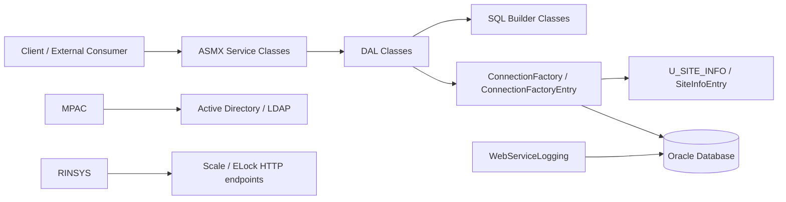
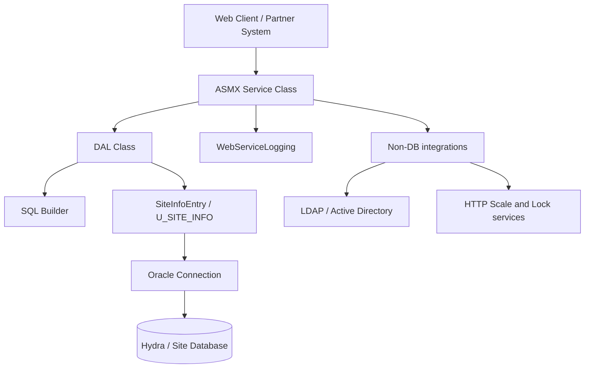
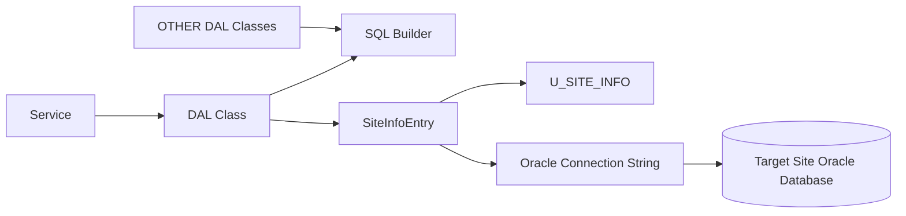
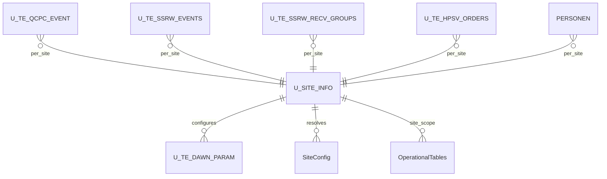

# Executive Summary

This solution is implemented as a classic ASP.NET Web Service (ASMX) application on the .NET Framework, not ASP.NET Core. The authoritative evidence is the project file target framework (`TargetFrameworkVersion v4.5.2`) and the use of `System.Web.Services.WebService` across the service classes. The implementation centers on a set of ASMX endpoints that expose data access and operational workflows for manufacturing, quality, event, operator, and machine monitoring.

The solution is organized around:
- public web service classes in the project root (for example, `HDVE`, `HYQS`, `MPAC`, `RINSYS`, `SSRR`, `SSRN`, `PAWS`, `DAWN`)
- database access layers under the `DAL` folder
- SQL builders under the `DAL` folder, typically named `*_SQL.cs`
- shared infrastructure classes under `Classes` for connection management, logging, parameter handling, and conversion utilities
- a Windows Forms client project (`HDVEClient`) used as a manual test harness

The primary runtime pattern is:
- a service class receives a request
- a corresponding `*_DAL` class performs Oracle queries
- connection metadata is resolved from the central `U_SITE_INFO` table or the service's configured connection profile
- results are returned as XML, JSON payloads, or strongly typed DTO-like objects

The solution is tightly coupled to Oracle database access and uses `System.Data.OracleClient` throughout. It also uses Active Directory LDAP validation for MPAC user authentication, and it exposes configuration values from `Web.config` and application settings.

| File | Class | Method | Evidence |
|---|---|---|---|
| [mesTE.Web.DAWN/mesTE.Web.DAWN.csproj](mesTE.Web.DAWN/mesTE.Web.DAWN.csproj) | N/A | N/A | Project targets .NET Framework 4.5.2 and includes `System.Web.Services` and `System.Web` references, confirming an ASMX/ASP.NET classic web service implementation. |
| [mesTE.Web.DAWN/DAWN.asmx.cs](mesTE.Web.DAWN/DAWN.asmx.cs) | `DAWN` | `Select`, `DedicatedSelect`, `SelectWithParameters`, `DedicatedSelectWithParameters` | These are public `[WebMethod]` methods on a `System.Web.Services.WebService` class, confirming the exposure model. |
| [mesTE.Web.DAWN/DAL/DAL.cs](mesTE.Web.DAWN/DAL/DAL.cs) | `DAL` | `GetConnectionInformation` | Service-specific database access is resolved by querying the central metadata table and constructing an Oracle connection string. |

# Solution Structure

The solution contains two projects:
- `mesTE.Web.DAWN` — the web service application
- `HDVEClient` — a Windows Forms client used to exercise the HDVE service

The web service project contains:
- root-level ASMX service classes (`*.asmx.cs`)
- a `DAL` folder with data access classes
- a `Classes` folder with shared models, connection management, logging, and utility classes
- `Global.asax.cs` for ASP.NET application lifecycle events
- `Web.config` and `Properties/Settings.Designer.cs` for configuration

The service implementations are domain-oriented and correspond closely to manufacturing and production data domains:
- `HDVE` — machine and order data, license tag data, maintenance data
- `HYQS` — quality inspection and SPC data
- `MPAC` — user rights, personnel, work order actions, BAPI integration
- `RINSYS` — DQIP / cavity / scale / lock / andon integration
- `SSRN` / `SSRR` — event handling and receiving group management
- `PAWS` — OEE data
- `HAWS` — HPSV machine and order data
- `Andon` — event retrieval and response integration
- `dQCPC` — quality control event feed

The actual runtime structure follows a layered pattern:

| File | Class | Method | Evidence |
|---|---|---|---|
| [mesTE.Web.DAWN/Global.asax.cs](mesTE.Web.DAWN/Global.asax.cs) | `Global` | `Application_Start`, `Session_Start`, `Application_BeginRequest`, etc. | ASP.NET application lifecycle hooks are present, but the methods are empty, indicating no custom app-level startup logic. |
| [mesTE.Web.DAWN/mesTE.Web.DAWN.csproj](mesTE.Web.DAWN/mesTE.Web.DAWN.csproj) | N/A | N/A | The project structure includes the main web service and references for the AWS SDK and Oracle-related libraries. |
| [HDVEClient/Program.cs](HDVEClient/Program.cs) | `Program` | `Main` | This Windows Forms app is the only explicit test harness in the solution and launches the license-tag test UI. |

# Application Architecture

The application is structured as an ASMX web service platform with a shared infrastructure layer. The dominant pattern is one web service class per business domain, each backed by dedicated data-access classes and SQL-generation routines. There is no ASP.NET Core MVC/Web API pipeline, no `Startup.cs`, and no `IServiceCollection` registration pattern in the repository.

The main architectural characteristics are:

- layered service architecture
  - UI consumer or partner service calls an ASMX method
  - service calls a `*_DAL` class
  - `*_DAL` class invokes database SQL built by `*_SQL`
  - result is serialized to XML/JSON or returned as DTO-like classes

- multi-site connection model
  - central config table `U_SITE_INFO` holds site metadata
  - the `DAL` layer resolves a site using `TE_HYDRA_ALIAS`
  - `SiteInfoEntry` contains Hydra user/password, host, domain, SID, port, and application server fields

- connection factory / pooling
  - `ConnectionFactory` owns a pool of `ConnectionFactoryEntry` objects
  - it supports dedicated tokens, async execution, cleanup timer, retry logic, and result tracking

- cross-cutting logging
  - `WebServiceLogging.LogWebServiceUseage` records start/stop actions per web service call, including user host address and request details

- external integrations
  - Active Directory via `DirectoryEntry` in `MPAC.IsValidUserPwd`
  - HTTP endpoints for scale and E-Lock via `ScaleAddress` and `ELockAddress`
  - BAPI integration in `MPACBAPI`

| File | Class | Method | Evidence |
|---|---|---|---|
| [mesTE.Web.DAWN/Classes/ConnectionFactory.cs](mesTE.Web.DAWN/Classes/ConnectionFactory.cs) | `ConnectionFactory` | `Initialize`, `Cleanup`, `AddConnection`, `GetUsableConnectionIndex` | The connection factory manages reusable Oracle connections, retry handling, and cleanup of idle connections. |
| [mesTE.Web.DAWN/Classes/ConnectionFactoryEntry.cs](mesTE.Web.DAWN/Classes/ConnectionFactoryEntry.cs) | `ConnectionFactoryEntry` | `CreateConnection`, `Select`, `Dispose` | A connection entry encapsulates the Oracle connection, transaction state, timestamps, last command metrics, and disposal lifecycle. |
| [mesTE.Web.DAWN/Classes/WebServiceLogging.cs](mesTE.Web.DAWN/Classes/WebServiceLogging.cs) | `WebServiceLogging` | `ConfigureConnection`, `LogWebServiceUseage` | Request logging is implemented as a reusable infrastructure service with Oracle-backed persistence. |

# Configuration and Dependency Injection

The solution does not use an ASP.NET Core dependency injection container. There are no `Startup` classes or service registrations. Instead, object creation is direct and static:
- `Global` lifecycle methods are empty
- `ConnectionFactory` is instantiated directly in `DAWN`
- `DAL` is static
- `WebServiceLogging` is static
- settings are read from `Web.config` and generated settings classes

Configuration is split between:
- `Web.config` application settings and IIS settings
- `Properties.Settings.Default` application settings generated from the config
- XML-based external connection metadata file loaded in `BASE_DAL.InitializeConnection` and `DAL.CreateSiteInfoConnection`

Important configuration entries implemented in source:
- `ELockAddress`
- `ScaleAddress`
- `WeightDecimal`
- `DqipPictureFolder`
- database connection defaults: `Database`, `Server`, `Port`, `SID`, `Domain`, `MPACMinimumRights`

Evidence:

| File | Class | Method | Evidence |
|---|---|---|---|
| [mesTE.Web.DAWN/Web.config](mesTE.Web.DAWN/Web.config) | N/A | N/A | IIS module config, request size limits, Windows authentication, HTTP GET protocol support, and endpoint app settings are defined here. |
| [mesTE.Web.DAWN/Properties/Settings.Designer.cs](mesTE.Web.DAWN/Properties/Settings.Designer.cs) | `Settings` | `Database`, `Server`, `Port`, `SID`, `Domain`, `MPACMinimumRights` | Default site/database settings are generated and used by service business logic. |
| [mesTE.Web.DAWN/MPAC.asmx.cs](mesTE.Web.DAWN/MPAC.asmx.cs) | `MPAC` | `GetUserData` | Rights validation is enforced by comparing `GetRightsByUser(user)` to `Properties.Settings.Default.MPACMinimumRights`. |
| [mesTE.Web.DAWN/DAL/DAL.cs](mesTE.Web.DAWN/DAL/DAL.cs) | `DAL` | `CreateSiteInfoConnection` | The connection metadata is loaded from `central.db.config.xml` under `Program Files\mesTE\common`. |

Notable design conclusion:
- there is no ASP.NET Core dependency injection system in this codebase
- configuration is environment-based and static
- site and database connectivity is resolved at runtime with XML and metadata tables

# API Design

The solution exposes a large set of ASMX web methods. These methods are defined as `[WebMethod]` on classes extending `System.Web.Services.WebService`. Method exposure patterns vary:
- some return primitive strings
- some return strongly typed objects or lists
- some produce JSON directly by writing to `Context.Response`
- some use XML/JSON string payloads rather than typed SOAP objects

API categories implemented in the source:

| Service Class | Representative Methods | Return Style | Purpose |
|---|---|---|---|
| `DAWN` | `Select`, `SelectWithParameters`, `GetConnectionToken`, `ResumeConnectionToken`, `IsResultReady` | `long`, `void` | Generic asynchronous SQL execution via Oracle connections and tokens |
| `HDVE` | `HDVEGetData`, `HDVEGetDataJSON`, `HDVCGetLicenseTagData`, `GetLastestLicenseTagData` | `string`, `void`, `LicenseTagResponse` | Machine/order data, maintenance information, license tag validation |
| `HYQS` | `GetHydraQualityData`, `GetInspectionDataInJson`, `GetInspectionDataSPC`, `GetInitialLoadDataInJson` | `string`, `void` | Quality inspection and SPC data retrieval |
| `MPAC` | `GetAdeGrundByMachine`, `GetPersonDataByUser`, `GetRightsByUser`, `IsValidUserPwd`, `GetUserData`, `SendBAPI` | `List<T>`, `string`, `bool`, `int` | User validation, authorization, order processing, SAP/BAPI workflow |
| `RINSYS` | `Scale`, `OpenLock`, `Andon`, `GetDQIPbyPartNumberInJson`, `GetCavityInfoByMachineNrInJson` | `string` | Scale integration, lock integration, DQIP and cavity info |
| `SSRN` | `GetMachines`, `GetTerminals`, `GetTerminalMachines`, `CreateEvent`, `CancelEvent` | `string`, `List<T>` | Event and receiving-group operations |
| `SSRR` | `GetUserInformation`, `GetEvents`, `SetEventStatus`, `CreateQCPCEvent`, `SetCostCenter` | `string`, `List<T>` | Event response and cost center updates |
| `dQCPC` | `GetQCPCEventsByHoursJSON`, `GetQCPCEventsByDate`, `GetQCPCEventsWithParentchildDataByDate` | `string` or `void` | QC event feed retrieval |
| `Andon` | `GetAndonEvents`, `GetAndonEventStatus`, `InsertEvent`, `DownloadLog` | `string`, `DataTable`, etc. | Event monitoring and update workflow |
| `PAWS` | `GetOEEData`, `GetOeeDataByPlant`, `GetOeeDataByPlantReportingGroupMachine` | `string` | OEE data retrieval per plant/group/machine |
| `HAWS` | `GetHPSVMachines`, `GetHPSVMachinesOrders` | `string` | HPSV machine and order data |

The following service classes are present but contain no active `[WebMethod]` definitions in the inspected code:
- `HYMD`
- `OperationService`
- `Template`

Evidence table:

| File | Class | Method | Evidence |
|---|---|---|---|
| [mesTE.Web.DAWN/DAWN.asmx.cs](mesTE.Web.DAWN/DAWN.asmx.cs) | `DAWN` | `Select`, `DedicatedSelect`, `SelectWithParameters`, `DedicatedSelectWithParameters`, `GetConnectionToken`, `ResumeConnectionToken`, `IsResultReady` | This is the generic data access API for raw database select operations using connection tokens. |
| [mesTE.Web.DAWN/HDVE.asmx.cs](mesTE.Web.DAWN/HDVE.asmx.cs) | `HDVE` | `HDVEGetDataJSON`, `HDVEGetDataMachineBasedJSON`, `HDVCGetLicenseTagData` | This service returns JSON or typed objects, and it logs request lifecycle metrics through `WebServiceLogging`. |
| [mesTE.Web.DAWN/MPAC.asmx.cs](mesTE.Web.DAWN/MPAC.asmx.cs) | `MPAC` | `IsValidUserPwd`, `GetUserData`, `SendBAPI` | User credential validation and BAPI submission are both implemented in the service layer. |
| [mesTE.Web.DAWN/RINSYS.asmx.cs](mesTE.Web.DAWN/RINSYS.asmx.cs) | `RINSYS` | `Scale`, `OpenLock`, `Andon` | External HTTP integration points are implemented via configuration addresses in `Web.config`. |

# Service Design

The service design is domain-specific and largely CRUD/reporting oriented. Service methods often embody business queries, not generic REST resource operations. There is no layered application framework; instead, each web service class acts as a façade over database logic, with the majority of validation and transformation logic happening in `*_DAL` classes and utility methods.

Key service responsibilities:

1. `DAWN`
   - generic asynchronous database query execution
   - connection token management and result readiness
   - connection cleanup and parameter-driven retry logic

2. `HDVE`
   - retrieves production and machine information
   - supports table-based and JSON-based result formats
   - includes license-tag retrieval and maintenance processing

3. `MPAC`
   - validates users against Active Directory
   - compares user rights against `MPACMinimumRights`
   - retrieves person and machine data
   - invokes `MPACBAPI` for sending business transactions

4. `RINSYS`
   - scale integration to configured `ScaleAddress`
   - E-Lock control to configured `ELockAddress`
   - DQIP order and cavity data retrieval
   - andon notification operations

5. `SSRN` / `SSRR`
   - receiving group and event management
   - event status changes
   - event comments and cost center updates

6. `HYQS` / `dQCPC`
   - quality inspection and event feed retrieval
   - date-range and time-window queries
   - machine filtering and parent-child event support

The service layer relies on static data access methods and shared utilities rather than a DI-based services layer.

| File | Class | Method | Evidence |
|---|---|---|---|
| [mesTE.Web.DAWN/DAWN.asmx.cs](mesTE.Web.DAWN/DAWN.asmx.cs) | `DAWN` | `AsyncSelectHandling` | The service runs database selects asynchronously in a `BackgroundWorker`, returning a process token and later retrieving a result using `AsyncWorkItem`. |
| [mesTE.Web.DAWN/MPAC.asmx.cs](mesTE.Web.DAWN/MPAC.asmx.cs) | `MPAC` | `IsValidUserPwd`, `GetRightsByUser`, `GetUserData` | Authentication and authorization are directly implemented in the service, based on LDAP validation and local user rights lookup. |
| [mesTE.Web.DAWN/RINSYS.asmx.cs](mesTE.Web.DAWN/RINSYS.asmx.cs) | `RINSYS` | `Scale`, `OpenLock` | Runtime endpoints are resolved from app settings and passed to DAL logic; the service class performs orchestration only. |
| [mesTE.Web.DAWN/Classes/AsyncWorkItem.cs](mesTE.Web.DAWN/Classes/AsyncWorkItem.cs) | `AsyncWorkItem` | `ToString` and properties | The processing result is represented as a tokenized work item with select statement, parameters, connection entry, and result data. |

# Data Access Design

The data access layer is implemented as static DAL classes, each designed for a domain area or business process. An observed pattern is consistent across the solution:

- service class calls `Domain_DAL.<method>`
- `Domain_DAL` calls a domain-specific `Domain_SQL` builder or direct Oracle commands
- domain metadata is resolved through `U_SITE_INFO` and optional central config
- results are mapped to strongly typed classes or strings

Examples:
- `HDVE_DAL` manages HDVE queries
- `MPAC_DAL` manages machine/person/security logic
- `RINSYS_DAL` manages scale, lock, DQIP, and cavity functions
- `ANDON_DAL` and `dQCPC_DAL` manage event data retrieval
- `BASE_DAL` and `DAL` manage connection initialization and central connection resolution

Important data access mechanisms implemented in source:
- `DAL.GetConnectionInformation` reads a Hydra site from `U_SITE_INFO`
- `SQL.GetSiteInfoSelectCommand` selects site metadata fields
- `ConnectionFactory.GetUsableConnectionIndex` selects an available Oracle connection
- `DawnParameters.GetParameters` loads runtime settings from `U_TE_DAWN_PARAM`
- `WebServiceLogging.ConfigureConnection` initializes a logging database connection

The infrastructure is designed around a single central site lookup and then site-specific Hydra database connections.

| File | Class | Method | Evidence |
|---|---|---|---|
| [mesTE.Web.DAWN/DAL/DAL.cs](mesTE.Web.DAWN/DAL/DAL.cs) | `DAL` | `CreateSiteInfoConnection`, `GetConnectionInformation` | Site resolution uses a central config XML and then queries `U_SITE_INFO` for the hydra database metadata. |
| [mesTE.Web.DAWN/DAL/SQL.cs](mesTE.Web.DAWN/DAL/SQL.cs) | `SQL` | `GetSiteInfoSelectCommand`, `GetParam`, `GetTabsSelectCountCommand` | Database metadata and service parameters are retrieved using parameterized Oracle commands. |
| [mesTE.Web.DAWN/Classes/DawnParameters.cs](mesTE.Web.DAWN/Classes/DawnParameters.cs) | `DawnParameters` | `GetParameters` | Runtime service parameters are read from `U_TE_DAWN_PARAM`, including connection, retry, and cleanup settings. |
| [mesTE.Web.DAWN/DAL/BASE_DAL.cs](mesTE.Web.DAWN/DAL/BASE_DAL.cs) | `BASE_DAL` | `InitializeConnection`, `ConfigureConnection` | Base data access handles initialization and site connection configuration. |

# Database Design

The code reveals a database architecture built around Oracle and a metadata table that identifies the target Hydra site. The solution reads from a central site table and then works against per-site operational tables.

Observed database objects and usage:

- `U_SITE_INFO`
  - holds site metadata: company, customer number, Hydra user/password, alias, host, domain, SID, port, application server, test flag
  - referenced in `SQL.GetSiteInfoSelectCommand`
- `U_TE_DAWN_PARAM`
  - holds parameters such as `MaximumConnections`, `MaximumRetry`, `RetryWaitTime`, `AllowTemporaryConnections`, `AllowCleanup`, `KeepDisposed`, `HasLog`
  - referenced in `DawnParameters.GetParameters`
- service-specific tables
  - `U_TE_QCPC_EVENT` in `dQCPC_SQL`
  - `U_TE_SSRW_EVENTS`, `U_TE_SSRW_EVENT_TYPES`, `U_TE_SSRW_RECV_GROUPS` in `ANDON_SQL`
  - `U_TE_HPSV_*` tables in `HAWS_SQL`
  - `U_TE_MMLP_*` and other domain tables in the project’s various SQL files
  - `PERSONEN`, `MASCHINEN`, `U_TE_MPAC_LOG`, and other operational tables are referenced in DAL classes

The database design is not a single monolithic schema in code; rather, the code reflects a common enterprise MES metadata table plus domain-specific application tables.

| File | Class | Method | Evidence |
|---|---|---|---|
| [mesTE.Web.DAWN/DAL/SQL.cs](mesTE.Web.DAWN/DAL/SQL.cs) | `SQL` | `GetSiteInfoSelectCommand` | `U_SITE_INFO` is used to resolve the target Hydra database alias and its connection settings. |
| [mesTE.Web.DAWN/Classes/DawnParameters.cs](mesTE.Web.DAWN/Classes/DawnParameters.cs) | `DawnParameters` | `GetParameters` | Application service runtime settings are stored in `U_TE_DAWN_PARAM`. |
| [mesTE.Web.DAWN/DAL/ANDON_SQL.cs](mesTE.Web.DAWN/DAL/ANDON_SQL.cs) | `ANDON_SQL` | `GetAndonEventsDataByCreateDateSQL`, `GetAndonEventsDataExtendedByCreateDateSQL` | Event processing maps to `U_TE_SSRW_EVENTS` and related event tables. |
| [mesTE.Web.DAWN/DAL/dQCPC_SQL.cs](mesTE.Web.DAWN/DAL/dQCPC_SQL.cs) | `dQCPC_SQL` | `QCPCEventsDataSelect`, `QCPCEventsByDate` | QC event retrieval is mapped to `U_TE_QCPC_EVENT`. |
| [mesTE.Web.DAWN/DAL/HAWS_SQL.cs](mesTE.Web.DAWN/DAL/HAWS_SQL.cs) | `HAWS_SQL` | query builders | HPSV scheduling and order data use tables such as `U_TE_HPSV_ORDERS`, `U_TE_HPSV_USER_MACH`, and related configuration tables. |

# Business Rules and Processing Flows

The implemented logic shows the following business flows:

1. Site and connection resolution
   - `DAL.GetConnectionInformation` loads alias and host details from `U_SITE_INFO`
   - `ConnectionFactory` selects a usable Oracle connection and verifies the environment
   - `DawnParameters` loads runtime tuning values from `U_TE_DAWN_PARAM`

2. Generic async query execution
   - `DAWN.DedicatedSelectWithParameters` creates an `AsyncWorkItem`
   - a background worker executes the Oracle statement and stores the result
   - the caller retrieves the result through the process token

3. User authentication and authorization
   - `MPAC.IsValidUserPwd` validates credentials against LDAP using `DirectoryEntry("LDAP://" + Properties.Settings.Default.Domain, user, pwd)`
   - `MPAC.GetUserData` rejects invalid credentials and insufficient rights
   - minimum rights threshold is defined in configuration: `MPACMinimumRights = 4`

4. Quality control and event reporting
   - `dQCPC` queries events by time range and optionally machine list
   - `ANDON` retrieves events by create date or change date
   - event payloads include response user, receiving group, description, status, dates, and source metadata

5. Operating data retrieval
   - `HAWS` retrieves production order and machine data
   - `HDVE` provides current and next order, maintenance, and production details
   - `PAWS` returns OEE data by plant and reporting group

6. External device flow
   - `RINSYS.Scale` loads `ScaleAddress` from configuration and calls the configured scale service
   - `RINSYS.OpenLock` loads `ELockAddress` and calls the configured lock service
   - these are not REST controller actions; they are web methods that call `RINSYS_DAL`

Evidence table:

| File | Class | Method | Evidence |
|---|---|---|---|
| [mesTE.Web.DAWN/DAWN.asmx.cs](mesTE.Web.DAWN/DAWN.asmx.cs) | `DAWN` | `DedicatedSelectWithParameters` | This method creates an asynchronous work item and returns a process token, enabling decoupled query execution. |
| [mesTE.Web.DAWN/MPAC.asmx.cs](mesTE.Web.DAWN/MPAC.asmx.cs) | `MPAC` | `GetUserData` | The method uses LDAP validation, minimum rights enforcement, and then loads person data. |
| [mesTE.Web.DAWN/RINSYS.asmx.cs](mesTE.Web.DAWN/RINSYS.asmx.cs) | `RINSYS` | `Scale`, `OpenLock`, `Andon` | Device orchestration is implemented through external addresses and service DAL methods. |
| [mesTE.Web.DAWN/DAL/dQCPC_SQL.cs](mesTE.Web.DAWN/DAL/dQCPC_SQL.cs) | `dQCPC_SQL` | `QCPCEventsDataSelect` | The query filters event data by time window and optional machine list before returning QC results. |

# Security Design

Security is implemented in a mixed model:
- Windows authentication is configured in `Web.config` (`<authentication mode="Windows"/>`)
- Active Directory validation is used for MPAC user authentication (`DirectoryEntry`)
- site connection credentials are stored in external XML / database metadata and decrypted at runtime via `Functions.Decrypt` using a fixed key `"mpdv"`
- user rights are validated against a configured minimum threshold (`MPACMinimumRights`)
- service methods log client host addresses using `HttpContext.Current.Request.UserHostAddress`

The source does not show:
- ASP.NET Core auth middleware
- JWT or OAuth
- per-endpoint [Authorize] attributes
- explicit role-based claims authorization for all ASMX methods

This is an important architectural fact: the solution relies on network-level and application-level checks, but not a formal identity framework.

| File | Class | Method | Evidence |
|---|---|---|---|
| [mesTE.Web.DAWN/Web.config](mesTE.Web.DAWN/Web.config) | N/A | N/A | The web application is configured with Windows authentication and request filtering. |
| [mesTE.Web.DAWN/MPAC.asmx.cs](mesTE.Web.DAWN/MPAC.asmx.cs) | `MPAC` | `IsValidUserPwd` | LDAP validation is performed using the supplied username/password against the configured domain. |
| [mesTE.Web.DAWN/Classes/Functions.cs](mesTE.Web.DAWN/Classes/Functions.cs) | `Functions` | `Decrypt` | Credential values are decrypted in code using a fixed encryption key. |
| [mesTE.Web.DAWN/Properties/Settings.Designer.cs](mesTE.Web.DAWN/Properties/Settings.Designer.cs) | `Settings` | `MPACMinimumRights` | Authorization threshold is defined as a project setting and enforced in service code. |

# Error Handling and Logging

The application uses a two-pronged pattern:
- local exception handling inside `*_DAL` methods and service methods
- centralized start/stop logging via `WebServiceLogging.LogWebServiceUseage`

Implementation details:
- `DAL.LastException` stores the last exception
- `ConnectionFactory.LastException` and `ConnectionFactoryEntry.LastException` are used in connection resolution and processing
- many service methods trap exceptions and return an error string or typed error payload
- `Global.Application_Error` exists but is empty in source
- `WebServiceLogging.LogWebServiceUseage` creates and opens an Oracle connection to log events

Examples:
- `HDVE.HDVCGetLicenseTagData` catches `Exception` and returns `Status = "SERVERERROR"`
- `MPAC.SendBAPI` catches errors and returns a sanitized message
- `MPAC.IsValidUserPwd` swallows exceptions and returns `false`
- `RINSYS.Scale` and `RINSYS.OpenLock` log missing configuration problems and return sentinel values

| File | Class | Method | Evidence |
|---|---|---|---|
| [mesTE.Web.DAWN/Classes/WebServiceLogging.cs](mesTE.Web.DAWN/Classes/WebServiceLogging.cs) | `WebServiceLogging` | `LogWebServiceUseage` | Every service method logs `START` and `STOP` records, capturing the caller host and request details. |
| [mesTE.Web.DAWN/Classes/ConnectionFactory.cs](mesTE.Web.DAWN/Classes/ConnectionFactory.cs) | `ConnectionFactory` | `Initialize`, `Cleanup` | Connection-related exceptions are captured and stored in the `LastException` property. |
| [mesTE.Web.DAWN/HDVE.asmx.cs](mesTE.Web.DAWN/HDVE.asmx.cs) | `HDVE` | `HDVCGetLicenseTagData` | The method catches exceptions and returns a typed response with `Status` and `ErrorMessage`. |
| [mesTE.Web.DAWN/Global.asax.cs](mesTE.Web.DAWN/Global.asax.cs) | `Global` | `Application_Error` | The application error hook exists but has no implementation in the current source. |

# Testing

There is no automated test project in the solution for the web services. The project list and sources show a manual client harness instead of Unit Test or Integration Test projects.

Implemented test/support patterns:
- `HDVEClient` is a Windows Forms application
- `Program.Main` launches `LicensetagTest`
- `LicensetagTest.button1_Click` calls the generated HDVE web service proxy, sets credentials to `System.Net.CredentialCache.DefaultCredentials`, and reads the license tag response

This indicates a manual validation approach rather than a formal automated test suite.

| File | Class | Method | Evidence |
|---|---|---|---|
| [HDVEClient/Program.cs](HDVEClient/Program.cs) | `Program` | `Main` | The application entry point launches the `LicensetagTest` form. |
| [HDVEClient/LicensetagTest.cs](HDVEClient/LicensetagTest.cs) | `LicensetagTest` | `button1_Click` | The client invokes the `HDVCGetLicenseTagData` web method and displays the returned status and payload. |
| [mesTE.Web.DAWN/mesTE.Web.DAWN.sln](mesTE.Web.DAWN.sln) | N/A | N/A | The solution file contains the main app and the HDVE client, but no separate test project is included. |

This document is based solely on the source code present in the solution. It reflects implemented functionality, configuration, and runtime patterns only, and intentionally excludes unsupported assumptions.
