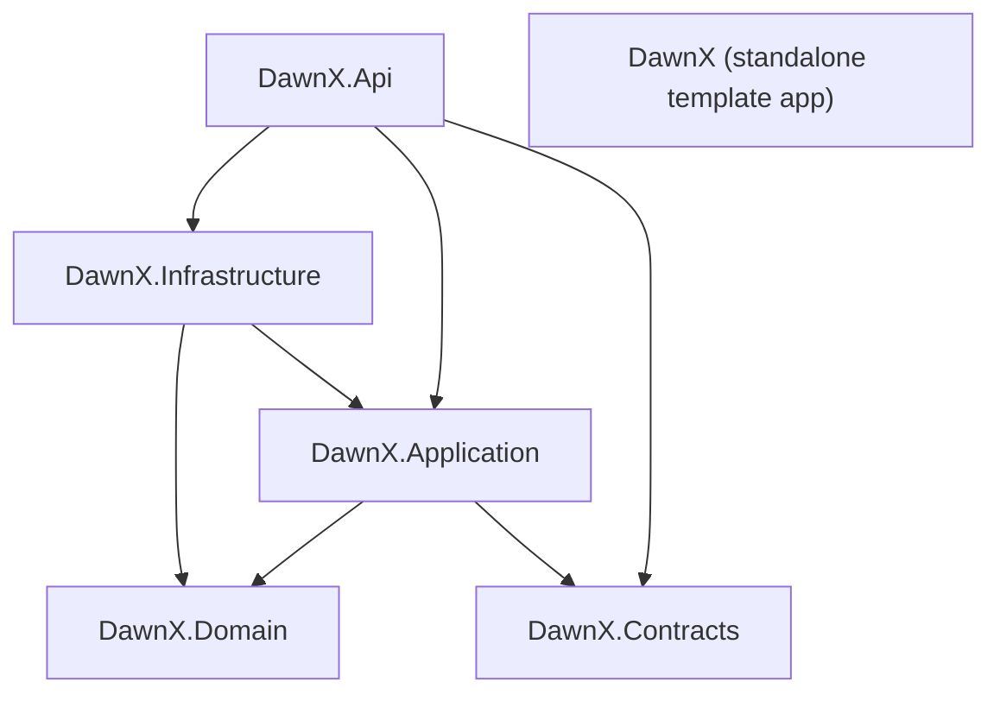
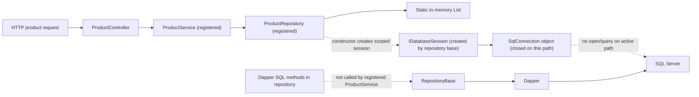
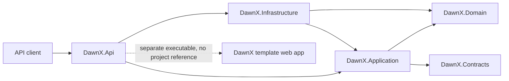
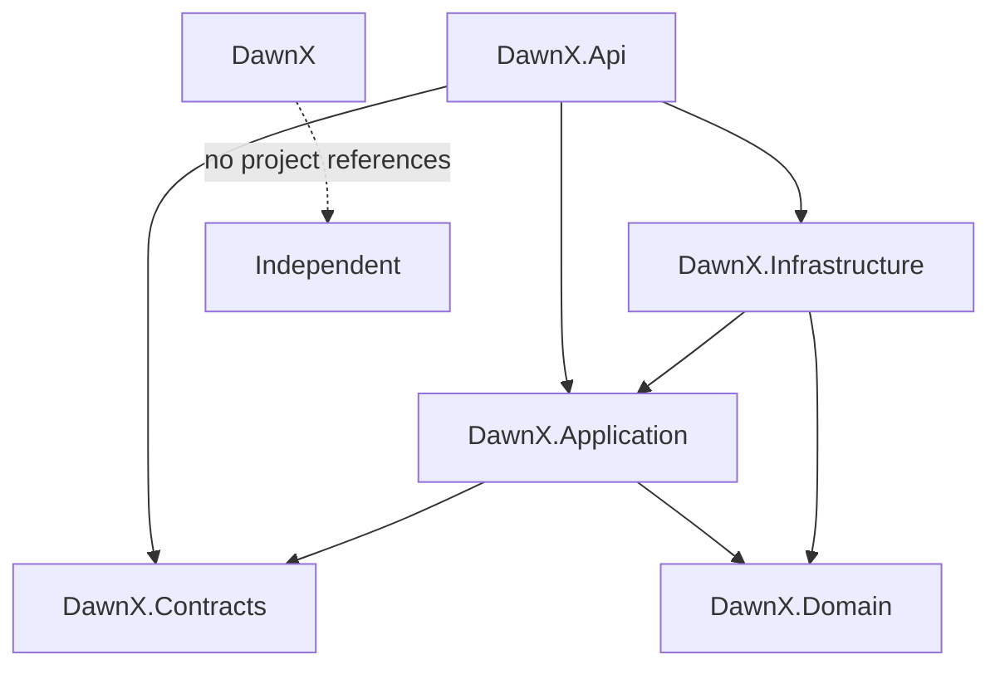
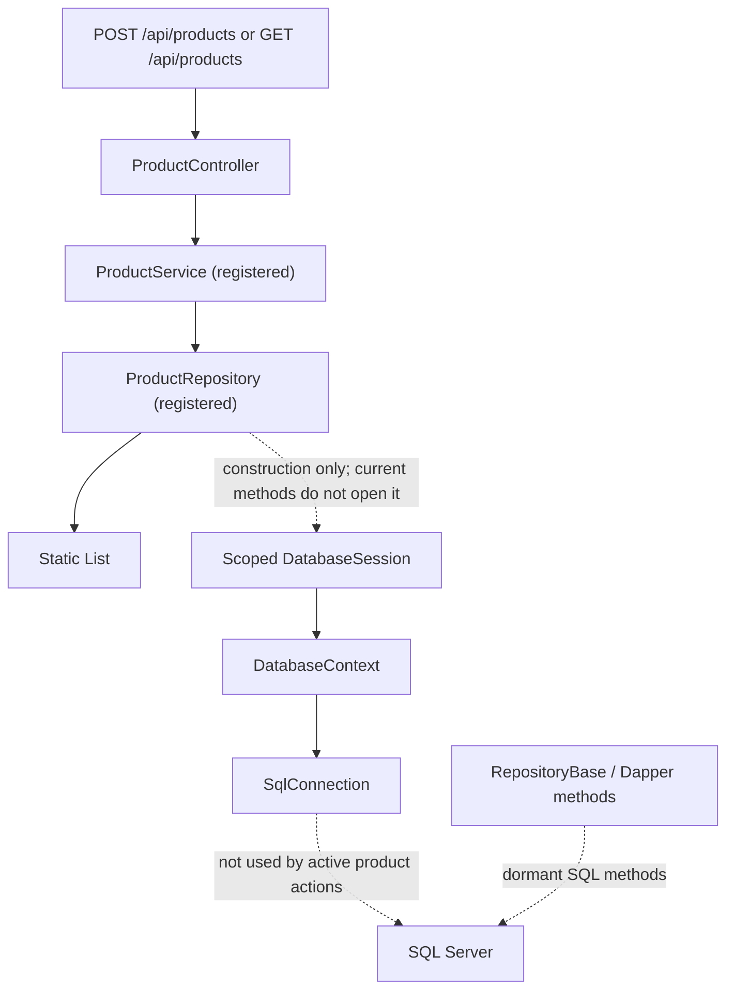

# .NET Solution Architecture & Database Review

**Scope:** Static review of the solution's source, project references, and configuration. No code changes were made. The main finding is that the product API has a Dapper/SQL Server implementation, but its currently registered request path **does not read from or write to the database**.

## Executive summary

- The solution is a small, layered .NET 8 codebase with a Clean Architecture-like split, but also contains a second, standalone template web app.
- The active product API is `DawnX.Api`. Its registered `ProductService` calls a `ProductRepository` backed by a **static in-memory list**.
- `SqlConnection`, Dapper repositories, and a transaction wrapper exist, but the Dapper methods are not used by the active product endpoints.
- There is **no EF Core `DbContext`**, no `AddDbContext`, and no EF query or persistence path. EF Core packages are referenced but unused.
- I found no SQL formed from user input: the Dapper statements use parameters. I found no N+1 query pattern in the code reviewed.
- The highest-priority concerns are the hardcoded login and signing key, disabled JWT lifetime validation, and the in-memory product persistence path.

## 1. Architecture and project responsibilities

The solution has five projects:

- **`DawnX.Api`** — the product API host: controllers, JWT setup, Swagger, logging, and composition root in [`Program.cs`](../DawnX.Api/Program.cs#L11).
- **`DawnX.Application`** — service interfaces and product application services. It references both Contracts and Domain in [`DawnX.Application.csproj`](../DawnX.Application/DawnX.Application.csproj#L9).
- **`DawnX.Domain`** — domain entity `Product` and its basic invariants in [`Product.cs`](../DawnX.Domain/Entities/Product.cs#L21).
- **`DawnX.Contracts`** — request/response and authentication DTOs.
- **`DawnX.Infrastructure`** — SQL connection creation, Dapper helpers/repositories, and JWT token generation. It references Application and Domain in [`DawnX.Infrastructure.csproj`](../DawnX.Infrastructure/DawnX.Infrastructure.csproj#L9).

There is also a separate **`DawnX`** web project, with its own `Program.cs` and a template weather endpoint. It has no project references to the layered API; it appears to be a standalone scaffold rather than part of the product API.

### Dependency direction

The general project direction is layered and mostly avoids circular references. Infrastructure depends on Application interfaces, and the API composes the layers. Two notable deviations are:

- Application references transport DTOs from Contracts, coupling application services to API request/response shapes.
- The API directly references Infrastructure, which is common for composition but means it can also directly depend on infrastructure types.

## 2. API endpoints and request flow

| Host | Endpoint | Behavior |
|---|---|---|
| `DawnX.Api` | `POST /api/products` | Authorized product creation; route and action are in [`ProductController.cs`](../DawnX.Api/Controllers/ProductController.cs#L23). |
| `DawnX.Api` | `GET /api/products` | Authorized product listing; action is in [`ProductController.cs`](../DawnX.Api/Controllers/ProductController.cs#L31). |
| `DawnX.Api` | `POST /login` | Login action in [`AuthController.cs`](../DawnX.Api/Controllers/AuthController.cs#L18). |
| `DawnX` | `GET /WeatherForecast` | Template-only endpoint in [`WeatherForecastController.cs`](../DawnX/Controllers/WeatherForecastController.cs#L21). |

[`HDVEController.cs`](../DawnX.Api/Controllers/HDVEController.cs) is empty and exposes no endpoint.

The product controller calls `IProductService`; DI registers `IProductService` to `ProductService` in [`ApplicationDependencyInjection.cs`](../DawnX.Application/DependencyInjection/ApplicationDependencyInjection.cs#L10). `ProductService` calls `IProductRepository`, which DI maps to `ProductRepository` in [`InfrastructureDependencyInjection.cs`](../DawnX.Infrastructure/InfrastructureDependencyInjection.cs#L31).

## 3. Database access inventory

### Configuration and connection creation

The only source connection string found is `ConnectionStrings:DefaultConnection` in [`DawnX.Api/appsettings.json`](../DawnX.Api/appsettings.json#L8). It targets local SQL Server using integrated Windows authentication and sets `TrustServerCertificate=True`. The development settings file has logging settings but no database override in [`appsettings.Development.json`](../DawnX.Api/appsettings.Development.json#L1).

`DatabaseContext` reads the named setting with `GetConnectionString("DefaultConnection")!` and creates a new `SqlConnection` in [`DatabaseContext.cs`](../DawnX.Infrastructure/Database/DatabaseContext/DatabaseContext.cs#L17). The null-forgiving operator means a missing setting is not reported explicitly there.

The API uses `WebApplication.CreateBuilder(args)` in [`Program.cs`](../DawnX.Api/Program.cs#L11), so the standard .NET configuration providers can supply environment-specific settings and environment-variable overrides. No custom secret provider or configuration validation is implemented in the reviewed startup code.

### Connection lifecycle and pooling

- `IDatabaseContext`, `IDatabaseSession`, and `IProductRepository` are registered as **scoped** services in [`InfrastructureDependencyInjection.cs`](../DawnX.Infrastructure/InfrastructureDependencyInjection.cs#L23).
- `DatabaseSession` creates its connection in its constructor in [`DatabaseSession.cs`](../DawnX.Infrastructure/Database/DatabaseSession/DatabaseSession.cs#L28).
- `IDatabaseSession` implements `IDisposable` in [`IDatabaseSession.cs`](../DawnX.Application/Interfaces/DatabaseManager/IDatabaseSession.cs#L10); the implementation disposes its transaction and connection in [`DatabaseSession.cs`](../DawnX.Infrastructure/Database/DatabaseSession/DatabaseSession.cs#L66). Under normal request-scoped DI resolution, the container disposes that scoped session.
- The active `ProductService` path uses in-memory repository methods. It causes a connection object to be constructed through the repository's base-class dependency, but does **not** open or query that connection.
- SQL Client connection pooling is enabled by default unless disabled in the connection string. No explicit pool settings are present. Disposing/closing a pooled connection normally returns it to the pool.

**Leak assessment:** I found no definite connection leak in the normal scoped DI path. The lifecycle risk is that manual consumers of `IDatabaseSession` must dispose it; the code's DI registration currently provides that lifecycle for request scopes.

### Dapper and transaction implementation

`RepositoryBase` wraps Dapper's `QueryAsync`, `QueryFirstOrDefaultAsync`, and `ExecuteAsync` in [`RepositoryBase.cs`](../DawnX.Infrastructure/Database/RepositoryBase/RepositoryBase.cs#L21). It passes the session's transaction to each operation.

There are two `IProductRepository` implementations:

- Registered `ProductRepository`: `AddAsync` and `GetAllAsync` use a static list in [`ProductRepository.cs`](../DawnX.Infrastructure/Repositories/ProductRepository.cs#L18). It also contains Dapper `GetProductsAsync` and `CreateAsync` methods in [`ProductRepository.cs`](../DawnX.Infrastructure/Repositories/ProductRepository.cs#L44), but the registered `ProductService` does not call them.
- Unregistered `ProductsRepository`: contains SQL-backed `GetAllAsync` and `CreateAsync` in [`ProductsRepository.cs`](../DawnX.Infrastructure/Repositories/ProductsRepository.cs#L21), but its `AddAsync` and `GetProductsAsync` throw `NotImplementedException` in [`ProductsRepository.cs`](../DawnX.Infrastructure/Repositories/ProductsRepository.cs#L59).

`DatabaseSession.BeginAsync` uses a dynamic `OpenAsync` call and then **synchronous** `BeginTransaction`; `CommitAsync` and `RollbackAsync` also call synchronous transaction methods in [`DatabaseSession.cs`](../DawnX.Infrastructure/Database/DatabaseSession/DatabaseSession.cs#L39). The wrapper's `ExecuteAsync` methods provide commit/rollback handling in [`DatabaseSession.cs`](../DawnX.Infrastructure/Database/DatabaseSession/DatabaseSession.cs#L72).

`ProductsService.CreateAsync` uses that transaction wrapper and calls repository `CreateAsync` in [`ProductsService.cs`](../DawnX.Application/Services/ProductsService.cs#L28), but **`ProductsService` is not registered**. The actual registered service is `ProductService`, which uses the in-memory `AddAsync` path.

The repository's Dapper SQL uses fixed SQL statements and `@Name`/`@Price` parameters. I found no SQL concatenation or interpolation of request values. Thus, **no SQL injection issue was identified in the SQL statements present**.

### EF Core, repository and Unit of Work patterns

- No `DbContext`, `DbSet`, `AddDbContext`, EF query, or EF persistence implementation was found.
- EF Core and SQL Server EF packages are referenced in [`DawnX.Infrastructure.csproj`](../DawnX.Infrastructure/DawnX.Infrastructure.csproj#L22), but there is no active EF access path.
- `IDatabaseExecutor` declares database and transaction methods in [`IDatabaseExecutor.cs`](../DawnX.Application/Interfaces/DatabaseManager/IDatabaseExecutor.cs#L10), but no implementation or DI registration was found.
- `IRepository<T>` is defined in [`IRepository.cs`](../DawnX.Application/Interfaces/IRepository.cs#L9), but no concrete generic repository or usage was found.
- There is no class named `UnitOfWork`. `IDatabaseSession` acts as a transaction/session abstraction, but is currently used only by the unregistered transactional service.

## 4. Data flow, validation, caching, and performance

On the active product path, `ProductController` forwards the request to `ProductService`; the service constructs a `Product`, then calls the repository. `Product` checks that the name is non-empty and price is positive in [`Product.cs`](../DawnX.Domain/Entities/Product.cs#L21). `ProductService` maps the entity to `ProductResponse` in [`ProductService.cs`](../DawnX.Application/Services/ProductService.cs#L23).

The repository's static list means product data is lost on process restart and shared across requests in a single process. `Products.Count + 1` is not concurrency-safe, and the `GetAllAsync` method returns the list itself rather than a snapshot in [`ProductRepository.cs`](../DawnX.Infrastructure/Repositories/ProductRepository.cs#L26).

`CreateProductRequest` has no validation attributes in [`CreateProductRequest.cs`](../DawnX.Contracts/Requests/CreateProductRequest.cs#L9). Although the domain entity validates values, invalid input can throw `ArgumentException`; no API exception mapping is apparent, so invalid values may become server errors rather than client validation responses. FluentValidation is referenced but no validator registration or validators were found.

No caching mechanism was found. There is no N+1 pattern in the code reviewed; the SQL shown is simple. If the SQL-backed list path is activated, it reads all rows without paging, which will become a scalability concern. No synchronous blocking calls such as `.Result` or `.Wait()` were identified, but transaction operations are synchronous despite the async API.

## 5. Security and configuration findings

- **Hardcoded login:** `AuthController.Login` compares credentials directly in source in [`AuthController.cs`](../DawnX.Api/Controllers/AuthController.cs#L23). Replace this demo credential check with a proper identity/authentication mechanism.
- **Hardcoded signing key:** a JWT signing key is stored in source configuration in [`appsettings.json`](../DawnX.Api/appsettings.json#L2). Treat it as exposed: rotate it and move secrets to a managed secret store or deployment configuration.
- **JWT validation weakened:** `Program.cs` disables issuer, audience, and lifetime validation at [`Program.cs`](../DawnX.Api/Program.cs#L81). In particular, tokens can remain accepted after expiration even though token generation sets an expiry.
- **Token logging:** the JWT bearer event writes the received token to debug output in [`Program.cs`](../DawnX.Api/Program.cs#L101). Remove token logging and avoid logging sensitive authentication material.
- **SQL TLS configuration:** `TrustServerCertificate=True` is set in [`appsettings.json`](../DawnX.Api/appsettings.json#L9). Use a trusted server certificate and disable certificate bypass for deployed environments.
- **Login binding:** `AuthController` has no `[ApiController]` or explicit controller `[Route]`; its action only has `[HttpPost("login")]` in [`AuthController.cs`](../DawnX.Api/Controllers/AuthController.cs#L8). Make the route and body binding explicit (for example, a controller route plus `[FromBody]`) and enable consistent validation.
- **Configuration safety:** JWT settings are loaded and used in [`Program.cs`](../DawnX.Api/Program.cs#L67), but startup does not visibly validate that required values exist and meet minimum requirements.

## 6. Mermaid diagrams

### Architecture/runtime view

### Project dependency diagram

### API-to-database connection flow

## 7. Technical debt and top 10 recommendations

| Priority | Recommendation |
|---|---|
| **P1 – High** | Remove the hardcoded login and rotate/externalize the JWT signing key. |
| **P1 – High** | Enable and test JWT lifetime, issuer, and audience validation. |
| **P1 – High** | Decide on the product persistence source of truth. If SQL Server is intended, wire the SQL-backed service/repository into DI and stop serving product endpoints from the static list. |
| **P1 – High** | Remove token contents from authentication debug logging. |
| **P2 – Medium** | Correct the duplicate product service/repository implementations and their mismatched DI registration; remove or complete the `NotImplementedException` methods. |
| **P2 – Medium** | Use real asynchronous transaction APIs with cancellation support and strongly typed `DbConnection`/`DbTransaction` rather than `dynamic` and synchronous transaction calls. |
| **P2 – Medium** | Add request validation and consistent 400/error responses instead of allowing domain exceptions to become server errors. |
| **P2 – Medium** | Use trusted SQL Server certificates; validate required connection/JWT configuration at startup. |
| **P2 – Medium** | Add paging and bounded result sizes before enabling full-table product reads. |
| **P3 – Lower** | Consolidate the two web hosts and remove unused scaffolding/dependencies (including unused EF packages or incomplete database abstractions); consider keeping transport DTOs out of Application. |

**Bottom line:** Connection construction, scoped disposal, and parameterized Dapper usage are generally recognizable and no definite connection leak or SQL injection path was found. The central database issue is architectural and functional: **the active product API does not use the database at all**, despite the presence of a separate, incomplete Dapper/transaction implementation.
